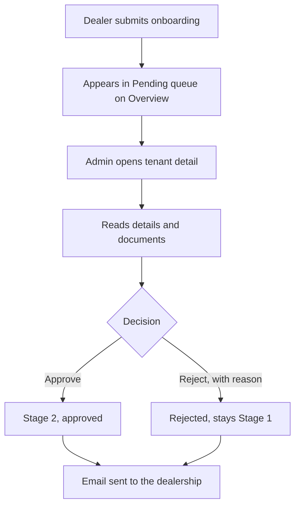

# Admin portal

This page describes the platform admin portal that DryvHub staff use to review dealers and manage vehicles across all dealerships.

:::warning[Internal only]
This portal is for **DryvHub employees**. Dealers never see it and cannot sign in to it. Do not share its address or screenshots outside the company. Dealer-facing help should not point to it.
:::

:::tip[In plain English]
When a dealer submits their business papers, someone at DryvHub has to look at them and say yes or no. The admin portal is where that happens. It also lets staff fix or hide a vehicle for any dealership when something goes wrong.
:::

## Who may use it

Only people with a **platform admin** account. This is a separate record from a dealer login (it lives in a platform users table with the role `admin`). A dealership owner or staff member is **not** a platform admin, and being a platform admin does not make someone a member of any dealership.

- The portal lives on its own address, `admin.{root domain}` (for example `admin.dryvhub.com`). On that host `/login` shows the admin sign-in and `/` shows the admin overview.
- Sign-in is **email and password only**. There is no Google sign-in and no sign-up. A wrong pair shows "Email or password is incorrect."
- On every admin page the app asks the API "who am I?" (`GET /api/v1/admin/me`). If the person is not signed in they are sent to the admin sign-in. If they are signed in but not an admin, they see a "forbidden" panel (the API answers `PLATFORM_ADMIN_REQUIRED`).
- The dealer dashboard needs dealership membership, so a platform admin account alone cannot open it.

## What is in the portal

| Page | Address | What it does |
| --- | --- | --- |
| **Overview** | `/admin` | The queue of dealerships **pending verification**, and **flagged follow-ups**. |
| **Tenants** | `/admin/tenants` | List of all dealerships. |
| **Tenant detail** | `/admin/tenants/{tenant id}` | One dealership: details, documents, decision, history, follow-up flag. |
| **Vehicles** | `/admin/vehicles` | List of vehicles across all dealerships. |
| **Vehicle detail** | `/admin/vehicles/{vehicle id}` | Edit or act on one vehicle. |
| **Feedback** | `/admin/feedback` | Product feedback and bug reports from every dealership. Filter by kind and status. |
| **Feedback detail** | `/admin/feedback/{id}` | Full message, evidence link, reporter, page path, email status, and triage status. |
| **Login** | `/admin/login` | Sign-in. |

## Reviewing a dealership

On the tenant detail page the admin sees:

- **Details:** business information from onboarding.
- **Documents:** the uploaded papers, opened through short-lived links.
- **Decision:** **Approve** or **Reject**. A rejection **requires a reason**; without one the page says "A reason is required when rejecting a tenant."
- **Decision history:** earlier decisions.
- **Follow-up flag:** mark the dealership **flagged** or **clear**, with a reason of 1 to 2000 characters. Each change is kept in an audit history.

After deciding, the page says "Verification decision saved. We emailed the dealership." If the email could not be sent it says so ("…but the email could not be sent."). The decision is still saved.

What the decision means for the dealer is in [Verification and access](/docs/dealer/verification-and-access).

## Managing vehicles

On a vehicle's admin page, staff can:

| Action | Effect |
| --- | --- |
| **Edit fields** | Correct vehicle data. |
| **Archive** | Hide the vehicle from the dealership's active lists. There is no restore button. |
| **Publish** / **Unpublish** | Change the listing state for that vehicle. |
| **Reassign tenant** | Move the vehicle to a different dealership. All rows that belong to the vehicle move together in one step, and the change is recorded in an audit log. |

:::warning
Reassigning a tenant moves a vehicle and its related records between dealerships. This cannot be undone with a button. Only use it to fix a genuine mix-up.
:::

## What has an API but no screen

Some admin work exists **only as API endpoints**. There is no page for it in the dealer app, so staff use other tools:

- **Cashback review:** `GET /api/v1/admin/cashback/claims` and `.../claims/:id`, `PATCH .../claims/:id` (decisions) and `POST .../claims/:id/payout` (record a payout). See [Cashback](/docs/dealer/cashback).
- **Platform settings:** `GET` and `PATCH /api/v1/admin/platform-settings` (cashback rate, dealer fee, platform revenue share).

## For developers

- Pages: `app/(session)/admin/`; components in `components/admin/`; client in `services/admin.service.ts`; the guard is `RequirePlatformAdmin`.
- Host routing for `admin.{root}` is in `proxy.ts`.
- API: all admin controllers are marked as platform-admin-only and skip tenant context (`@PlatformAdmin()` and `@SkipTenantContext()`). Endpoints include `/admin/me`, `/admin/tenants`, `/admin/tenant-verifications` (GET and PATCH), `/admin/tenant-follow-ups`, and `/admin/vehicles` with archive, listing publish, listing unpublish and tenant reassignment.
- Plan: `docs/plans/admin-dashboard.md` (dealer repo). Background on why admin routes are exempt from tenant scoping: [Auth and tenancy](/docs/developers/auth-and-tenancy).

## Related pages

- [Verification and access](/docs/dealer/verification-and-access)
- [Cashback](/docs/dealer/cashback)
- [Dealer app overview](/docs/dealer/overview)
- [Auth and tenancy](/docs/developers/auth-and-tenancy)
