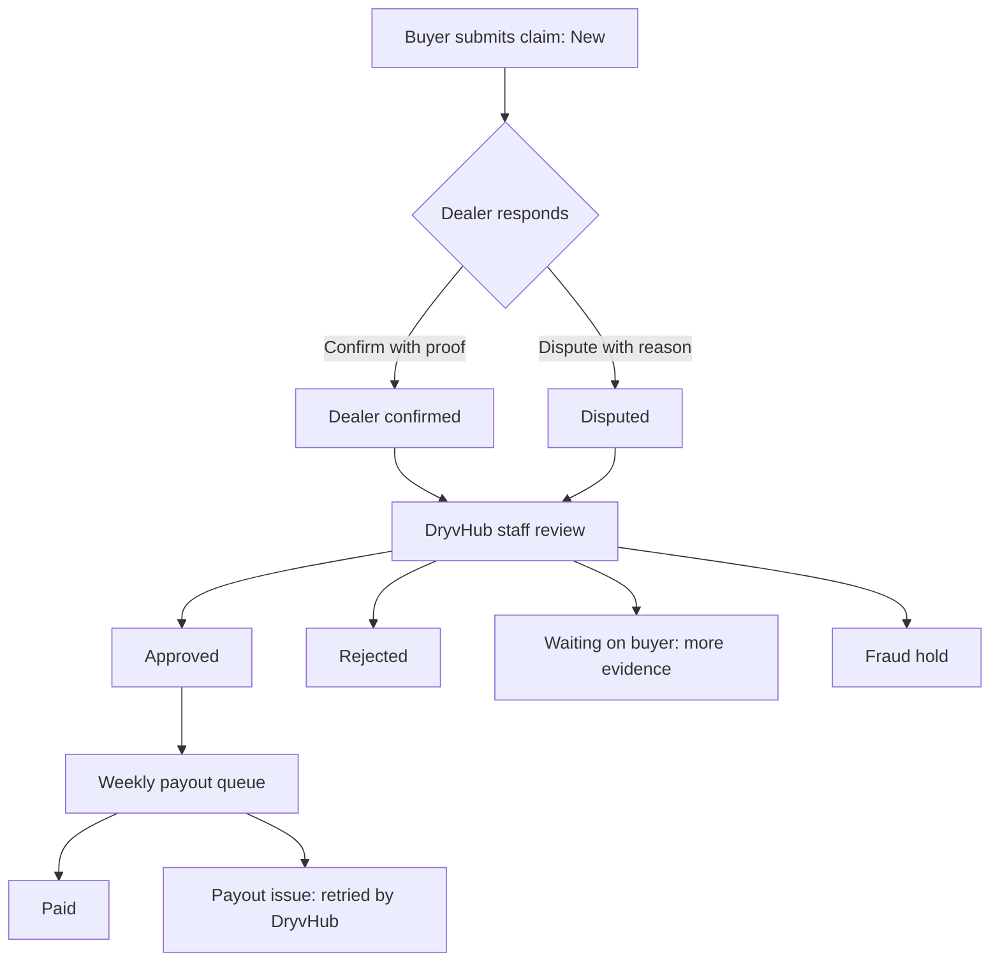

# Cashback

This page explains the **Cashback** screens: how buyer claims appear to the dealer, what each status means, and what the dealer has to do (confirm the sale with proof, or dispute it).

:::tip[In plain English]
DryvHub rewards buyers who found their car through the Marketplace with a cashback payment. To stop false claims, the **dealer is asked to confirm** that the sale really happened. The dealer's job is simple: look at the claim, then either confirm with proof, or dispute with a reason.
:::

## Who can see it

Like Inquiries, Cashback is locked until the dealership is Stage 2 verified on an active paid plan. See [Verification and access](/docs/dealer/verification-and-access).

## The list page

The page is titled **Cashback management**.

- **Number cards:** **Needs action**, **Under review**, **Approved**, **Paid**.
- **Status chips** filter the list.
- A **banner** shows if the dealership's cashback eligibility is affected:
  - Suspended: "Cashback participation is suspended until a date shown on screen. Existing claims may still need your response."
  - Revoked: the text says participation "has been revoked" and that new claims cannot be processed until DryvHub restores eligibility.

Selecting a claim opens its detail page (`/dashboard/cashback/{claim id}`).

## Claim statuses

| Status (as shown) | What it means for the dealer |
| --- | --- |
| **New** | A buyer submitted a claim. Confirm the sale with proof, or dispute it. **Action needed.** |
| **Needs your action** | DryvHub asked for your response. Confirm with proof or dispute. **Action needed.** |
| **Waiting on buyer** | DryvHub asked the buyer for more evidence. No dealer action yet. |
| **Dealer confirmed** | Your confirmation is with DryvHub for review. |
| **Disputed** | Your dispute is with DryvHub for review. |
| **Fraud hold** | On hold while DryvHub investigates. It is not rejected. |
| **Approved** | Approved for the weekly payout queue. |
| **Payout issue** | The buyer payout failed. DryvHub will retry or follow up. No dealer action. |
| **Paid** | Buyer cashback has been paid. |
| **Rejected** | The claim was rejected. A reason is shown. |

The dealer can respond **only** while a claim is **New** or **Needs your action**.

The diagram shows the main path. Decisions after the dealer responds are made manually by DryvHub staff.

## What the dealer must do

### Confirm the sale

1. Open the claim and check the vehicle, sold date and price.
2. Choose **Confirm sale**.
3. Upload **proof** (required). Pick its kind: **OR/CR**, **Sales proof**, **Release**, or **Other**. Notes are optional.
4. Submit. The message "Claim confirmed." appears.

### Dispute the claim

1. Choose **Dispute**.
2. Pick a reason: **Buyer did not purchase**, **Wrong vehicle**, **Sale date incorrect**, **Inquiry not related**, **Duplicate or suspicious**, or **Other**.
3. Notes are **required**. Evidence is optional.
4. Submit. The message "Dispute submitted." appears.

Evidence files may be PDF, JPEG, PNG or WebP, up to 15 MB each.

:::warning
Respond truthfully. A claim that DryvHub staff mark as **confirmed fraud** gives the dealership a strike against its cashback eligibility (see below).
:::

## The detail page

| Section or field | Meaning |
| --- | --- |
| Vehicle, Inquiry, Inquiry created | What the claim is about and when the buyer inquired. |
| Sold date, Sold price | From the sale record. |
| Buyer cashback, Agent commission | The buyer is owed a flat ₱2,000. Agent commission of ₱3,000 appears only when the sale has a sales agent. |
| Buyer evidence | Notes and files the buyer supplied. |
| Your notes, Your evidence, You responded | What the dealer sent, and when. |
| Dispute reason | If disputed. |
| Claim review, Rejection reason, Fraud hold, Waiting on buyer | Explanations that appear for those statuses. |
| **Fee summary** | On approved or paid claims: **Dealer fee** and **Buyer amount**. DryvHub's share is not shown. |

The fee summary notes: "Approved claims enter the weekly payout queue. Buyer payouts cut off Tuesday and pay out on Friday."

## Amounts

When a claim is created the amounts are calculated once and stored:

- **Buyer amount** is a flat **₱2,000**. It does not change with the sold price.
- **Agent commission** is **₱3,000** when the sale has a sales agent. The claim screen shows that amount. When the sale has no sales agent, that ₱3,000 stays with DryvHub and the screen does not mention it.
- The **dealer fee** is still a percentage of the sold price. It defaults to **0.00%**.

## What the system checks on a claim

These checks happen on the API when the buyer submits a claim. Dealers rarely see the errors, but they explain why some claims never appear.

| Result | Reason |
| --- | --- |
| 404 `INVALID_INQUIRY` | The inquiry code does not exist. |
| 422 `BUYER_MISMATCH` | The claimant is not the buyer who made the inquiry. |
| 422 `SALE_EVIDENCE_INVALID` | The sale evidence is not acceptable. |
| 422 `LOCKED_RATE_INVALID` | The locked rate does not match. |
| 409 `DUPLICATE_CLAIM` | A claim already exists for this inquiry code or this vehicle. |
| 409 `DEALER_NOT_ELIGIBLE` | The dealership is suspended or revoked. |

If the inquiry was created on or after the sale date, the claim is flagged for a **timing review**. It is not rejected automatically. A person decides.

## Review, payout and strikes (DryvHub side)

These steps have API support but **no screen in the dealer app**. They are done by platform admins.

- **Review decisions:** approved, rejected, needs evidence, fraud review, fraud confirmed.
- **Payout:** done manually through GCash or bank transfer, in a weekly cycle.
- **Strikes:** a review decision of *fraud confirmed* records a strike against the dealership. The first gives a warning, a second strike within 365 days gives a **30-day suspension**, and a third strike (lifetime) is a **permanent revoke**.

## For developers

- Pages: `app/(session)/dashboard/cashback/` and `.../cashback/[claimId]/`; components in `components/cashback/`; labels in `lib/cashback/`.
- Dealer endpoints: `GET /api/v1/cashback/claims`, `GET .../claims/:id`, `POST .../claims/:id/confirm`, `.../dispute`, `.../documents`, `.../documents/complete`.
- Buyer endpoints: `POST /api/v1/cashback/claims`, `PATCH /api/v1/cashback/claims/:id/evidence`.
- Admin endpoints (no dealer UI): `GET /api/v1/admin/cashback/claims(/:id)`, `PATCH /api/v1/admin/cashback/claims/:id`, `POST .../payout`, `GET`/`PATCH /api/v1/admin/platform-settings`.
- Plans: `docs/plans/dealer-cashback-management.md`, `buyer-cashback-claim-flow.md`.

## Related pages

- [Inquiries](/docs/dealer/inquiries)
- [Cashback claims (buyer side)](/docs/marketplace/cashback-claims)
- [Verification and access](/docs/dealer/verification-and-access)
- [Admin portal](/docs/dealer/admin-portal)
