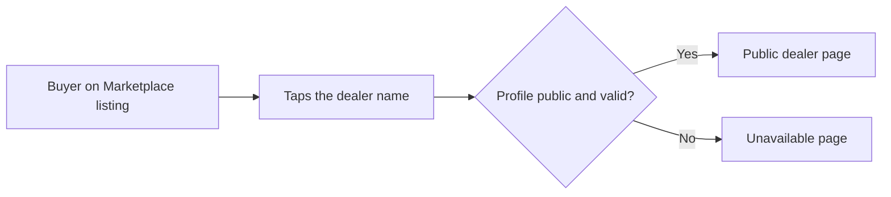

# Dealer profile

This page covers the **Dealer Profile** editor, the **public dealer page** that buyers can visit, and the small landing page at the top of each dealership's workspace address.

:::tip[In plain English]
The dealer profile is the dealership's "storefront page" on DryvHub: logo, photo, short description, address, hours and social links. The dealer fills it in once, chooses whether it is public, and buyers see it from the dealer's listings.
:::

## The editor

**Menu:** Dealer Profile (`/dashboard/dealer-profile`).

| Field | Notes |
| --- | --- |
| **Cover photo** | Wide banner image. |
| **Logo** | JPEG, PNG or WebP, up to 5 MB. |
| **Business name** | Required. Error: "Business name is required." |
| **Public display name** | The name buyers see, if different from the business name. |
| **Legal business name** | For DryvHub's records. **Not shown publicly.** |
| **About** | A short description. |
| **Contact phone** | |
| **Contact email** | |
| **Physical address** | Street, an optional second line, barangay, and postal code are typed in. **Region, province and city are dropdowns**, chosen in that order — picking a region narrows the provinces, picking a province narrows the cities. See [the note below](#why-the-address-is-a-dropdown). |
| **Business hours** | Free text, for example "Mon–Sat 9am–6pm". |
| **Website** | |
| **Facebook, Instagram, LinkedIn, YouTube** | Links to the dealer's pages. |
| **Show profile publicly** | A checkbox. When off, buyers cannot open the public page. |

A sticky **Save profile** button saves everything at once and shows "Profile saved." A **View public profile** link opens the public page.

:::note
Saving the profile is **not** locked behind verification. Any dealer can edit it, even before submitting onboarding.
:::

### Why the address is a dropdown

Region, province and city come from the **PSGC**, the Philippine Statistics Authority's official list of administrative divisions. Picking from a list instead of typing means a dealership cannot be lost from buyer searches because its city was spelled a different way — "Parañaque City" and "City of Parañaque" would otherwise be two unrelated places as far as a filter is concerned.

Two consequences dealers notice:

- **The saved spelling is the official one.** A dealer who picked Makati sees **City of Makati** afterwards. Nothing is wrong; that is the PSA's name for it.
- **Metro Manila is the region, not a province.** Choosing NCR hides the province dropdown entirely, because the PSA does not divide NCR into provinces.

Barangay is still typed in freely. If a dealership's city is genuinely missing from the list, that is a data issue to raise with DryvHub rather than something to work around in the street field.

## The public dealer page

Buyers reach it at `/dealers/{dealer-slug}` (the slug is the dealership's subdomain), usually from a link on one of the dealer's Marketplace listings. It does not need an account.

The page shows:

- **Identity:** logo, cover photo and display name.
- **About** text.
- **Contact:** location, website, email, phone and social links, where filled in.
- **Number of listed vehicles.**
- A **verified** badge, only when the dealership is Stage 2 verified.
- The dealer's **published listings**, which link to the Marketplace.

If the profile is hidden or the address is invalid, the buyer sees an "unavailable" page instead (the API answers not found or bad request).

Only a safe subset of the profile is public. Private details such as the legal business name, purchase prices, documents and internal notes are never sent. The public endpoint returns only the fields above.

## The workspace landing page

Each dealership's own address (`{subdomain}.dryvhub.com`) has a small landing page with the business name and a **Sign in to this DryvHub dealer workspace** message. It is **not** indexed by search engines. Opening it with an unknown or invalid subdomain returns a not-found page or sends the visitor to the platform sign-in. See [Getting started](/docs/dealer/getting-started).

## For developers

- Editor: `app/(session)/dashboard/dealer-profile/`; components in `components/dealer-profile/`; type `types/api/tenant.ts`.
- Public page: `app/(public)/dealers/[slug]/` fed by `GET /api/v1/dealers/:domain`. The Marketplace link base comes from the `NEXT_PUBLIC_MARKETPLACE_URL` setting.
- Workspace landing: `app/(session)/tenant/[subdomain]/page.tsx`.
- Plans: `docs/plans/dealer-profile.md`, `dry-79-dealer-profile.md`.

## Related pages

- [Verification and access](/docs/dealer/verification-and-access)
- [Listings and publishing](/docs/dealer/listings-and-publishing)
- [Marketplace overview](/docs/marketplace/overview)
- [Getting started](/docs/dealer/getting-started)
