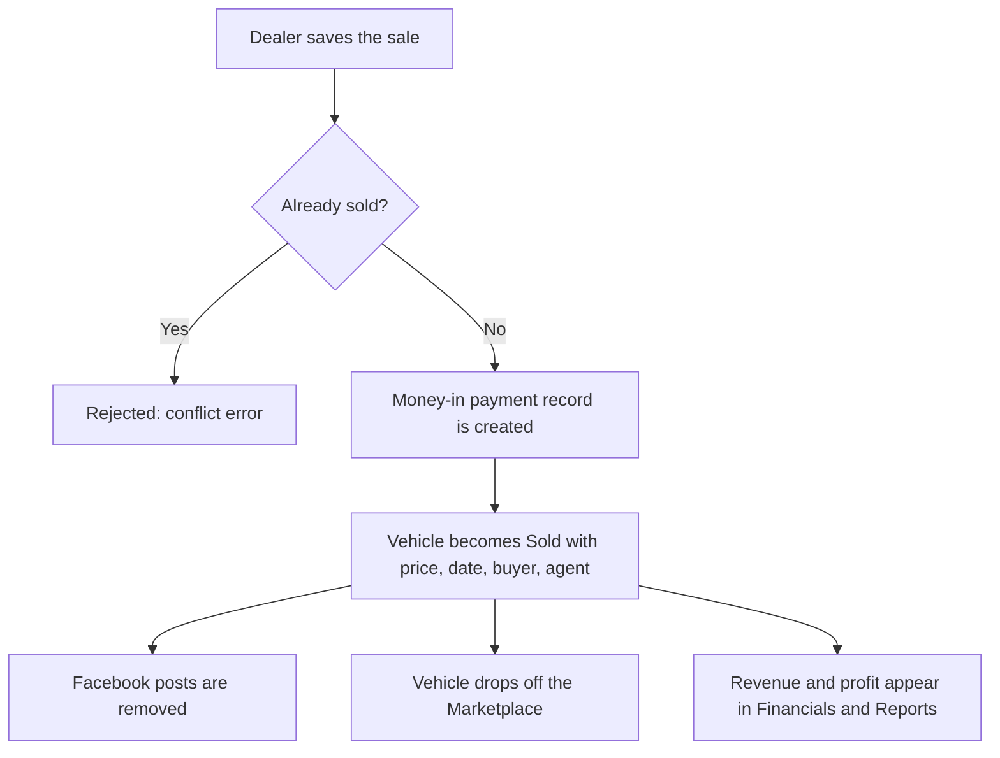

# Expenses and sales

This page covers recording costs on a vehicle, how those differ from monthly overhead, the sale form, and what happens automatically once a sale is saved.

:::tip[In plain English]
Profit is what you sold for, minus what you paid, minus what you spent fixing the car up. **Expenses** capture that last part per car. **Overhead** is the cost of running the business (rent, salaries) and is tracked by month, not by car. The **sale** record is how a car becomes "Sold" and how revenue enters the books.
:::

## Two kinds of cost

| | Vehicle expense | Overhead |
| --- | --- | --- |
| Belongs to | One specific car | The whole dealership, per month |
| Examples | Repairs, detailing, parts | Office rent, utilities |
| Entered on | The [vehicle page](/docs/dealer/vehicle-detail), or Financials → Vehicle Expenses | Financials → Overhead |
| Affects | That car's profit | Net profit on the dealership's totals |

Overhead is covered in [Financials](/docs/dealer/financials).

## Vehicle expenses

On the vehicle page, the **Expenses** section lists costs and offers **Add expense**.

| Field | Rule |
| --- | --- |
| Label | A short description, up to 160 characters. |
| Amount | In Philippine pesos. |
| Payment method | Chosen from the same list used for sales (see below). |

The expense list shows "No expenses yet." until something is added. Every item has a remove button.

:::note
The form has no category field. Every expense is sent to the server with the category `other`, so the "By category" lists in [Financials](/docs/dealer/financials) and [Reports](/docs/dealer/reports) will group these under "other" for now.
:::

The same expenses can also be seen across all cars in **Financials → Vehicle Expenses** (Overview) or managed one car at a time (Manage by vehicle).

## Recording a sale

There are two ways to open the sale form:

- On the inventory card, press the quick **Sold** button. A dialog titled **Record sale** opens.
- On the vehicle page, press **Edit** and fill in the **Sale** section.

When a sale already exists the dialog is titled **Sale details**.

### Sale form fields

| Field | Required? | Notes |
| --- | --- | --- |
| Buyer first name | Yes | Error: "Buyer first name is required." |
| Buyer last name | No | |
| Contact | No | Buyer phone. |
| Sale date | Yes | Error: "Sale date is required." |
| Posted price | No | The list price for reference. |
| Sold price | Yes | The price actually agreed. Error: "Sold price is required." |
| Deposit | No | Cannot be more than the sold price. |
| Balance | Automatic | Sold price minus deposit. |
| Payment method | Yes | Error: "Select a valid payment method." |
| Payment status | No | See below. |
| Agent first name, last name | No | The salesperson. |
| Notes | No | Free text. |

**Payment methods:** cash, bank transfer, check, GCash, Maya, card, financing, trade-in, internal credit, other.

**Payment statuses:** pending, cleared, failed, voided, reversed. An invalid choice shows "Select a valid sale payment status."

:::warning
The vehicle page notes that saving a sale with status "Cleared" marks the vehicle as sold. The API, however, marks the vehicle as sold when any sale is recorded, whatever the payment status. Record a sale only when the deal is real.
:::

## What happens after a sale

1. **A payment record is created.** The system adds an inflow entry of type "vehicle sale" with a number like `VS-20260115-AB12CD34` (date plus a short code). It shows up in [Financials → Payments](/docs/dealer/financials).
2. **The vehicle is marked Sold**, with the sold price, sale date, buyer, agent and payment method stored on it.
3. **Facebook posts are taken down.** By default the system deletes the vehicle's Facebook posts (both the DryvHub Page post and the dealer's own Page post). The dealer app does not send an override, so the default applies. A Facebook failure does **not** undo the sale.
4. **Marketplace visibility ends.** Sold vehicles are never shown to buyers.
5. **Numbers update.** Revenue, gross profit and units sold rise in the dashboard, summaries and reports.

If the vehicle is already marked sold, saving again returns a conflict error and nothing changes.

:::note
The API can instead rewrite Facebook captions as "sold" rather than deleting posts, but the dealer app does not use that option.
:::

## For developers

- Components: `components/inventory/record-vehicle-sale-dialog.tsx`, `components/vehicle/detail/vehicle-sales-form*.tsx`, `lib/vehicle/sale-form.ts` (validation).
- Endpoints: `POST /api/v1/vehicles/:id/sale`; `POST /api/v1/vehicles/:id/expenses`, `GET .../expenses`, `GET .../expenses/summary`, `PATCH`/`DELETE .../expenses/:expenseId`.
- API logic: `src/use-cases/vehicle/record-vehicle-sale.use-case.ts` and `apply-sold-facebook-listing.use-case.ts`.

## Related pages

- [Vehicle detail](/docs/dealer/vehicle-detail)
- [Financials](/docs/dealer/financials)
- [Reports](/docs/dealer/reports)
- [Listings and publishing](/docs/dealer/listings-and-publishing)
