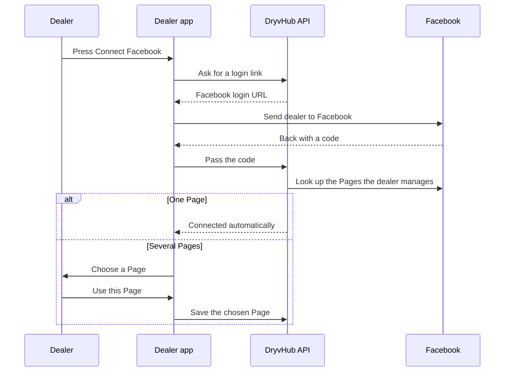

# Facebook integration

This page explains how a dealer connects their Facebook Page to DryvHub, how listings get posted there, what **Bump** does, and what disconnecting means.

:::tip[In plain English]
Many Philippine buyers browse Facebook first. If a dealer connects their business Page, DryvHub can post each published car to that Page for them, so they do not have to retype the details and photos. DryvHub also posts to its own Page.
:::

## What you need

| Requirement | Why |
| --- | --- |
| **Stage 1 reached** (onboarding application submitted) | Facebook connect is locked until then. The message is "Complete Stage 1 verification to unlock this feature." |
| **A Facebook account that administers the Page** | Facebook must give DryvHub permission to create posts on that Page. |
| **A Facebook Page** (not a personal profile) | Posts go to a Page. |

A paid plan and Stage 2 are **not** needed for Facebook, only for the Marketplace.

## Connect a Page

Go to **Settings → Facebook** (`/dashboard/settings/facebook`).

1. Press **Connect Facebook**. The dealer is sent to Facebook to sign in and approve access.
2. Facebook returns the dealer to DryvHub at `/dashboard/settings/facebook/callback`.
3. If the account manages **one** Page, it is connected straight away: "Connected to" followed by the Page name
4. If it manages **several**, a screen titled "Choose a Page" lists them. Pick one and press **Use this Page**. The list is kept in the browser for about 10 minutes while choosing.

The connection card then shows **Connected**, the Page name, the Page id and "Last validated". The button changes to **Reconnect**.

:::note
Facebook access tokens stay on the server. They are never sent to the browser or shown to the dealer.
:::

### What can go wrong

| Message | What it means |
| --- | --- |
| "Facebook authorization was cancelled." | The dealer closed or declined the Facebook screen. |
| "Missing Facebook authorization code. Start connect again from Settings." | The return link was incomplete. Start again. |
| "No Facebook Pages with permission to post were found. Use a Page admin account and try again." | The account does not manage a Page, or lacks posting rights. |
| "Failed to start Facebook connect." | The API could not begin the login. |
| "Failed to complete Facebook connect." | The code could not be exchanged. |
| "Failed to save Facebook Page." | Choosing the Page failed. |

A short tutorial dialog, "How to sync listings to Facebook", walks through four steps, and a tip card, "Connect Facebook to post listings", appears until a Page is connected.

## How listings reach Facebook

- When a vehicle is **published** with a connected Page, the system posts it automatically unless the vehicle is set to skip Facebook. See [Listings and publishing](/docs/dealer/listings-and-publishing).
- A vehicle can also be posted manually with **Post to Facebook** or **Sync to Facebook** on the Listings page.
- Connecting a Page also turns on automatic cross-posting to it. In the current API, choosing a Page sets cross-posting to on. The dealer app has no switch to turn it off.
- DryvHub also posts to **its own Page** when its Page credentials are set up, so one publish can create two posts: one on the DryvHub Page and one on the dealer's Page. The two post ids are tracked separately, and a second publish does not create duplicates.
- Facebook failures show as **Failed** on the listing. They never undo the publish.

For posting by hand, the vehicle page has a copyable [Facebook caption](/docs/dealer/vehicle-detail).

:::warning
Selling a vehicle or unpublishing it **deletes** the Facebook posts. Comments and reactions on a deleted post are lost.
:::

## Bump on Facebook

**Bump** brings a stale post back to the top of the Page by replacing it.

| What happens | Detail |
| --- | --- |
| The dealer's Page post is **deleted** | Comments and reactions on it are lost. |
| A **new** post is created | It appears as fresh content. |
| The **DryvHub Page post is untouched** | Only the dealer's own Page post is replaced. |

Rules:

- The button shows only when the vehicle has a dealer-Page post that is different from the DryvHub post.
- The listing must be published, not set to skip Facebook, and Facebook must be unlocked.
- Success message: "Listing bumped on your Facebook Page."
- **Partial failure:** if the old post was deleted but the new one failed, the message is "The previous Facebook Page post was removed." and Facebook status becomes **Failed**. Use **Retry Facebook** to post again.

## Disconnect

Press **Disconnect** on the connection card and confirm. The dialog says: "Published listings stay published. Sync to Facebook will stop until you connect a Page again." Disconnecting removes the saved Page token and turns off cross-posting. Existing Facebook posts are not deleted by disconnecting.

## Planned and decisions on record

- **ADR-0004** (dealer repo) records the decision to connect a Facebook Page per dealership, keep tokens on the server, and keep Marketplace sync separate from Facebook. It also says the product chose manual per-listing sync with no auto "publish both". The shipped API goes further: publishing now auto-posts to Facebook when a Page is connected (see the Listings page), so this page follows the code.
- The cross-post plan (`docs/plans/facebook-dealer-page-cross-post.md`) says connecting must **not** turn on cross-posting and that the dealer must always pick a Page. The shipped API instead turns cross-posting on when a Page is chosen, with a code comment explaining that otherwise a freshly connected Page would never be posted to. Where the plan and the code differ, this page follows the code.
- **Planned:** a dealer-facing switch for cross-posting. The API supports changing the setting but the dealer app does not expose it.

## For developers

- Screens: `app/(session)/dashboard/settings/facebook/` and `.../callback/`; `components/settings/facebook-connection-panel.tsx`.
- Endpoints: `GET /api/v1/tenants/current/facebook/connect/start`, `POST .../connect/callback`, `POST .../connect/select`, `GET .../facebook/connection`, `DELETE .../facebook/connection`, `POST /api/v1/vehicles/:id/listing/facebook/bump`.
- API: `src/use-cases/tenant/select-facebook-page.use-case.ts`, `resolve-facebook-page-credentials.ts`, `src/use-cases/vehicle/bump-listing-facebook.use-case.ts`. Decision records: `docs/adr/` in the dealer repo and `docs/plans/facebook-dealer-page-cross-post.md`, `bump-facebook-listing.md`.

## Related pages

- [Listings and publishing](/docs/dealer/listings-and-publishing)
- [Verification and access](/docs/dealer/verification-and-access)
- [Storage and settings](/docs/dealer/storage-and-settings)
- [Troubleshooting and FAQ](/docs/dealer/troubleshooting-faq)
