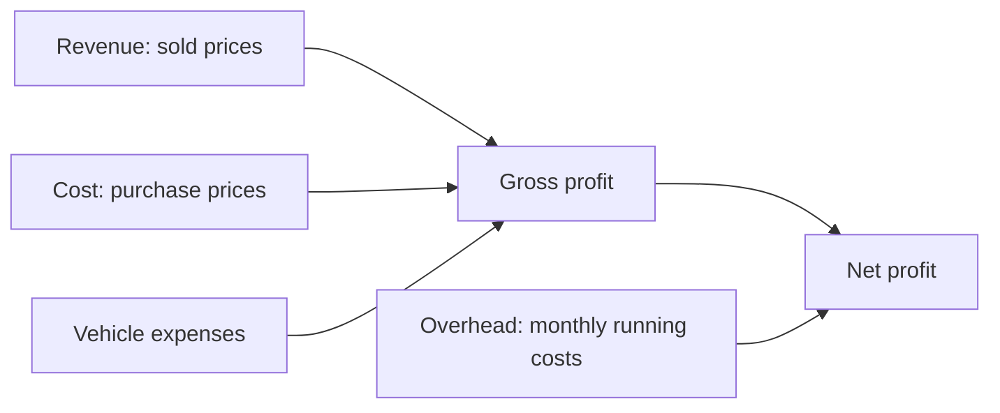

# Financials

This page explains the five screens under **Financials** in the menu: what each one shows, how the numbers are built, and the controls on each.

:::tip[In plain English]
Financials is the dealership's books, kept simple. **Revenue** is money from sales. **Gross profit** is revenue minus what the cars cost and what was spent on them. **Net profit** also subtracts monthly overhead such as rent. Everything here is in Philippine pesos.
:::

## How the numbers fit together

| Term | Meaning |
| --- | --- |
| **Revenue** | Total of sold prices for vehicles sold in the period. |
| **Cost** | What the dealer paid for those vehicles. |
| **Vehicle expenses** | Repairs and prep recorded on the sold vehicles. |
| **Gross profit** | Revenue minus cost minus vehicle expenses. |
| **Overhead** | Monthly business costs not tied to one car. |
| **Net profit** | Gross profit minus overhead. |

## Financials Summary

**Menu:** Financials → Financials Summary (`/dashboard/financials/summary`). The page title is **Financials**.

| Control | Options |
| --- | --- |
| **Data source** | **Combined**, **System** (records created in DryvHub) or **Legacy** (records imported from older books). |
| **Timeframe** | All, Yearly or Monthly, with Year and Month pickers when relevant. |
| **Import Legacy** | Upload a .csv or .xlsx file with 1 to 5000 records and give it a source label. Download the template for the required columns: recordType, amount, and occurredOn. |
| **Clear Legacy** | Removes imported legacy records. A dialog asks "Clear imported legacy records?" first. |

Shows four cards: **Total Revenue**, **Gross Profit**, **Overhead**, **Net Profit**.

Below them, **Record source breakdown** compares system and legacy coverage, and a line-item list shows: **Revenue** (with the count sold), **Cost**, **Vehicle Expenses**, **Gross Profit**, **Monthly Overhead**, **Net Profit**.

With no data it says "No financial activity yet".

## Sales Summary

**Menu:** Financials → Sales Summary (`/dashboard/financials/sales-summary`).

Controls: Timeframe plus Year and Month, and vehicle filters:

| Filter | Options |
| --- | --- |
| Status chips | Sold, Available, Coming, Reserved |
| Age | Fresh, Good, Exit |
| Docs | Complete, Incomplete |
| Sold or Transfer | Transferred, Not transferred |
| Period | Date range |

Cards: **Revenue**, **Gross Profit**, **Overhead**, **Net Profit**, **Units**, **View**. A trend chart follows. With nothing sold: "No sales activity yet".

:::note
**Transferred** filters on a yes/no flag stored on the vehicle record (`isTransferred`, default no). The dealer screens reviewed here do not describe what it represents; it is generally understood to track ownership transfer after a sale, so confirm with the product team.
:::

## Payments

**Menu:** Financials → Payments (`/dashboard/financials/payments`). The cash ledger: every peso in and out.

| Control | Options |
| --- | --- |
| **From / To** | Date range. |
| **Direction** | All directions, Incoming, Outgoing. |
| **Method** | Cash, bank transfer, check, GCash, Maya, card, financing, trade-in, internal credit, other. |
| **Search** | Placeholder "Vehicle, buyer, seller, or reference". |
| **Export** | Downloads a CSV of the filtered rows. |

Cards: **Total inflow**, **Total outflow**, **Net cash**, **Incoming**, **Outgoing**, **Payments**.

### Recording a payment

Sales create an incoming payment automatically (see [Expenses and sales](/docs/dealer/expenses-and-sales)). For anything else the dealer can record one by hand. The form asks for:

| Field | Notes |
| --- | --- |
| Direction | Incoming or Outgoing. |
| Category | Incoming: Vehicle sale, Reservation, Down payment, Installment, Financing proceeds. Outgoing: Vehicle purchase. |
| Vehicle | Required. Error: "Select a vehicle." |
| Amount | Up to 2 decimal places, 0 or more. |
| Payment method | Required. |
| Date | Required. |
| Status | **Cleared** or **Pending**. |
| Receipt | Up to 80 characters. |
| Notes | Up to 2000 characters. |

The page confirms with "Payment recorded." Pending payments carry a **Pending** badge in the list.

## Vehicle Expenses

**Menu:** Financials → Vehicle Expenses (`/dashboard/financials/expenses`). Two views:

- **Overview:** all expenses across vehicles. Filters: vehicle status, a search ("Search vehicle, label, or ref"), and Timeframe (All time, Monthly, Yearly) with Year and Month. Cards: **Total expenses**, **Expense items**, **Vehicles with expenses**. A **By category** list can be sorted by amount. **Export** downloads a CSV with Date, Vehicle, Ref ID, Plate number, Category, Description and Amount.
- **Manage by vehicle:** pick a vehicle and add or remove its expenses. The same form as on the [vehicle page](/docs/dealer/vehicle-detail).

All expenses created by the app currently use the category "other".

## Overhead

**Menu:** Financials → Overhead (`/dashboard/financials/overhead`). Costs of running the business, one line per item per month.

| Field | Example |
| --- | --- |
| Month | The month the cost belongs to. |
| Label | "Office rent" |
| Amount | In pesos. |
| Due date | Optional. |
| Invoice number | Optional. |
| Notes | Optional. |

Filters: Year and Month. Cards: **Total overhead** and **Line items**. Lines can be added, edited and deleted, with confirmations "Overhead added.", "Overhead updated." and "Overhead deleted."

## For developers

- Pages: `app/(session)/dashboard/financials/{summary,sales-summary,payments,expenses,overhead}/`; components in `components/financials/`; helpers in `lib/financials/`.
- Plans: `docs/plans/dry-71-financials-sales-summary.md`, `dry-72-financials-summary.md`, `dry-73-financials-payments.md`, `sales-form-overhead-vehicle-expenses.md`.
- Payments store a `financial_transaction`; the sale creates one of type `vehicle_sale` (see `financial-transaction.data-service.ts` in the API).

## Related pages

- [Expenses and sales](/docs/dealer/expenses-and-sales)
- [Reports](/docs/dealer/reports)
- [Dashboard home](/docs/dealer/dashboard-home)
- [Troubleshooting and FAQ](/docs/dealer/troubleshooting-faq)
