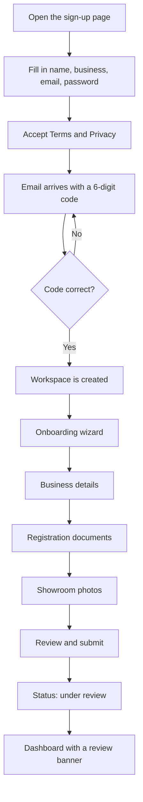

# Getting started

This page covers a dealer's first steps: signing up with an email code, signing in, resetting a password, landing on the dealership's own address, and filling in the onboarding checklist.

:::tip[In plain English]
A dealer signs up with their email, types a 6-digit code to prove the email is theirs, then fills in a short form about the business and uploads registration papers. DryvHub staff review those papers. While they wait, the dealer can already use the dashboard for stock and costs.
:::

## The whole journey

## 1. Sign up

The sign-up form asks for:

| Field | Notes |
| --- | --- |
| First name | Required. |
| Last name | Required. |
| Business name | Required. Must contain at least one letter or number. |
| Subdomain (preview) | Shown automatically, read-only. See below. |
| Email | Required. |
| Password | At least 8 characters. |
| Confirm password | Must match. |
| Terms of Service and Privacy Policy | Must be ticked to continue. |

### The subdomain preview

The business name becomes the dealership's web address. The rule is simple: lower-case the name, turn every run of characters that are not letters or digits into a single hyphen, trim hyphens from both ends, and keep at most 60 characters.

Example: `ABC Motors Trading, Inc.` becomes `abc-motors-trading-inc`, so the workspace address is `abc-motors-trading-inc.dryvhub.com`.

:::note
The preview on the form is a copy of the rule the API uses. The API is the source of truth for the final address.
:::

## 2. Verify the email with a code

After the form is submitted, DryvHub emails a **6-digit code**. The dealer types it on the next screen.

| Rule | Value |
| --- | --- |
| Code lifetime | 10 minutes |
| Wrong guesses allowed | 5, then a new code is needed |
| Resend button | Locked for 60 seconds after each send |

Messages the dealer may see:

| Message | What it means |
| --- | --- |
| "Enter the 6-digit code from your email." | The box is empty or too short. |
| "Incorrect verification code. Please try again." | Wrong digits. |
| "Your verification code has expired. Request a new code." | More than 10 minutes passed. |
| "Too many failed attempts. Request a new code." | Five wrong tries. |
| "Too many requests. Please wait before requesting another code." | Resend pressed too often. |

When the code is accepted, the email is marked confirmed and the dealership's workspace is created.

## 3. Sign in

There are two ways to sign in on the dealer sign-in page:

- **Email and password.** A wrong pair shows "Email or password is incorrect."
- **Continue with Google.** A new Google user is first asked to verify their email with a code, then completes registration with the business name.

### Reset a forgotten password

1. On the sign-in page choose the reset option and enter the account email. If the box is empty the page says "Enter the email for your account."
2. DryvHub sends a link to choose a new password.
3. On the reset page enter the new password twice. It must be at least 8 characters and both entries must match.
4. The page says "Password updated. Redirecting to dashboard..." and opens the dashboard.

## 4. Landing on the dealership's own address

Every dealership has its own address. Signing in on the main platform address (`app.dryvhub.com`) sends the dealer on to `https://{their-subdomain}.dryvhub.com/dashboard`.

The sign-in session is **not** shared between addresses automatically. To avoid a second login, the app passes the session along in the web address fragment (the part after `#`, which browsers do not send to servers) and the workspace picks it up on arrival. When testing locally the dealer stays on the same address and no hand-off happens.

If someone opens `their-subdomain.dryvhub.com/` without being signed in, they see a small landing page titled with the business name and an invitation to sign in. An address that does not match any dealership is sent back to the platform sign-in.

## 5. The onboarding wizard

New dealers start on `/onboarding`, a full-screen wizard with four steps. The wizard only opens while the application has **not** been submitted. After submission the same content lives on the **Onboarding Checklist** page (`/dashboard/onboarding`).

| Step | What the dealer provides |
| --- | --- |
| **1. Business details** | Legal business name, physical address, contact email, contact phone, Facebook page link. All five are required. Links to the Terms and Privacy pages are shown. |
| **2. Registration docs** | Four documents: **DTI**, **BIR Form 2303**, **Certificate of Registration**, **Latest Business Permit**. All four are required before submitting. |
| **3. Showroom photos** | At least one photo of the showroom that includes a selfie of the dealer. The step can be skipped for now, but a photo is needed before submitting. |
| **4. Review and submit** | A summary of everything entered, a list of any missing documents, and the Submit button. |

On the first step, street and barangay are typed in, but **region, province and city are dropdowns** picked in that order: a region narrows the provinces, a province narrows the cities. The list is the PSA's official one, so the saved spelling can differ from what the dealer would have typed — Makati is stored as "City of Makati". Choosing NCR hides the province dropdown, because the PSA does not split NCR into provinces. [Dealer profile](/docs/dealer/dealer-profile#why-the-address-is-a-dropdown) explains why.

File rules:

| Kind | Accepted | Largest size |
| --- | --- | --- |
| Registration documents | PDF or an image (JPEG, PNG, WebP) | PDF 10 MB, image 5 MB |
| Showroom photos | JPEG, PNG, WebP | 5 MB each |

Useful behaviors:

- **Progress is saved.** A dealer can leave and come back; a banner reads "Finish your onboarding" and shows how many steps are left.
- **Replacing a document.** On a confirmed document the dealer can pick a new file. The app asks for confirmation, deletes the old file, uploads the new one and refreshes. There is no single "swap" action on the server, so if the upload fails after the delete, the page shows a retry for the new file.
- **Validation messages** include "Legal business name is required.", "Enter a valid email address." and "Enter a valid Facebook page URL."

### After submitting

Submitting moves the application to **pending** review at **Stage 1**. The dashboard then shows a banner, "Application under review", saying the team is checking the documents and will notify the dealer. The dealer can keep using the dashboard.

If DryvHub **rejects** the application, the status becomes **rejected** and the stage stays at Stage 1. The Verification page says "Application needs attention" and links back to the checklist so the dealer can update details or replace documents. The screen has no resubmit button; the page tells the dealer to contact support.

For what each stage unlocks, see [Verification and access](/docs/dealer/verification-and-access).

## 6. Day-one actions

Even before approval a dealer can:

1. [Add vehicles](/docs/dealer/inventory) with photos and purchase details.
2. Record [expenses](/docs/dealer/expenses-and-sales) such as repairs.
3. Add monthly [overhead](/docs/dealer/financials).
4. Look up plates in [PlateCheck](/docs/dealer/platecheck).
5. Fill out the [Dealer profile](/docs/dealer/dealer-profile).

Connecting Facebook and reporting plates need Stage 1, which starts once the onboarding application is submitted. Publishing to the Marketplace needs full verification and a paid plan.

## For developers

- Sign-up screens: `app/(session)/dealer/signup/`, `components/auth/signup-form-fields.tsx`, `components/auth/otp-verification-form.tsx`.
- OTP is **stateless**: a signed token valid for 600 seconds with at most 5 attempts, issued by Next.js route handlers under `app/api/auth/signup/`. See `lib/auth/otp-challenge.ts` and `docs/adr/0001-stateless-short-lived-signup-otp.md` in the dealer repo.
- Registration call: `POST /api/v1/auth/register`.
- Workspace hand-off: `lib/tenant/post-login-navigation.ts`, `app/(session)/auth/handoff/`, ADRs 0002 and 0003 in the dealer repo.
- Onboarding: `components/onboarding/`, `lib/onboarding/required-documents.ts`, `GET/PATCH /api/v1/tenants/current/onboarding`, `GET .../onboarding/checklist`.

## Related pages

- [Verification and access](/docs/dealer/verification-and-access)
- [Dashboard home](/docs/dealer/dashboard-home)
- [Troubleshooting and FAQ](/docs/dealer/troubleshooting-faq)
- [Auth and tenancy](/docs/developers/auth-and-tenancy)
- [Welcome](/docs/start/welcome)
