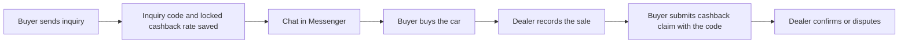

# Inquiries

This page explains the **Inquiries** screen: what an inquiry is, what the dealer sees, and how an inquiry becomes the starting point of a buyer cashback claim.

:::tip[In plain English]
When a buyer taps "Send Inquiry" on a Marketplace listing, DryvHub records it, gives it a short code, and sends the buyer to Facebook Messenger to chat with the dealer. The Inquiries page is the dealer's log of those taps. The chat itself happens in Messenger, not in DryvHub.
:::

## Who can see it

The page is part of the Marketplace feature set, so it is **locked** until the dealership is Stage 2 verified on an active paid plan. Until then a "locked" panel explains what to complete. See [Verification and access](/docs/dealer/verification-and-access).

## What an inquiry is

An inquiry is a record created when a buyer sends an inquiry from a listing's card or details page. It stores:

- An **inquiry code** (a short reference the buyer can quote).
- The **buyer** who sent it.
- The **vehicle** they asked about.
- The **source**, which is always **Messenger** today, and the **entry point**: **Listing card** or **Listing details**.
- The **cashback rate locked at that moment** (see below).

How the buyer side works is described in [Send inquiry](/docs/marketplace/send-inquiry).

## The page

Title **Inquiries**, subtitle "Buyer questions from marketplace Messenger, with the vehicle in view."

| Control | Notes |
| --- | --- |
| Search | Placeholder "Search by code, buyer, or vehicle". |
| Date range | From and To. |
| Pagination | Moves through pages of results. |

### Summary numbers

The top of the page shows four figures calculated by the API for the filtered set:

| Figure | Meaning |
| --- | --- |
| **Inquiries** | How many inquiries match. |
| **Average cashback rate** | The mean of the locked rates on those inquiries. |
| **Estimated cashback total** | What buyer cashback could total if every one of those inquiries ended in a sale. |
| **Sold inquiries** | Inquiries whose vehicle has since been sold. |

### Each row

Inquiry code, buyer, vehicle name, the source (**Messenger**), the entry point (**Listing card** or **Listing details**), and a status badge once the vehicle is sold.

With no data the page says "No inquiries yet." and "When someone asks about a listing, the thread will live here."

:::note
There is no reply box in the dealer app. Dealers answer buyers in Messenger. The inquiries page is a record, not a chat.
:::

## How an inquiry links to cashback

- **Locked rate.** When the inquiry is created the cashback rate is copied onto it from DryvHub's platform settings, so later rate changes do not affect it. The default is **5.00%**. A running promotion can change the rate at that moment.
- **Estimate.** The estimated cashback uses the **sold price** if the car is sold, otherwise the **listing price**.
- **The claim.** The buyer submits a claim quoting the inquiry code, and the dealer then sees it under [Cashback](/docs/dealer/cashback). One inquiry code can produce only one claim.

For the buyer-side rules see [Cashback claims](/docs/marketplace/cashback-claims).

## For developers

- Page: `app/(session)/dashboard/inquiries/`; components in `components/inquiries/`; types in `types/api/inquiries.ts`.
- Endpoints: `GET /api/v1/inquiries` (dealer, authenticated); `POST /api/v1/marketplace/listings/:vehicleId/inquiries` (public, buyer side).
- Plan: `docs/plans/inquiries-cashback-pages.md` in the dealer repo.

## Related pages

- [Cashback](/docs/dealer/cashback)
- [Listings and publishing](/docs/dealer/listings-and-publishing)
- [Send inquiry](/docs/marketplace/send-inquiry)
- [Cashback claims](/docs/marketplace/cashback-claims)
