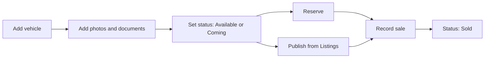

# Inventory

This page explains the **Inventory → Vehicles** screen: how to browse stock as cards or a list, add a vehicle, filter, change status, and what the sourcing and pricing fields mean.

:::tip[In plain English]
Inventory is the dealership's list of cars. Each car has a **status** (is it for sale, reserved, sold?), a **posted price** (what the buyer sees) and private **purchase details** (what the dealer paid and who supplied it). Only some of this ever reaches buyers.
:::

## Card and list views

Vehicles can be shown two ways. The choice is kept in the address (`?view=list`), so it survives a refresh and can be shared.

| View | Best for |
| --- | --- |
| **Cards** (default) | Photo-first browsing. Each card shows the cover photo, name, price, status and badges. |
| **List** | Scanning many vehicles quickly in a table. |

Badges on a vehicle include **Complete documents** (the dealer has marked the paperwork as complete) and **Published** (the vehicle is live on the Marketplace).

## Finding vehicles

Filters sit above the grid:

| Filter | Options |
| --- | --- |
| **Search** | Free text. Placeholder: "Year, make, model, plate". |
| **Category** | Hatchback, Sedan, Crossover, SUV, Pickup, Van. |
| **Status** | Available, Sold, Coming, Reserved. |
| **Age** | Fresh, Good, Exit (see below). |
| **Docs** | Complete or Incomplete. |

The footer reads "Showing X-Y of N vehicles". Page sizes are **10, 20 or 50** (default 10).

### Inventory age bands

Age is counted in **days on lot** from the purchase date. If there is no purchase date, the listed date is used, and if there is none of those, the date the record was created.

| Band | Days on lot |
| --- | --- |
| **Fresh** | 0 to 29 |
| **Good** | 30 to 60 |
| **Exit** | 61 or more. A prompt to move the car, for example by lowering the price. |

## Statuses

| Status | Meaning | Visible on Marketplace? |
| --- | --- | --- |
| **Available** | In stock and for sale. | Yes, if published and eligible. |
| **Coming** | Bought or arriving, not yet ready. | Yes, on the "Coming soon" tab, if published and eligible. |
| **Reserved** | Held for a buyer. | No. |
| **Sold** | Sale recorded. | No. |

Each card has quick buttons for **Coming**, **Reserve** and **Sold**. **Sold** opens the [sale form](/docs/dealer/expenses-and-sales) instead of flipping the status directly, so the sale amount and buyer are captured. Short confirmations appear, for example "Marked as coming." and "Marked as reserved."

**Archive** is a soft delete: the card menu asks "Archive this vehicle?" and the vehicle disappears from lists. Archiving shows "Vehicle archived successfully."

:::note
The server also knows the statuses `draft`, `active` and `archived`. The Vehicles page offers only the four above as filters and quick actions.
:::

## Adding a vehicle

Choose **Add Vehicle**. The dialog is titled "Create Vehicle" and says "Add a new vehicle to inventory and upload photos and documents." Photos and documents chosen in the dialog are uploaded right after the vehicle is saved. More can be added later on the [vehicle page](/docs/dealer/vehicle-detail).

| Group | Fields | Required by the server? |
| --- | --- | --- |
| **Identity** | Make, Model, Plate number | Yes, all three. |
| **Status** | Status | No. Defaults to Available. |
| **Details** | Year (1900 or later), Mileage (0 or more), Variant, Color | Year and Mileage yes. Variant and Color optional. |
| **Classification** | Category, Transmission, Fuel type | Yes, pick from lists. |
| **Pricing** | Posted price (0 or more) | Yes. |
| **Sourcing** | Purchase price, Purchase date, Supply agent, Supply agent contact number | All optional. |
| **Description** | Free text | Yes. |

Choices:

- **Category:** hatchback, sedan, crossover, SUV, pickup, van.
- **Transmission:** manual, automatic, CVT, other.
- **Fuel type:** gasoline, diesel, hybrid, electric, LPG, other.

On success the app shows "Vehicle created successfully."

### Sourcing fields

**Supply agent** is the person who brought the car in, with a contact number. **Purchase price** and **Purchase date** are the dealer's own cost data. They are private, they feed the profit numbers, and they are never sent to buyers.

### Pricing: two different prices

| Price | Who sees it | Used for |
| --- | --- | --- |
| **Posted price** | Buyers (Marketplace and Facebook caption). | What the car is advertised at. Also the "Inventory value" figure on the [Inventory Report](/docs/dealer/reports) and the projected profit on the vehicle page. |
| **Purchase price** | Dealer only. | Profit and cost reports. |
| **Sold price** | Dealer only, plus the buyer. | Set when the sale is recorded. |

## From a card to the next step

The card menu also offers **Publish to Marketplace & Facebook** and **Unpublish**. See [Listings and publishing](/docs/dealer/listings-and-publishing).

## For developers

- Page: `app/(session)/dashboard/inventory/`; components in `components/inventory/`.
- Service: `services/vehicle.service.ts`; endpoints `POST /api/v1/vehicles`, `GET /api/v1/vehicles`, `GET /api/v1/vehicles/:id`.
- Plans: `docs/plans/inventory-card-list-view.md`, `dry-81-vehicle-onboarding-pricing-nav-ux.md`, `dry-80-vehicle-sourcing-orcr.md` in the dealer repo.

## Related pages

- [Vehicle detail](/docs/dealer/vehicle-detail)
- [Expenses and sales](/docs/dealer/expenses-and-sales)
- [Listings and publishing](/docs/dealer/listings-and-publishing)
- [Reports](/docs/dealer/reports)
