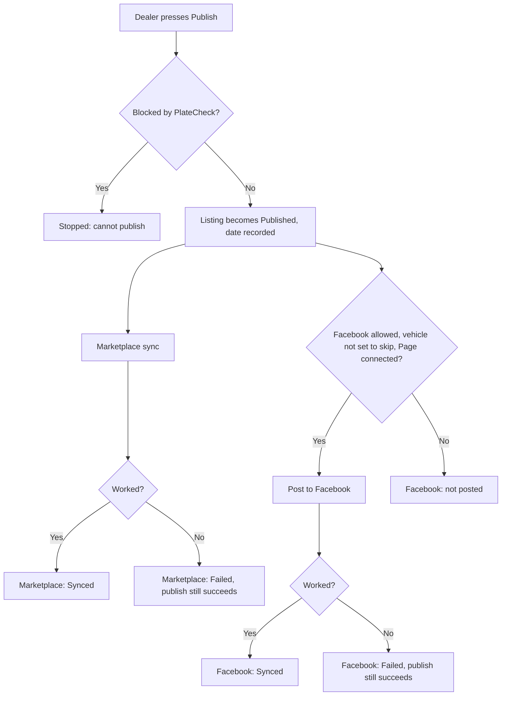

# Listings and publishing

This page explains the **Listings** page: how a vehicle goes live on the public Marketplace and on Facebook, what must be true before it can, and what the statuses and sync buttons mean.

:::tip[In plain English]
A vehicle in inventory is private. **Publishing** makes it a public *listing*. DryvHub then tries to do two things: show it on the DryvHub Marketplace, and post it to Facebook. Each step can succeed or fail on its own, and a failed step never cancels the publish.
:::

## Before a dealer can publish

Publishing to the Marketplace is locked until the dealership is fully set up. The dealer sees the lock reason as a message on the button.

| Requirement | Detail |
| --- | --- |
| Stage 2 verification | DryvHub has approved the dealership. See [Verification and access](/docs/dealer/verification-and-access). |
| A paid plan | Starter, Growth, Pro or Enterprise. Free cannot list. See [Billing](/docs/dealer/billing). |
| Subscription in good standing | Active or trialing in the app. |

If something is missing the app shows one of these messages:

- "Complete Stage 2 verification and upgrade to a paid plan to access the DryvHub Marketplace."
- "Complete Business Verification to unlock Marketplace access."
- "Your dealership is verified. Upgrade to Starter or higher to list vehicles on the DryvHub Marketplace."
- "Your subscription needs attention. Restore an active paid plan to list vehicles on the Marketplace."

Facebook posting has a lower bar: Stage 1 and a connected Page. See [Facebook integration](/docs/dealer/facebook-integration).

:::note
The API also accepts a subscription in `past_due` for Marketplace access, while the dealer screens treat only active or trialing as good. The practical effect is that a lapsed payment may block publishing in the app slightly sooner than the server would.
:::

## What makes a listing visible to buyers

Publishing is necessary but not enough. A vehicle shows on the public Marketplace only when **all** of these are true (checked by the API every time a buyer looks). For the full rules see [Marketplace eligibility](/docs/marketplace/eligibility).

- The listing is **published**.
- The vehicle is **not sold** and **not archived**.
- It is **not flagged by PlateCheck**.
- The dealership is active, verified at Stage 2 with approved status.
- The plan is Starter, Growth, Pro or Enterprise, and the subscription is trialing, active or past due.
- The vehicle status is **Available**, or **Coming** (shown on the "Coming soon" tab). **Reserved** vehicles are not shown.

## The Listings page

Open **Inventory → Listings**. A table lists vehicles with these columns:

| Column | Shows |
| --- | --- |
| **Vehicle** | Name and details. |
| **Listing** | Listing status. |
| **Marketplace** | Marketplace sync status. |
| **Facebook** | Facebook sync status. |
| **Actions** | Buttons for this row. |

A search box ("Year, make, model, plate") narrows the list. **Create listing** opens a dialog to start a listing from an existing vehicle, and **Archive** asks "Archive this listing?".

### Listing statuses

| Status | Meaning |
| --- | --- |
| **Draft** | Not live. |
| **Pending review** | Waiting for a check. |
| **Published** | Live (subject to the checks above). |
| **Held** | Temporarily held. |
| **Blocked** | Blocked by PlateCheck. It cannot be published. |

### Sync statuses

Marketplace and Facebook each have their own sync status:

| Status | Meaning |
| --- | --- |
| **Idle** | Nothing attempted yet. |
| **Synced** | Succeeded. |
| **Failed** | The last attempt failed. Hover the status for the reason. |
| **Unpublished** | Taken down. |

## Publishing, step by step

Key behaviors:

- Publishing records the time it went live.
- The Marketplace and Facebook steps run automatically after publishing.
- **A failure in either never rolls back the publish.** The listing stays published and the failed channel shows **Failed** so it can be retried.
- A vehicle set to skip Facebook (`noFbPost`) is never posted. Its Facebook column shows **Skipped** on the vehicle page.

The publish button gives a summary tooltip, for example "Published to Marketplace and Facebook", with lines such as "Marketplace: Live / Sync failed / Not live" and "Facebook: Posted / Post failed / Not posted / Posting disabled".

## Unpublishing

**Unpublish** is available for published, pending review or held listings and shows "Listing unpublished." The system then:

1. Marks the Marketplace sync as **Unpublished**, so the car drops off the public site.
2. Deletes the Facebook posts. By default both the DryvHub Page post and the dealer Page post are deleted; the setting `fbDeleteOnStatusChange` can limit this. If Facebook refuses the delete, the request returns an error (HTTP 502) instead of silently leaving old posts up.

## Sync and bump buttons

Each row offers manual actions. Their labels change with state:

| Channel | Labels you may see |
| --- | --- |
| Marketplace | Publish to Marketplace, Sync to Marketplace, Re-sync Marketplace, Retry Marketplace |
| Facebook | Post to Facebook, Sync to Facebook, Re-sync Facebook, Retry Facebook |

Other actions:

- **Bump on Facebook**: post the car again at the top of the Page. See [Facebook integration](/docs/dealer/facebook-integration).
- **Feature listing**: shows a message only. Featured placement is Pro or Enterprise only ("Featured marketplace listings are available on Pro and Enterprise plans."). Today the button does not change anything on the server. **Planned**: real featured placement, although the API already refuses featured listings for lower plans.
- **Edit** and **Archive**.

Buttons can be disabled for a reason shown on hover:

| Message | Why |
| --- | --- |
| "Publish the listing before syncing." | Sync needs a published listing. |
| "Facebook posting is disabled for this listing." | The vehicle is set to skip Facebook. |
| "Publish the listing before bumping it on Facebook." | Bump needs a published listing. |

Marketplace sync does not need Facebook. The two channels are independent.

## For developers

- Page: `app/(session)/dashboard/listings/`; components in `components/listings/`; rules in `lib/listing/`.
- Endpoints: `POST /api/v1/vehicles/:id/listing/publish`, `.../listing/unpublish`, `.../listing/sync/marketplace`, `.../listing/sync/facebook`, `.../listing/facebook/bump`.
- API: `src/use-cases/vehicle/publish-listing.use-case.ts`, `unpublish-listing.use-case.ts`; eligibility in `src/services/data-services/marketplace-listing.data-service.ts`; access policy in `src/core/policies/dealer-access.policy.ts`.
- A listing blocked by PlateCheck returns HTTP 409 "Cannot publish a listing blocked by plate check".

## Related pages

- [Facebook integration](/docs/dealer/facebook-integration)
- [Verification and access](/docs/dealer/verification-and-access)
- [PlateCheck](/docs/dealer/platecheck)
- [Marketplace eligibility](/docs/marketplace/eligibility)
- [Marketplace overview](/docs/marketplace/overview)
