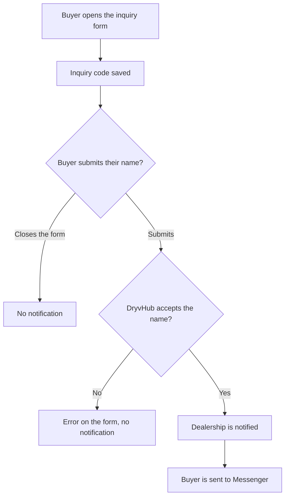

# Notifications

This page explains the bell in the dealer header: what creates a notification, who receives it, and how to open the inquiry it points to.

:::tip[In plain English]
The bell means a buyer typed their name on a Marketplace inquiry and was sent to Messenger. Opening the form, or closing it without submitting, does not notify anyone. The bell does not mean a Messenger message arrived.
:::

## What triggers a notification

A notification is created only when a buyer **submits their name** on the Marketplace inquiry form.

1. The buyer opens **Send Inquiry** on a listing, or **Inquire** on a listing card. DryvHub saves an inquiry code. Nobody is notified.
2. The buyer enters their name and submits the form.
3. If that submit succeeds, each person listed below gets one notification, and the buyer is sent to Facebook Messenger.
4. If the submit fails, the buyer sees an error and can try again. They stay on the form, they are not sent to Messenger, and nobody is notified.

Closing the form without submitting does not notify anyone.

:::warning
Messenger delivery is not confirmed. The notification means the buyer was sent to Messenger. It does not mean a message was received. The buyer still has to press Send in Messenger.
:::

Each item is titled **New marketplace inquiry**. Under that it says **Buyer redirected to Messenger, delivery not confirmed**, then the buyer's name (when DryvHub has one) and the vehicle.

## Who is notified

Every **active owner** and every **active staff member** of the dealership that owns the listing gets their own notification. Each person has a separate unread count.

## The bell and the inbox

The bell sits in the header.

| What you see | What it means |
| --- | --- |
| **Badge** | How many of **your** notifications are still unread. The badge is hidden when that number is zero. Above nine it shows **9+**. |
| **Inbox** | Recent items, newest first, with how long ago each one arrived. Unread items are styled differently from ones you have already opened. |
| **Mark all as read** | Clears the unread mark on your items. |

The bell's name includes the unread count ("Notifications, 2 unread", for example). When the count changes, that change is announced.

Click an item to mark it read and open that inquiry on the [Inquiries](/docs/dealer/inquiries) page.

## Read state is per person

Marking one item read, or choosing **Mark all as read**, changes only your bell. Other owners and staff still see their own unread items. Your other open screens update to match yours.

## If the bell does not update live

The badge is meant to update while you are signed in. If a live update does not arrive, the badge refreshes when you reload the page or when the connection comes back. It then shows the current unread count.

## For developers

- Plan: `dryvhub-api/docs/plans/inquiry-realtime-notifications.md`.

## Related pages

- [Inquiries](/docs/dealer/inquiries)
- [Send inquiry](/docs/marketplace/send-inquiry)
