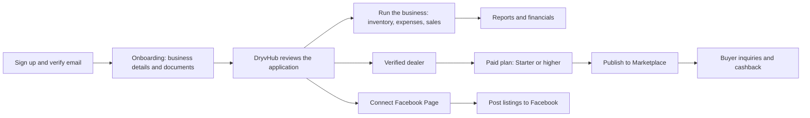

# Dealer app overview

This page explains what the DryvHub Dealer app is, who uses it, and gives a map from every menu item to the page it opens.

:::tip[In plain English]
The Dealer app is the **back office** of a used-car dealership. A dealer keeps their stock, costs, sales and paperwork in one place, and can choose to show selected cars to buyers on the DryvHub Marketplace and on Facebook.
:::

## What the app is

The Dealer app is a web application for car dealerships in the Philippines. Each dealership gets its own private **workspace** (called a *tenant* in technical docs) with its own web address, for example `acme-motors.dryvhub.com`. Nothing a dealer enters is visible to other dealers.

The app does three jobs:

1. **Run the dealership.** Track vehicles, purchase prices, expenses, sales, payments and monthly overhead, and see profit.
2. **Sell the cars.** Publish eligible vehicles to the public [Marketplace](/docs/marketplace/overview) and post them to a Facebook Page.
3. **Build trust.** Submit business documents so DryvHub can verify the dealership, and check plates against a shared list of flagged vehicles.

The Dealer app does **not** show the public Marketplace. Buyers use a separate site. See [Marketplace overview](/docs/marketplace/overview).

## Who uses it

| Person | What they can do |
| --- | --- |
| **Dealer owner** | Everything in the dashboard, including billing, verification and Facebook. |
| **Dealer staff** | Everything in the dashboard. The app lets `owner`, `staff` and `super_admin` roles in; it does not hide pages per role. |
| **Platform admin** (DryvHub employee) | Uses a separate portal on a separate address. See [Admin portal](/docs/dealer/admin-portal). |
| **Buyers** | Never sign in to the Dealer app. They see the dealer's public profile page only. See [Dealer profile](/docs/dealer/dealer-profile). |

:::note
The dashboard allows three roles in: `super_admin`, `owner` and `staff`. The app has no screen for inviting team members or changing roles, and no per-role page restrictions were found in the code.
:::

## The big picture

Day-to-day work (inventory, expenses, sales, reports, PlateCheck lookups) is open from the first day. Selling features unlock in steps. See [Verification and access](/docs/dealer/verification-and-access).

## Sidebar map

The left menu is the main way to move around. This table follows the menu exactly as it appears in the app.

| Menu item | Address | What it is for | Page |
| --- | --- | --- | --- |
| **Dashboard** | `/dashboard` | Headline numbers, sales chart, stock by status. | [Dashboard home](/docs/dealer/dashboard-home) |
| **Inventory → Vehicles** | `/dashboard/inventory` | All vehicles, as cards or a list. Add, filter, change status. | [Inventory](/docs/dealer/inventory) |
| **Inventory → Listings** | `/dashboard/listings` | Publish and sync vehicles to Marketplace and Facebook. | [Listings and publishing](/docs/dealer/listings-and-publishing) |
| **Financials → Sales Summary** | `/dashboard/financials/sales-summary` | Revenue and profit from sold vehicles. | [Financials](/docs/dealer/financials) |
| **Financials → Financials Summary** | `/dashboard/financials/summary` | Revenue, cost, expenses, overhead, profit. | [Financials](/docs/dealer/financials) |
| **Financials → Payments** | `/dashboard/financials/payments` | Money in and money out. | [Financials](/docs/dealer/financials) |
| **Financials → Vehicle Expenses** | `/dashboard/financials/expenses` | Repair and prep costs per vehicle. | [Financials](/docs/dealer/financials), [Expenses and sales](/docs/dealer/expenses-and-sales) |
| **Financials → Overhead** | `/dashboard/financials/overhead` | Monthly running costs such as rent. | [Financials](/docs/dealer/financials) |
| **Reports → Sales / Inventory / Profit / Expense Report** | `/dashboard/reports/...` | Filterable reports with CSV export. | [Reports](/docs/dealer/reports) |
| **Inquiries** | `/dashboard/inquiries` | Buyer questions that came from the Marketplace. | [Inquiries](/docs/dealer/inquiries) |
| **Cashback** | `/dashboard/cashback` | Buyer cashback claims the dealer must confirm or dispute. | [Cashback](/docs/dealer/cashback) |
| **Dealer Profile** | `/dashboard/dealer-profile` | The public page buyers see. | [Dealer profile](/docs/dealer/dealer-profile) |
| **Subscription & Billing** | `/dashboard/billing` | Plans and invoices. | [Billing](/docs/dealer/billing) |
| **Storage** | `/dashboard/storage` | How much photo and document space is used. | [Storage and settings](/docs/dealer/storage-and-settings) |
| **PlateCheck** | `/dashboard/platecheck` | Search and report flagged plates. | [PlateCheck](/docs/dealer/platecheck) |
| **Settings** | `/dashboard/settings` | Facebook connection. | [Storage and settings](/docs/dealer/storage-and-settings), [Facebook integration](/docs/dealer/facebook-integration) |
| **Verification** | `/dashboard/verification` | Where the dealership stands in verification. | [Verification and access](/docs/dealer/verification-and-access) |
| **Documents → Onboarding Checklist** | `/dashboard/onboarding` | Business details and documents submitted for review. | [Getting started](/docs/dealer/getting-started) |
| **Documents → Monthly Report** | `/dashboard/reports/sales` | Shortcut to the Sales Report. | [Reports](/docs/dealer/reports) |

The top of the sidebar shows the dealership name, its current plan, and a verified badge. The user menu at the bottom has **Billing** and **Log out**.

## Two kinds of "admin"

The word *admin* appears in two unrelated ways:

- **Dealer roles** (`owner`, `staff`, `super_admin`) belong to a dealership.
- **Platform admin** is a DryvHub staff account that reviews dealers across all dealerships. It signs in on `admin.dryvhub.com`, not on a dealership address.

## For developers

- App stack and layering: [Architecture](/docs/developers/architecture).
- How sign-in and workspace separation work: [Auth and tenancy](/docs/developers/auth-and-tenancy).
- How the app calls the API: [API integration](/docs/developers/api-integration).
- Code locations: pages under `app/(session)/dashboard/`, public pages under `app/(public)/`, menu in `components/app-sidebar.tsx`.

## Related pages

- [Getting started](/docs/dealer/getting-started)
- [Verification and access](/docs/dealer/verification-and-access)
- [How it fits together](/docs/start/how-it-fits-together)
- [Glossary](/docs/start/glossary)
