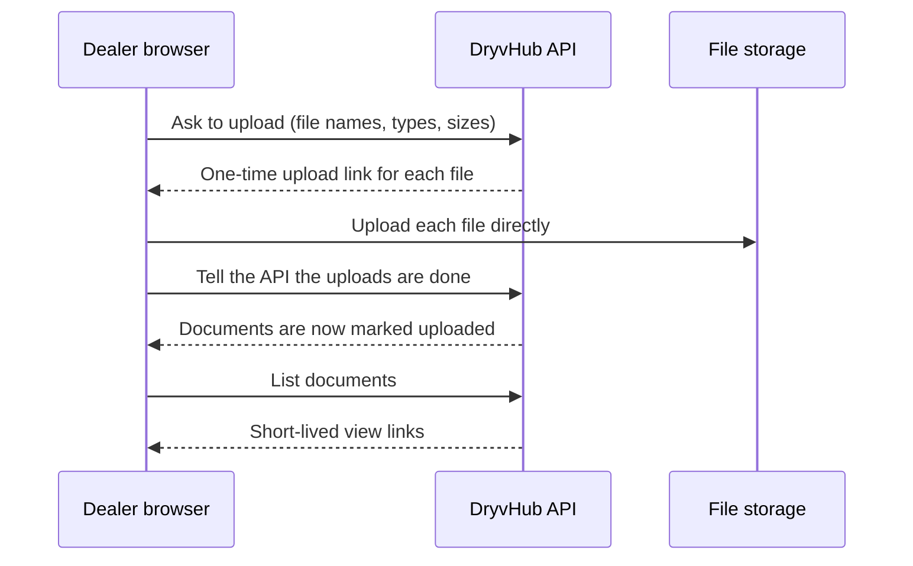

# Vehicle detail

This page explains the screen a dealer opens by selecting a vehicle: the spec sheet, how inline editing works, photos, the vehicle documents (such as OR and CR), profit, and what the page looks like once the car is sold.

:::tip[In plain English]
Think of it as the car's file folder. Everything about one car is on one page. It starts read-only. Press **Edit** and the same fields become editable in place, then save.
:::

## Layout

*Design mockup. The shipped screen follows this layout but may differ in small details.*

A header shows the vehicle name (year, make, model), a reference code ("Ref …"), the category and the plate. On the right are a **status badge** and an **Edit** button.

From top to bottom the page contains:

| Section | What it holds |
| --- | --- |
| **Photos** | The photo gallery. A counter shows how many of 8 are used. |
| **Vehicle info** | The spec sheet. |
| **Documents** | A preview of uploaded documents. In edit mode, the upload tool. |
| **Facebook caption** | A ready-to-copy ad text. |
| **Dealer tracking** | Private purchase details. |
| **Sale** | The sale record, or a note that the car is not sold yet. |
| **Expenses** | Costs spent on this car. |
| **Profit & loss** | The result. |

On wide screens the spec sheet sits beside the photos; on a phone everything stacks.

*Design mockup of the phone layout.*

## Spec sheet ("Vehicle info")

| Row | Notes |
| --- | --- |
| Status | Available, Sold, Coming or Reserved. |
| Year, Make, Model, Variant | The car's identity. |
| Selling price | The posted price buyers see. |
| Category, Mileage, Transmission, Fuel, Color, Plate | Basic specs. |
| Inventory age | Days on lot, see [Inventory](/docs/dealer/inventory). |
| Documents | A "Documents complete" switch showing **Complete** or **Incomplete**. It is a flag the dealer sets, and the system does not check the files. |
| Facebook | **Not posted**, **Posted**, or **Skipped** (the vehicle is set not to post to Facebook). Failed states show their name. |
| Description | Free text, used in the Facebook caption. |

## Inline editing

1. Press **Edit** in the header. Fields turn into inputs.
2. Change what you need. A bar appears at the bottom reading **Unsaved changes**.
3. Press **Save changes** to store everything at once, or discard.
4. If you try to leave with edits pending, a dialog asks "Discard unsaved changes?".

*Design mockup of edit mode in the dark theme.*

Photos, documents and expenses are handled by their own controls (upload, add expense). The **Save changes** button covers the spec sheet, tracking, and sale fields.

### Dealer tracking

Private fields that buyers never see:

| Field | Meaning |
| --- | --- |
| Purchase price | What the dealer paid. |
| Purchase date | When it was bought. Starts the age clock. |
| Supply agent | Who brought the car in. |
| Agent contact | Phone number of that person. |

## Photos

- Up to **8** photos per vehicle.
- JPEG, PNG or WebP. The default size limit is 10 MB per photo.
- The first photo is labeled **Cover** and is the picture used on cards and listings.
- Photos can be added or removed in edit mode. A failed upload shows a retry option.

## Vehicle documents

These are the files that prove the car is legitimate and ready to sell.

| Type | Meaning |
| --- | --- |
| **or** | Official Receipt |
| **cr** | Certificate of Registration |
| **insurance** | Insurance papers |
| **deed_of_sale** | Deed of sale |
| **id** | ID document |
| **showroom_photo** | Showroom photo |
| **business_registration** | Business registration |
| **other** | Anything else |

Rules:

- PDF, JPEG, PNG or WebP.
- Up to 15 MiB per file.
- The dealer screen uploads 1 to 8 files at a time (the API itself accepts up to 20).
- In normal view the **Documents** section is a read-only preview with a file count. Choose **Edit** to add more. With none uploaded it says "No documents uploaded. Choose Edit to add some."
- Documents have a server-side `isVerified` flag that starts as false. The dealer screen does not show it.

### How an upload works

Files go straight from the browser to storage, not through the API, so large files do not slow the app.

Document links expire quickly. If a preview stops opening, reload the page to get a fresh link. A vehicle id from another dealership returns "not found", because documents are scoped to the signed-in dealership.

## Facebook caption

A collapsible "Facebook caption" box builds an ad text from the vehicle's details. The dealer can edit the text, then use the copy button. A message confirms: "Caption copied. Paste it into Facebook." The text updates automatically if the vehicle's details change. This is for manual posting; automatic posting is described in [Facebook integration](/docs/dealer/facebook-integration).

## Profit and loss

| Row | Meaning |
| --- | --- |
| Sold price | The sale amount. For an unsold car this row is labeled **Selling price** and uses the posted price. |
| Purchase price | From dealer tracking. |
| Expenses | Total of this vehicle's expenses. |
| Net profit | Sold price minus purchase price minus expenses. For an unsold car it reads **Projected profit** with the note "Projected from list price". |

## The sold view

Once a sale is recorded the status badge reads **Sold** with a check mark and the **Sale** section shows the sold date, buyer, contact, sold price, deposit, payment method and more. See [Expenses and sales](/docs/dealer/expenses-and-sales).

*Design mockup of the sold state.*

## For developers

- Page: `app/(session)/dashboard/inventory/[vehicleId]/`; components in `components/vehicle/detail/`. Edit state lives in `use-vehicle-edit-session.ts`.
- Endpoints: `GET /api/v1/vehicles/:id`, `GET /api/v1/vehicle-document-types`, `POST /api/v1/vehicles/:id/documents`, `POST .../documents/complete`, `GET .../documents`, `DELETE .../documents/:documentId`. API reference: `docs/api/vehicle-documents.md` in the API repo.
- Limits: `lib/vehicle-images/constants.ts` (photos), `VEHICLE_DOCUMENT_MAX_BYTES` (documents).

## Related pages

- [Inventory](/docs/dealer/inventory)
- [Expenses and sales](/docs/dealer/expenses-and-sales)
- [Listings and publishing](/docs/dealer/listings-and-publishing)
- [Storage and settings](/docs/dealer/storage-and-settings)
