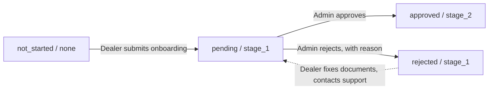

# Verification and access

This page explains how a dealership becomes a **verified dealer**, what each stage unlocks, why some buttons are locked, and which documents are reviewed.

:::tip[In plain English]
Buyers need to trust the dealers on the Marketplace. So DryvHub checks each dealership's business papers before letting it sell there. Everything for running the business is open immediately. The features that reach the public unlock step by step.
:::

## Two separate ideas

Access depends on **two** things, which are easy to confuse:

| Idea | What it answers | Set by |
| --- | --- | --- |
| **Verification** (status and stage) | "Has DryvHub checked this business?" | The dealer's submission, then a DryvHub admin. |
| **Plan and subscription** | "Is this dealership on a paid plan in good standing?" | [Billing](/docs/dealer/billing). |

Marketplace selling needs **both**.

## Status and stage

The dealership record carries a **status** and a **stage**.

| Status | Meaning |
| --- | --- |
| `not_started` | The onboarding application has not been submitted. |
| `pending` | Submitted; waiting for a DryvHub decision. |
| `approved` | A DryvHub admin approved it. |
| `rejected` | A DryvHub admin rejected it. |

| Stage | Meaning |
| --- | --- |
| `none` | Nothing submitted. |
| `stage_1` | Application submitted. |
| `stage_2` | Approved by DryvHub. |

How they move:

:::note
The sidebar badge reads **Stage 3 verified** for a stage_2 dealership and **Not yet Stage 3 verified** otherwise. The badge numbering is shifted by one from the internal stage names (the dealer-facing journey counts "Get started" as the first step). Internally the approved stage is `stage_2`.
:::

## The Verification page

**Menu:** Verification (`/dashboard/verification`). It shows three steps:

| Step | Label |
| --- | --- |
| Get started | **Submit your dealership** |
| Stage 1 | **Identity and document review** |
| Stage 2 | **Verified dealer** |

The page also shows one of these status views:

| View | When |
| --- | --- |
| **Onboarding incomplete** | Nothing submitted yet. |
| **Under review** | Submitted and pending. |
| **Needs attention** | Rejected. |
| **Awaiting Stage 2** | Stage 1 reached and not pending or rejected. |
| **Verified** | Approved. |

## What each stage unlocks

| Feature | Not submitted | Stage 1 (submitted) | Stage 2 (approved) |
| --- | --- | --- | --- |
| Inventory, expenses, sales, financials, reports | Yes | Yes | Yes |
| PlateCheck **lookup** | Yes | Yes | Yes |
| Dealer profile, storage, billing pages | Yes | Yes | Yes |
| **Facebook** connect and posting | Locked | **Yes** | Yes |
| PlateCheck **report** and **import** | Locked | **Yes** | Yes |
| **Marketplace** publishing, **Inquiries**, **Cashback** | Locked | Locked | **Yes, with a paid plan** |
| **Featured** listings | Locked | Locked | Pro or Enterprise only |

For Marketplace features the dealership must also be on **Starter, Growth, Pro or Enterprise** with a subscription that is **active or trialing**. See [Billing](/docs/dealer/billing).

### Locked-state messages

The dealer sees one of these, depending on what is missing:

| Message | Meaning |
| --- | --- |
| "Complete Stage 1 verification to unlock this feature." | Facebook or PlateCheck reporting needs a submitted application. |
| "Complete Business Verification to unlock Marketplace access." | Stage 1 reached; waiting for approval. |
| "Complete Stage 2 verification and upgrade to a paid plan to access the DryvHub Marketplace." | Neither requirement met. |
| "Your dealership is verified. Upgrade to Starter or higher to list vehicles on the DryvHub Marketplace." | Approved, but on the Free plan. |
| "Your subscription needs attention. Restore an active paid plan to list vehicles on the Marketplace." | Paid plan set, subscription not active. |
| "Featured marketplace listings are available on Pro and Enterprise plans." | Featured needs a higher plan. |

Banners that show these messages across the dashboard are described in [Dashboard home](/docs/dealer/dashboard-home).

### How the lock is applied

- **Inquiries** and **Cashback** replace the whole page with a "locked" panel when not eligible.
- **Listings** stay open, but the publish and sync **actions** are disabled with the reason on hover.
- The **API enforces the same rules** and answers with a clear message if the app is bypassed. Examples: "Dealer verification approval is required", "Stage 2 verification is required", "A paid subscription plan is required", "Marketplace access requires an active paid subscription", "Facebook connection requires Stage 1 verification", "PlateCheck flag submission requires Stage 1 verification", "Featured listings require a Pro or Enterprise plan".

:::note
One small difference: the API also accepts a subscription in the `past_due` state for Marketplace access, while the dealer screens count only active or trialing as good. The buyer-facing Marketplace follows the API (trialing, active or past due).
:::

## Documents DryvHub reviews

These are collected during [onboarding](/docs/dealer/getting-started) and kept as **tenant documents**:

| Document | Purpose |
| --- | --- |
| **DTI** registration | Business name registration. |
| **BIR Form 2303** | Tax registration. |
| **Certificate of Registration** | SEC or equivalent business registration. |
| **Latest Business Permit** | Mayor's permit. |
| **Showroom photo with selfie** | Shows a real physical location. At least one is needed. |

PDF documents can be up to 10 MB, images up to 5 MB. Dealers can replace a document from the checklist. The app deletes the old file first, after confirmation, then uploads the new one; there is no one-step swap on the server.

Documents are scoped to the dealership and are viewable through short-lived links, never public.

## What a DryvHub admin does

In the [admin portal](/docs/dealer/admin-portal), staff open the dealership, read its details and documents, then **Approve** or **Reject**. A rejection **requires a reason**. The dealership is emailed the result. Approving sets stage_2 and status approved; rejecting sets status rejected and leaves the stage at stage_1.

## Wording that does not match the screens

Some Verification-page and badge text still says "identity documents" or "government IDs". The code treats only the five items above as **required**. The system knows two further document types (Barangay Clearance and Valid Government ID), but the onboarding wizard does not ask for them. If a dealer asks whether an ID is needed, the answer from the code is no, unless DryvHub staff request one separately. Confirm the policy with the product team.

## For developers

- Capability logic: `lib/access/dealer-capabilities.ts` (UI) and `src/core/policies/dealer-access.policy.ts` (API). Keep them in sync.
- Verification copy and steps: `lib/onboarding/verification-process.ts`; page `app/(session)/dashboard/verification/`.
- Plans: `docs/plans/dealer-access-gating.md`, `dealer-verification-page.md`.
- Background: [Auth and tenancy](/docs/developers/auth-and-tenancy).

## Related pages

- [Getting started](/docs/dealer/getting-started)
- [Billing](/docs/dealer/billing)
- [Admin portal](/docs/dealer/admin-portal)
- [Marketplace eligibility](/docs/marketplace/eligibility)
