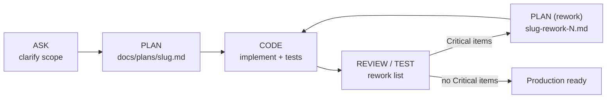

# Adding a feature

**What this page covers:** the team's development cycle (Plan, Code, Review/Test, then rework if needed), the written artifacts each phase must produce, and a worked checklist that takes a new endpoint from the API all the way to a screen in the dealer app.

:::tip[In plain English]
Before writing code we write a short **plan** with clear pass/fail checks ("acceptance criteria"). Then we build exactly that, then someone reviews it against the plan. If the review finds blocking problems we write a small rework plan and repeat. Writing things down keeps humans and AI assistants aligned and stops scope from quietly growing.
:::

## The cycle

| Phase | Mode | What you do | Artifact |
| ----- | ---- | ----------- | -------- |
| Ask | Ask | Clarify scope, constraints, and success criteria until they are unambiguous | Notes or a ticket |
| Plan | Plan | Write the contract: scope, acceptance criteria, approach, task list, risks | `docs/plans/<feature-name>.md` |
| Code | Agent | Implement only what the plan defines, plus tests | Code, tests, implementation notes |
| Review/Test | Read-only review | Validate against acceptance criteria and rules | Review summary, test status, rework list |
| Rework | Plan (brief) | Turn Critical findings into new acceptance criteria | `docs/plans/<feature>-rework-N.md` |

Do not skip phases for medium or high-risk changes. A change to scope means a new plan cycle, not a quiet edit mid-implementation.

## Artifacts

### Plan document

One file per feature at `docs/plans/<feature-name>.md` with these sections:

1. **Scope**: what is in and out, dependencies, boundaries (for UI work: what belongs to `dryvhub-api`).
2. **Acceptance criteria**: a numbered, testable checklist (`AC-1`, `AC-2`, ...).
3. **Technical approach**: components, interfaces, data shapes, and which rules apply.
4. **Task list**: ordered implementation tasks (backend, frontend, and E2E blocks as needed).
5. **Risks and mitigations**.

A plan is complete when another person (or agent) can implement it without guessing.

### Code handoff (implementation notes)

- **Done:** what was implemented and which AC it maps to.
- **Deferred:** what was postponed and why.
- **Assumptions:** environment, dependencies, behavior.
- **Env/config:** new variables or setup steps.
- Plus: changed files, AC traceability, and test evidence (commands and pass or fail).

### Review/Test report

Severity model (exactly these three):

- **Critical:** must fix before production.
- **Suggestion:** should fix soon.
- **Nice to have:** optional.

Each finding has a **location** (file and function or class), a **failure or risk statement**, and a **required correction**.

### Definition of done

All true: the plan exists and is unambiguous; every AC is implemented and covered by tests; review reports zero Critical findings; architecture and security rules pass; migration and Prisma regeneration steps are done or explicitly documented.

## Worked example: add "vehicle test-drive notes"

Suppose dealers want to save a short note per vehicle after a test drive and see it on the vehicle page. Illustrative only; adapt names to your feature.

### 0. Plan

Write `dryvhub-api/docs/plans/vehicle-test-drive-notes.md` and a matching dealer plan, with ACs such as:

- AC-1: `POST /api/v1/vehicles/:id/test-drive-notes` creates a note for a vehicle in the caller's tenant.
- AC-2: `GET` returns the notes newest first.
- AC-3: Another tenant's vehicle id returns 404.
- AC-4: Unauthenticated calls return 401; invalid bodies return 400.
- AC-5: The vehicle detail page lists notes and lets staff add one.

### 1. API checklist (`dryvhub-api`)

Order matters: inner layers first.

1. **Schema (if new data):** edit `prisma/schema.prisma` (add `tenantId`, `vehicleId`, UTC `timestamptz` columns, indexes starting with `tenantId`). Then run `npx prisma migrate dev --name add_test_drive_notes` and `npx prisma generate`. Never hand-write migration SQL or touch `src/generated/prisma`.
2. **Entity:** add a plain interface in `src/core/entities/` (no Prisma types, no decorators; string unions instead of enums).
3. **Port:** add `TestDriveNoteDataService` with an injection token in `src/core/interfaces/`.
4. **Data service:** implement it in `src/services/data-services/`. Read the tenant from `ContextStorageService` and filter every query by `tenantId`, including the vehicle ownership check.
5. **Use-cases:** `create-test-drive-note.use-case.ts` and `list-test-drive-notes.use-case.ts` in `src/use-cases/`. Verify the vehicle belongs to the tenant (throw `NotFoundException` otherwise), validate rules, and return entities. No Prisma, no HTTP types.
6. **DTOs:** `src/controllers/<domain>/dtos/` with `class-validator` rules and Swagger `@ApiProperty`; add a response DTO with `fromEntity`.
7. **Controller route:** add routes to the controller (`ParseUUIDPipe` on `:id`, `@ApiBearerAuth`, `@ApiOperation`, `@ApiResponse`). Keep it thin: parse, call one use-case, map. Authenticated by default; do not add `@Public()`.
8. **Wire up:** register the use-cases and bind the port token to the data service in `src/app.module.ts`.
9. **Tests (Jest):**
   - Use-case specs with a mocked port: success, vehicle not found, validation rule failures.
   - Controller spec: 201 and 200 shapes, 400 validation, 401 unauthenticated, 404 for another tenant's vehicle.
   - Tenant scoping: assert the data service receives the context tenant and never an id from input.
10. **Verify:** `npx jest` and `npx tsc --noEmit`.
11. **Docs:** if you add a new endpoint family, document it under `docs/api/` and update the endpoint list in `AGENTS.md`. Record a new ADR in `docs/adr/` if you made a structural decision.

### 2. Frontend checklist (`dryvhub-dealer`)

Outer layers last; the order mirrors the data flow.

1. **Types:** add response and payload interfaces to `types/api/`.
2. **Service:** add functions to the relevant `services/*.service.ts` using `apiGet` and `apiPost` with the access token. Parse responses with zod where the shape matters. Keep it free of React.
3. **Hook:** add `hooks/vehicle/useTestDriveNotes.ts` (TanStack Query): `enabled: Boolean(accessToken)`, a stable query key, and a mutation that invalidates only that key.
4. **Pure helpers:** formatting or sorting goes in `lib/` with no `fetch` and no endpoint paths.
5. **UI:** build a client component under `components/vehicle/` with shadcn primitives, labeled inputs, loading, empty, and error states. Add it to the existing vehicle detail island. If you add a route, make `page.tsx` a Server Component that imports a client island and add `loading.tsx` if needed.
6. **Tests:**
   - Vitest for the service (stubbed `fetch`: path, method, headers, error mapping) and any pure helper.
   - Playwright only if the AC needs a browser journey: add a page object under `e2e/pages/`, a spec under `e2e/flows/`, and mock the new endpoint in `e2e/helpers/mock-api.ts`.
7. **Verify:** `npm run lint`, `npm test`, `npx tsc --noEmit`, and `npm run test:e2e` when flows changed. Run `npx next build` if you touched layouts or providers.
8. **Check the performance rules:** no `fetchAll`, no static Recharts import, no new providers on the root layout (see [Dealer app internals](/docs/developers/dealer-app-internals)).

If the feature also appears on the public marketplace, the data must come from a **public DTO** added in the API first; the marketplace then gets its own service, zod schema, and hook (see [Marketplace internals](/docs/developers/marketplace-internals)).

### 3. Review

Run the review against the plan's ACs. Typical checks: layer boundaries, tenant scoping, auth decorators, validation, no secrets in logs, tests for negative paths, and no scope creep. Output a rework list in the Critical, Suggestion, Nice to have model.

### 4. Pull request

Branch from `staging`, open a PR into `staging`, and reference the plan and ACs ("implements AC-1 to AC-5"). See [Git workflow](/docs/developers/git-workflow).

## Quick checklist

- [ ] Plan with numbered, testable ACs exists
- [ ] Layer boundaries respected; business rules live in use-cases
- [ ] Tenant derived from the authenticated user; every query tenant-scoped
- [ ] Input validated at the boundary; errors mapped to correct status codes
- [ ] Schema changes done via the Prisma CLI, `npx prisma generate` run
- [ ] Unit tests plus negative-path tests; cross-tenant case covered
- [ ] Docs and endpoint lists updated if routes changed
- [ ] Review report has zero Critical findings

## Related pages

- [AI workflow](/docs/developers/ai-workflow)
- [Conventions](/docs/developers/conventions)
- [Testing](/docs/developers/testing)
- [Git workflow](/docs/developers/git-workflow)
- [API integration](/docs/developers/api-integration)
