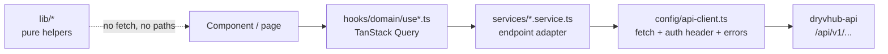

# API integration

**What this page covers:** how the dealer app and marketplace talk to `dryvhub-api`, the error formats you will see, which endpoints are public, a catalog of every route the API exposes today, and summaries of the two long-form API docs.

:::tip[In plain English]
Frontends never write SQL or call Supabase for business data. They call REST endpoints under `/api/v1/...` through one small wrapper (`api-client`). A "service" function knows the URL, a "hook" wraps it with caching, and the screen just uses the hook. The API's live, always-current reference is **Swagger** at `/swagger` when the API is running; this page is a human-friendly map.
:::

## Frontend layering



| Layer | Dealer app | Marketplace |
| ----- | ---------- | ----------- |
| HTTP driver | `config/api-client.ts`: `apiGet`, `apiPost`, `apiPostForm`, `apiPatch`, `apiDelete`, `apiDownload`, plus `apiGetPublic` for unauthenticated reads | `config/api-client.ts`: `apiGet`, `apiPost`, `apiPatch` (never sends credentials) |
| Auth | Every call takes the Supabase `accessToken` and sends `Authorization: Bearer <token>`; requests use `cache: "no-store"` | None |
| Base URL | `NEXT_PUBLIC_API_URL` (throws if missing). A trailing `/api/v1` on the base is de-duplicated | Browser: same-origin `/api/*` (rewritten to the API in `next.config.ts`). Server: `API_URL` or `NEXT_PUBLIC_API_URL` |
| Adapters | `services/*.service.ts` (auth, tenant, vehicle, financials, reports, listing, inquiries, cashback, admin, plate check, ...) | `services/marketplace-listings.service.ts`, `marketplace-inquiries.service.ts`, `cashback-claims.service.ts` |
| Validation | zod parsers for important payloads; response types in `types/api/` | zod parse at the service boundary, public DTO types in `types/api/` |
| Orchestration | `hooks/<domain>/use*.ts` with TanStack Query | `hooks/marketplace/` |

Rules both repos follow:

- `lib/` must not import `fetch` or hard-code endpoint paths.
- React Query lives in hooks, never in services.
- Components never call `fetch` directly.
- Short revalidation is allowed only for the public tenant-by-subdomain lookup in the dealer app. Bearer calls stay uncached.

## Error shapes

### The convention

The API rules say errors should look like this:

```json
{
  "error": {
    "code": "SOME_CODE",
    "message": "Human readable text",
    "details": []
  }
}
```

### What actually comes back

Three shapes coexist today, and both frontends tolerate all of them:

| Shape | Where it comes from |
| ----- | ------------------- |
| `{ statusCode, message, error: "Bad Request" }` (message may be a string or an array of strings) | Nest defaults: `ValidationPipe` failures and plain `HttpException`s |
| `{ statusCode, error, code, message }` | Handlers that add a machine `code` (for example the platform-admin guard returns `PLATFORM_ADMIN_REQUIRED`; plate-check returns `VALIDATION_ERROR`, `DUPLICATE_FLAG`, `RATE_LIMITED`) |
| `{ error: { code, message, details? } }` | The documented convention |

The dealer `toApiHttpError` reads `message` and `code` from the top level first, then from a nested `error` object, then falls back to a string `error`. It throws `ApiHttpError` carrying `status`, `message`, optional `code`, and the raw body in `details`. Use `isAppError(err)` to branch on `err.status` or `err.code`. The marketplace `ApiHttpError` carries `status`, `statusText`, `path`, `method`, and optional `code`.

New endpoints should return the documented convention. Never expose stack traces or internal paths.

## Public vs authenticated

| Kind | How it is marked | Examples |
| ---- | ---------------- | -------- |
| Authenticated tenant route (default) | Nothing; the global guard and interceptor apply | `GET /vehicles`, `GET /tenants/current` |
| Authenticated, no tenant required | `@SkipTenantContext()` | `POST /auth/register`, all `/admin/*` |
| Platform-admin only | `@PlatformAdmin()` plus `@SkipTenantContext()` | `/admin/cashback/claims`, `/admin/platform-settings`, `/admin/tenant-verifications` |
| Public | `@Public()` | Marketplace listings and inquiries, public dealer profile, tenant-by-subdomain lookup, cashback claim creation |

Public endpoints must never return private tenant data (plate numbers, purchase prices, notes, expenses, internal documents, buyer data). Public marketplace responses are separate DTOs.

## Endpoint catalog

Prefix every path with `/api/v1`. "Tenant" means a bearer token plus an active tenant membership. "Admin" means a bearer token plus an active platform-admin record. This table reflects the controllers under `dryvhub-api/src/controllers` on the `staging` branch; Swagger is authoritative for request and response bodies.

### Auth, tenant, onboarding, verification

| Method | Path | Auth | Purpose |
| ------ | ---- | ---- | ------- |
| POST | `/auth/register` | Bearer (no tenant) | Create tenant plus owner for a verified Supabase user |
| GET | `/tenants/current` | Tenant | Current tenant (including `subdomain`) |
| GET | `/tenants/current/profile` | Tenant | Dealer public-profile settings |
| PATCH | `/tenants/current/profile` | Tenant | Update profile |
| POST | `/tenants/current/profile/media` | Tenant | Presign logo or cover upload |
| POST | `/tenants/current/profile/media/complete` | Tenant | Confirm profile media upload |
| GET | `/tenants/by-subdomain/:subdomain` | Public | Does this tenant exist (host lookup from `proxy.ts`) |
| GET | `/tenants/by-subdomain/:subdomain/profile` | Public | Public dealer profile by subdomain |
| GET | `/dealers/:domain` | Public | Public dealer profile by domain |
| GET | `/tenant-users/current` | Tenant | Current user and role |
| PATCH | `/tenant-users/current` | Tenant | Update current user |
| GET | `/tenants/current/onboarding` | Tenant | Onboarding state |
| PATCH | `/tenants/current/onboarding` | Tenant | Save onboarding progress |
| GET | `/tenants/current/onboarding/checklist` | Tenant | Onboarding checklist |
| POST | `/tenants/current/documents` | Tenant | Register tenant (business) document upload |
| POST | `/tenants/current/documents/complete` | Tenant | Complete tenant document upload |
| POST | `/tenants/current/documents/confirm` | Tenant | Confirm tenant document |
| GET | `/tenants/current/documents` | Tenant | List tenant documents |
| DELETE | `/tenants/current/documents/:documentId` | Tenant | Delete tenant document |
| GET | `/admin/tenant-verifications` | Admin | List verification queue |
| GET | `/admin/tenant-verifications/:tenantId` | Admin | Verification detail |
| PATCH | `/admin/tenant-verifications/:tenantId` | Admin | Approve, reject, or update verification |

### Facebook connection

| Method | Path | Auth | Purpose |
| ------ | ---- | ---- | ------- |
| GET | `/tenants/current/facebook/connect/start` | Tenant | Start Page OAuth (returns authorization URL) |
| POST | `/tenants/current/facebook/connect/callback` | Tenant | Exchange the OAuth code |
| POST | `/tenants/current/facebook/connect/select` | Tenant | Choose the Page to connect |
| GET | `/tenants/current/facebook/connection` | Tenant | Connection status |
| DELETE | `/tenants/current/facebook/connection` | Tenant | Disconnect |
| PATCH | `/tenants/current/facebook/settings` | Tenant | Update Facebook posting settings |

### Vehicles

| Method | Path | Auth | Purpose |
| ------ | ---- | ---- | ------- |
| POST | `/vehicles` | Tenant | Create vehicle |
| GET | `/vehicles` | Tenant | List (paginated) |
| GET | `/vehicles/archived` | Tenant | List archived |
| GET | `/vehicles/:id` | Tenant | Vehicle detail |
| PATCH | `/vehicles/:id` | Tenant | Update |
| DELETE | `/vehicles/:id` | Tenant | Archive or delete |
| POST | `/vehicles/:id/listing/publish` | Tenant | Publish listing |
| POST | `/vehicles/:id/listing/unpublish` | Tenant | Unpublish |
| POST | `/vehicles/:id/listing/sync/marketplace` | Tenant | Sync to marketplace |
| POST | `/vehicles/:id/listing/sync/facebook` | Tenant | Post to Facebook |
| POST | `/vehicles/:id/listing/facebook/bump` | Tenant | Re-post (bump) on Facebook |
| GET | `/vehicles/:id/images` | Tenant | List images with presigned view URLs |
| POST | `/vehicles/:id/images` | Tenant | Register image uploads (presigned PUT) |
| POST | `/vehicles/:id/images/complete` | Tenant | Complete image uploads |
| POST | `/vehicles/:id/images/confirm` | Tenant | Confirm image uploads |
| DELETE | `/vehicles/:id/images/:imageId` | Tenant | Delete image |
| GET | `/vehicle-document-types` | Tenant | Master list of document types |
| POST | `/vehicles/:id/documents` | Tenant | Register document uploads |
| POST | `/vehicles/:id/documents/complete` | Tenant | Complete document uploads |
| GET | `/vehicles/:id/documents` | Tenant | List documents |
| DELETE | `/vehicles/:id/documents/:documentId` | Tenant | Delete document |
| POST | `/vehicles/:id/sale` | Tenant | Record a sale |
| POST | `/vehicles/:id/expenses` | Tenant | Add expense |
| GET | `/vehicles/:id/expenses` | Tenant | List expenses |
| GET | `/vehicles/:id/expenses/summary` | Tenant | Expense totals |
| PATCH | `/vehicles/:id/expenses/:expenseId` | Tenant | Update expense |
| DELETE | `/vehicles/:id/expenses/:expenseId` | Tenant | Delete expense |

### Financials and reports

| Method | Path | Auth | Purpose |
| ------ | ---- | ---- | ------- |
| GET | `/financials/summary` | Tenant | Financial summary |
| GET | `/financials/sales-summary` | Tenant | Sales summary |
| GET | `/financials/expenses` | Tenant | Expense list |
| GET | `/financials/expenses/export` | Tenant | Expense export |
| POST | `/financials/payments` | Tenant | Record payment |
| GET | `/financials/payments` | Tenant | List payments |
| GET | `/financials/payments/summary` | Tenant | Payment summary |
| GET | `/financials/payments/export` | Tenant | Payment export |
| POST, GET | `/financials/monthly-overhead` | Tenant | Create, list monthly overhead |
| GET, PATCH, DELETE | `/financials/monthly-overhead/:id` | Tenant | Read, update, delete one overhead entry |
| POST | `/financials/legacy/import` | Tenant | Import legacy financial data |
| DELETE | `/financials/legacy` | Tenant | Remove imported legacy data |
| GET | `/reports/sales`, `/reports/profit`, `/reports/inventory`, `/reports/expenses` | Tenant | Report data |
| GET | `/reports/sales/export`, `/reports/profit/export`, `/reports/inventory/export`, `/reports/expenses/export` | Tenant | Report exports |

### Plate check

| Method | Path | Auth | Purpose |
| ------ | ---- | ---- | ------- |
| GET | `/plates/search` | Tenant | Search flagged plates (`q`, at least 3 characters) |
| POST | `/plates/report` | Tenant | Report a plate (multipart, optional image) |
| POST | `/plates/import` | Tenant | Bulk import CSV or XLSX |

### Marketplace, inquiries, cashback

| Method | Path | Auth | Purpose |
| ------ | ---- | ---- | ------- |
| GET | `/marketplace/listings` | Public | List or search eligible listings |
| GET | `/marketplace/listings/:vehicleId` | Public | Listing detail |
| POST | `/marketplace/listings/:vehicleId/inquiries` | Public | Create inquiry; returns the Messenger redirect (rate-limited) |
| GET | `/inquiries` | Tenant | Dealer's inquiries |
| POST | `/cashback/claims` | Public | Buyer submits a cashback claim (rate-limited) |
| PATCH | `/cashback/claims/:id/evidence` | Public | Buyer attaches evidence |
| GET | `/cashback/claims` | Tenant | Dealer's claims |
| GET | `/cashback/claims/:id` | Tenant | Claim detail |
| POST | `/cashback/claims/:id/confirm` | Tenant | Dealer confirms the sale |
| POST | `/cashback/claims/:id/dispute` | Tenant | Dealer disputes |
| POST | `/cashback/claims/:id/documents` | Tenant | Register dealer evidence upload |
| POST | `/cashback/claims/:id/documents/complete` | Tenant | Complete dealer evidence upload |
| GET | `/admin/cashback/claims` | Admin | List all claims |
| GET | `/admin/cashback/claims/:id` | Admin | Claim detail |
| PATCH | `/admin/cashback/claims/:id` | Admin | Review or decide a claim |
| POST | `/admin/cashback/claims/:id/payout` | Admin | Record payout |
| GET, PATCH | `/admin/platform-settings` | Admin | Read or update platform settings (such as the cashback rate) |

### Notifications

| Method | Path | Auth | Purpose |
| ------ | ---- | ---- | ------- |
| GET (SSE) | `/notifications/stream` | Marked `@Public()` in code | Server-sent events stream. It is marked public, yet it reads the tenant from request context; confirm tenant behavior with the API team before relying on it |

### Not matched in the API on `staging`

The dealer's admin service calls `GET /admin/me`, `GET /admin/tenants`, `GET` and `POST /admin/tenant-follow-ups/...`, and `/admin/vehicles` routes. No controller defines these on the `staging` branch of `dryvhub-api` that was checked, so they are probably on an unmerged branch. Check before depending on them. See [Dealer admin portal](/docs/dealer/admin-portal) for the product description.

## Vehicle documents API (summary)

Full doc: `dryvhub-api/docs/api/vehicle-documents.md`.

Purpose: attach typed files (Official Receipt, Certificate of Registration, insurance, deed of sale, and so on) to a vehicle using **private S3 direct uploads**. The API only stores metadata and hands out short-lived presigned URLs (ADR-0010).

Flow:

```text
1. GET  /api/v1/vehicle-document-types
2. POST /api/v1/vehicles/:vehicleId/documents          (metadata, returns presigned PUT URLs)
3. Browser PUTs each file to S3 with exactly the returned uploadHeaders
4. POST /api/v1/vehicles/:vehicleId/documents/complete (API verifies the object, status becomes uploaded)
5. GET  /api/v1/vehicles/:vehicleId/documents          (metadata plus short-lived viewUrl)
```

Key facts:

| Topic | Detail |
| ----- | ------ |
| Auth | Bearer token; tenant resolved from the user. Another tenant's vehicle or document id returns `404` |
| Statuses | `pending`, then `uploaded` (or `deleted`) |
| Limits | 1 to 20 documents per request; MIME types PDF, JPEG, PNG, WebP; size up to `VEHICLE_DOCUMENT_MAX_BYTES` (default 15 MiB) |
| Object key | `tenants/<tenantId>/vehicles/<vehicleId>/documents/<documentId>/original.<ext>` |
| Viewing | `public_url` is **not** stored; use the presigned `viewUrl` from list responses |
| Delete | Soft-deletes the row and removes the S3 object; returns `204` |
| Verification | `isVerified` starts `false`; verification workflow is out of scope today |
| Errors | `400` validation, unknown type, or file mismatch; `401` bad token; `404` not visible to tenant |

## Plate check API (summary)

Full doc: `dryvhub-api/docs/api/plate-check.md`.

Purpose: let any authenticated dealer search, report, and bulk-import **flagged plate numbers** in a shared MongoDB registry visible to all dealers (ADR-0012).

| Endpoint | Behavior |
| -------- | -------- |
| `GET /plates/search?q=` | `q` needs at least 3 characters. Matching ignores spaces and hyphens (`ABC-1234`, `ABC 1234`, `ABC1234` are the same). Returns `status` of `flagged` (with grouped `flags`) or `clear`. Each flag shows `isOwnReport` |
| `POST /plates/report` | Multipart form. Fields: `plateNumber`, `category` (`alarm_legal_issues`, `fake_documents_encumbered`, `flood_accident_damage`, `other`), optional `carModel`, `notes`, image (JPEG, PNG, or WebP, up to 5 MB); `otherCustom` required when category is `other`. Returns `201` with the flag. Errors: `400 VALIDATION_ERROR`, `409 DUPLICATE_FLAG`, `429 RATE_LIMITED` (more than 5 reports per 60 seconds per user) |
| `POST /plates/import` | Multipart `.csv` or `.xlsx`, up to 5 MB and 1000 rows. Accepts several header spellings and either API category codes or spreadsheet labels. Returns `{ inserted, skippedDuplicates, invalidRows }`. Not rate-limited |
| Availability | `503` if MongoDB is unavailable |

## Related pages

- [Auth and tenancy](/docs/developers/auth-and-tenancy)
- [Dealer app internals](/docs/developers/dealer-app-internals)
- [Marketplace internals](/docs/developers/marketplace-internals)
- [Adding a feature](/docs/developers/adding-a-feature)
- [Data model](/docs/developers/data-model)
