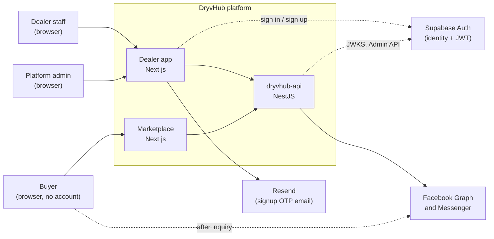
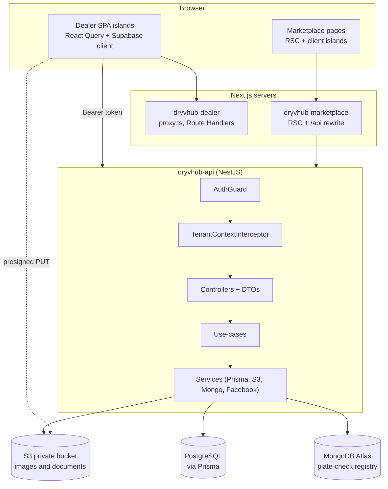
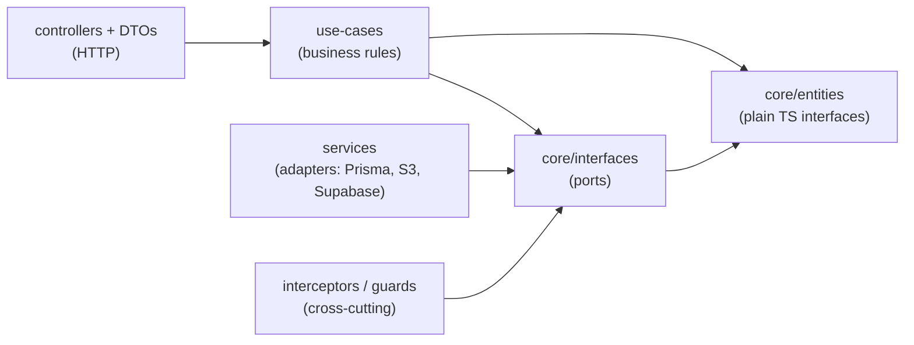
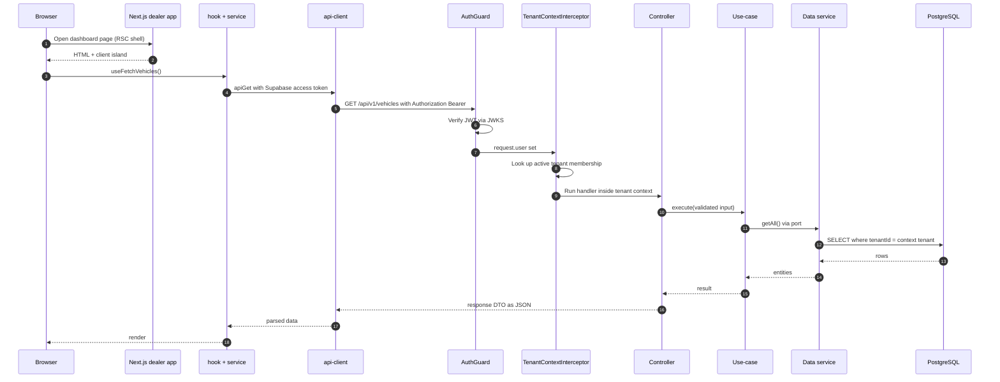

# Architecture

**What this page covers:** how the three DryvHub codebases fit together, how a single request travels from a browser to PostgreSQL, and the layering rules each repo enforces. Read this first; every other developer page builds on it.

:::tip[In plain English]
DryvHub is one **API** (the brain and the only thing that touches the database) plus two **websites** that talk to it: the **dealer app** (for dealerships, login required) and the **marketplace** (for buyers, no login). The websites never talk to the database. Every dealership is a separate **tenant**, and the API makes sure a dealer only ever sees its own data.
:::

If you need product-level context first, see [Welcome](/docs/start/welcome), [How it fits together](/docs/start/how-it-fits-together), and the [Glossary](/docs/start/glossary).

## The three repos

| Repo | What it is | Stack | Default dev port |
| ---- | ---------- | ----- | ---------------- |
| `dryvhub-api` | The only backend. Business rules, persistence, auth verification. | NestJS 11, TypeScript, Prisma 7, PostgreSQL, Supabase Auth (tokens only) | `3001` (`PORT`) |
| `dryvhub-dealer` | Dealer portal: inventory, listings, financials, reports, onboarding, platform-admin screens. | Next.js 16, React 19, Tailwind 4, shadcn/ui, TanStack Query, Supabase JS | `3000` |
| `dryvhub-marketplace` | Public buyer site: browse listings, inquire, claim cashback. | Next.js 16, React 19, Tailwind 4, TanStack Query, zod | `3002` |

Package manager everywhere: **npm** (not yarn, pnpm, or bun).

## System context

Who and what talks to the platform.



Platform admins use the same dealer app, on an `admin.` host (see [Auth and tenancy](/docs/developers/auth-and-tenancy) and [Dealer admin portal](/docs/dealer/admin-portal)).

## Container view

What runs where, and what owns data.



Key facts:

- **PostgreSQL** (via Prisma) is the system of record for tenants, users, vehicles, finance, cashback, and more. See [Data model](/docs/developers/data-model).
- **MongoDB** only holds the shared **plate-check** registry (ADR-0012). See [Decisions](/docs/developers/decisions).
- **S3** is a **private** bucket. Browsers upload directly using short-lived presigned URLs issued by the API; the API stores metadata only (ADR-0010).
- **Supabase** provides identity and JWTs only. The API verifies tokens locally through JWKS (ADR-0002, ADR-0004).
- The marketplace browser calls the API through a same-origin `/api/*` rewrite (`next.config.ts`), so CORS is not needed for buyer traffic. Server-side rendering calls the API directly.

## Clean architecture, per repo

**Clean architecture** means code is arranged in rings where inner rings (business rules) never import outer rings (frameworks, databases, UI). Dependencies point inward only. That is what lets us test business rules without a database and swap infrastructure without rewriting rules.

### `dryvhub-api` layers



| Layer | Path | May import | Must not import |
| ----- | ---- | ---------- | --------------- |
| Entities | `src/core/entities/` | nothing | any other layer, Prisma types |
| Interfaces (ports) | `src/core/interfaces/` | `core/entities` | use-cases, controllers, services |
| Use-cases | `src/use-cases/` | `core/*` only | controllers, services, interceptors, Prisma client |
| Controllers | `src/controllers/` | use-cases, `core/entities`, local DTOs | infrastructure services |
| Services | `src/services/` | `core/*` plus Prisma, Supabase SDK, AWS SDK, etc. | controllers, use-cases |
| Interceptors | `src/interceptors/` | `core/interfaces` | controllers, use-cases |

`src/app.module.ts` is the composition root and is the one place allowed to import everything. Source of truth: `AGENTS.md` section 4 in `dryvhub-api`, and ADR-0001.

### `dryvhub-dealer` layers

```text
app/ + components/        UI (pages are Server Components that mount client islands)
  -> hooks/               TanStack Query orchestration
    -> services/          endpoint adapters (/api/v1/...)
      -> config/api-client.ts   fetch + Bearer token + error mapping
        -> dryvhub-api
lib/                      pure helpers (no fetch, no endpoint paths)
types/api/                API response interfaces
```

Rule of thumb: transport code lives in `config/` and `services/`; React Query lives in `hooks/`; `lib/` stays pure.

### `dryvhub-marketplace` layers

| Layer | Folders | Responsibility |
| ----- | ------- | -------------- |
| Presentation | `app/`, `components/marketplace/` | Routes and UI; no `fetch`, no API paths |
| Application | `hooks/marketplace/`, RSC page loaders | Orchestrate use cases (list, filter, inquire, claim) |
| Infrastructure | `services/`, `config/api-client.ts` | Call public API endpoints; parse with zod |
| Domain | `types/api/`, `lib/marketplace/` | Public DTO types and pure helpers; never import outward |

## Request lifecycle

An authenticated dealer action, end to end (for example, "load my vehicles").



Nest executes, in order: guards, interceptors, pipes (global `ValidationPipe` with `whitelist: true`), then the controller handler. The tenant id is read from request-scoped `AsyncLocalStorage` by data services; it is never accepted from the client.

For the marketplace, steps are the same minus authentication: public endpoints are marked `@Public()`, so `AuthGuard` and `TenantContextInterceptor` pass through.

## Boundaries each repo must honor

| Repo | Owns | Must never |
| ---- | ---- | ---------- |
| `dryvhub-api` | Business rules, eligibility, cashback, Prisma, tenant scoping, DTOs | Import Prisma in use-cases or entities; read tenant identity from headers, hostname, query, or body on authenticated routes; hand-edit `src/generated/prisma/**` or write migration SQL by hand |
| `dryvhub-dealer` | Dealer UI, API clients, Supabase browser auth, thin Route Handlers (OTP, upload proxy), `proxy.ts` host rewrite | Contain domain CRUD in Route Handlers; put `fetch` or endpoint paths in `lib/`; put server secrets in `NEXT_PUBLIC_*`; mount Auth/Query providers on the root layout; treat the hostname as authorization |
| `dryvhub-marketplace` | Buyer UI, public listing and inquiry clients | Add buyer auth or Supabase; compute eligibility or cashback; request or render private fields (plate number, purchase price, dealer notes, expenses, internal documents); copy dealer-portal types |

Cross-cutting rule for all three: **tenant identity comes from the authenticated user's membership, not from where the request came from.** Details in [Auth and tenancy](/docs/developers/auth-and-tenancy).

## Related pages

- [Repo map](/docs/developers/repo-map): folder-by-folder guide.
- [Auth and tenancy](/docs/developers/auth-and-tenancy): login, tokens, subdomains, guards.
- [API integration](/docs/developers/api-integration): how frontends call the API, endpoint catalog.
- [Decisions](/docs/developers/decisions): the ADRs behind these choices.
- [Conventions](/docs/developers/conventions): condensed coding rules.
- [Dealer app overview](/docs/dealer/overview) and [Marketplace overview](/docs/marketplace/overview): product view.
