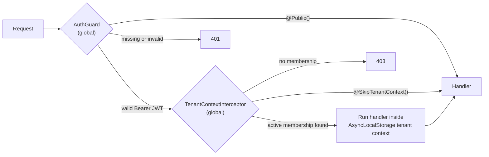
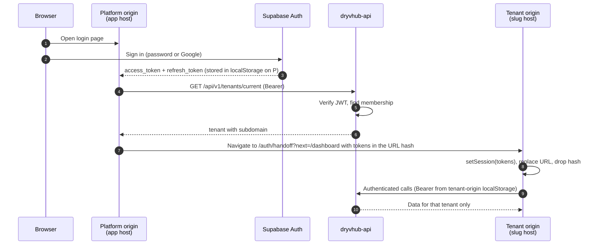

# Auth and tenancy

**What this page covers:** how a dealer proves who they are, how the API decides which dealership's data they may touch, how tenant subdomains and the cross-origin hand-off work, which guards protect which routes, and the roles that exist.

:::tip[In plain English]
- **Authentication** = "who are you?" Supabase answers that and gives the browser a **JWT** (a signed token, like a tamper-proof wristband).
- **Multi-tenancy** = many dealerships share one database, but each is a **tenant** that must see only its own rows.
- **Authorization** = "what may you touch?" The API answers that by looking up *your membership* in the database. The web address (`acme.dryvhub.com`) is just for show; it never grants access.
:::

## Core principles

1. **Supabase proves identity; the API decides access.** Supabase issues the JWT. The API verifies it and then looks up the user in its own `tenant_users` (or `platform_users`) table.
2. **Bearer tokens, no session cookies.** Every API call carries `Authorization: Bearer <access-token>`. The API reads no cookies. (ADR-0002.)
3. **Tenant identity comes only from the authenticated user.** The API resolves it through `TenantUserDataService.findTenantIdByAuthUserId`. It is **never** taken from headers, hostnames, query strings, or request bodies on authenticated routes.
4. **The hostname is UX, not security.** `slug.root` tells the dealer app which public landing page to show. Authorization is always membership-based.

## What a JWT is, here

The API verifies each token **locally** with `jose`: it downloads Supabase's public keys (JWKS) from `<SUPABASE_URL>/auth/v1/.well-known/jwks.json`, caches them, and checks the signature, the issuer (`<SUPABASE_URL>/auth/v1`), and the audience (`authenticated`). No per-request call to Supabase is made (ADR-0004). The verified user id (`sub`) becomes `request.user.id` (the `authUserId` stored in `tenant_users`).

## Request pipeline in the API

| Piece | File | Behavior |
| ----- | ---- | -------- |
| `AuthGuard` | `src/core/auth/auth.guard.ts` | Global. Skips `@Public()`. Reads the `Authorization: Bearer` header, verifies the token, sets `request.user`. Otherwise 401 |
| `TenantContextInterceptor` | `src/interceptors/tenant-context.interceptor.ts` | Global. Skips `@Public()` and `@SkipTenantContext()`. Looks up the tenant for `request.user.id`; no active membership gives 403 "User is not an active member of any tenant". Runs the handler inside `ContextStorageService.runWithTenant` |
| `ContextStorageService` | `src/services/context-storage/` | `AsyncLocalStorage` wrapper. Data services call `getTenantId()` to scope queries |
| `@Public()` | `src/core/auth/decorators/` | Route needs no token (health, public dealer profile, marketplace listings, public inquiry and cashback claim) |
| `@SkipTenantContext()` | same | Needs a token but not a tenant (for example `POST /auth/register`, which creates the tenant, and platform-admin routes) |
| `@PlatformAdmin()` | same | Applies `PlatformAdminGuard`: requires an active row in `platform_users` for the authenticated user, else 403 with code `PLATFORM_ADMIN_REQUIRED` |

### Tenant scoping rules for data code

- Every tenant-owned table has a `tenantId` column (see [Data model](/docs/developers/data-model)).
- Data services add `where: { tenantId }` **manually** on every query (ADR-0005). There is no database row-level security backstop, so a forgotten filter is a leak.
- Lookups by id must scope by tenant too (`findFirst({ where: { id, tenantId } })`), so guessing another tenant's id returns "not found".
- Use-cases never import Prisma or read the tenant from request input.

:::danger[Why cross-tenant leakage is the top risk]
One dealership seeing another's vehicles, costs, buyers, or documents is the worst failure this platform can have: it breaks trust, may expose personal data, and is hard to detect after the fact. Every PR touching data access must answer: "which tenant does this query belong to, and where is that enforced?" Tests must cover the negative path (another tenant's id returns 404 or 403).
:::

## Roles

| Role | Where it lives | Meaning |
| ---- | -------------- | ------- |
| `owner` | `tenant_users.role` | Created by registration; the dealership's primary user |
| `staff` | `tenant_users.role` | Additional dealership member |
| `admin` | `platform_users.role` | DryvHub platform administrator (verification review, cashback payouts, platform settings) |

Notes:

- Tenant roles in the API are `owner` and `staff`. The dealer dashboard's `RequireAuth` still accepts a legacy `super_admin` role string in its allow-list for backward compatibility. Treat it as legacy, not as a role the API creates.
- A Supabase user belongs to **exactly one** tenant (unique `authUserId` per tenant user).
- Platform admin is a separate table, not a tenant role. An account can be a dealer, an admin, or both, and each is checked independently.
- Tenant users also carry a verification state on the tenant (stages such as pending review, verified) that gates listing features. See [Dealer overview](/docs/dealer/overview) and [Dealer admin portal](/docs/dealer/admin-portal).

## Registration

`POST /api/v1/auth/register` (token required, no tenant yet):

1. Rejects blank business, first, or last names (400).
2. Rejects if the user already has a tenant (409).
3. Verifies the Supabase user's email is confirmed through the Supabase Admin API (403 if not; needs `SUPABASE_SERVICE_ROLE_KEY`).
4. Derives a `subdomain` slug from the business name (lowercase, non-alphanumerics become hyphens, max 60 characters).
5. Creates the `Tenant` and an `owner` `TenantUser` together (`createWithOwner`). A duplicate subdomain or user returns 409.

For email and password signup, the dealer app's own Route Handlers send and verify a one-time code (Resend email, signed httpOnly `otp_challenge` cookie) and then confirm the email through the Supabase Admin API before registering. That cookie is the one deliberate exception to "no cookies" and it only carries the short-lived challenge, not a session (ADR-0001 in the dealer repo).

## Login and the cross-origin hand-off

Each tenant lives on its own origin (`slug.root`, or `slug.localhost:3000` locally). Browsers keep `localStorage` separate per origin, so a login done on the platform origin is invisible to the tenant origin. The dealer app solves this by relaying the session through the **URL hash** (the part after `#`, which browsers never send to servers) once, then storing it on the tenant origin (dealer ADR-0003).

Details worth knowing:

- Tokens go in the hash, **never** the query string (query strings reach servers, logs, and referrers). Cookie-based cross-subdomain sessions were rejected (ADR-0002).
- `next` is sanitized (`sanitizeInternalNextPath`) to prevent open redirects.
- If `GET /tenants/current` returns 403 or 404 (no workspace yet), the user stays on the current origin to finish setup.
- The Supabase browser client stores its session under the key `dryvhub-dealer-auth-v1`.
- `proxy.ts` treats `/auth/handoff` as an auth path, so unknown tenant hosts redirect to the platform login instead of accepting tokens.

## Subdomain routing (`proxy.ts`)

`dryvhub-dealer/proxy.ts` is the Next.js 16 name for middleware. It only inspects the **host**; it reads no cookies and does no authentication.

| Host and path | Result |
| ------------- | ------ |
| Anything under `/api`, `/_next`, favicon | Pass through |
| `admin.<root>` with `/login` | Rewrite to `/admin/login` (platform admin sign-in) |
| `<slug>.<root>` with `/` | Rewrite to `/tenant/<slug>` (public tenant landing) |
| `<slug>.<root>` with `/login` | Rewrite to `/dealer/login` |
| `<slug>.<root>` with `/dashboard`, `/onboarding`, `/dealer/*`, ... | Unchanged (works on every tenant host) |
| Invalid slug, or unknown slug on an auth path | Redirect to the platform login |

The slug is passed along in an `x-tenant-subdomain` request header for UI convenience. It is not trusted for access control. See also ADR-0009 (tenant subdomain architecture) in the API repo.

## Guards in the dealer app

Frontend guards improve UX. They are **not** the security boundary; the API is.

| Guard | File | What it does |
| ----- | ---- | ------------ |
| `RequireAuth` | `guards/require-auth.tsx` | Needs a Supabase session and a tenant-user record from `GET /tenant-users/current`. No session sends the user to `/?next=...`; a role outside `allowedRoles` signs them out with an "unauthorized" hint; a 403 from the API shows the pending-workspace screen (including the Google "finish registration" step) |
| `RequireOnboarding` | `guards/require-onboarding.tsx` | Overlays an error and retry if the onboarding fetch fails and nothing is cached. It does **not** block page queries (a deliberate performance rule). Onboarding routing is handled elsewhere |
| `RequirePlatformAdmin` | `guards/require-platform-admin.tsx` | Checks `GET /api/v1/admin/me`: 401 goes to `/admin/login`; 403 shows "Platform admin access required" |
| `RedirectAuthed` | `guards/redirect-authed.tsx` | On login and signup pages, sends signed-in users onward (using the tenant hand-off) |
| `SessionLoadingShell` | `guards/session-loading-shell.tsx` | Shared loading UI while the session resolves |

## Auth in the marketplace

None. Buyers are anonymous. The marketplace calls only `@Public()` endpoints with no `Authorization` header and holds no Supabase client. Rate limiting for public inquiry and cashback claims lives in the API (see [Environment variables](/docs/developers/environment-variables)).

## Checklist for new endpoints

- Authenticated by default; add `@Public()` only when it is intentionally public.
- Needs a tenant? Leave the default. Needs only a user? Add `@SkipTenantContext()`. Admin-only? Add `@PlatformAdmin()`.
- All Prisma reads and writes filter by tenant; tests include a cross-tenant negative case.
- No tenant id in DTOs, query strings, or headers.
- No tokens, keys, or full PII in logs.

## Related pages

- [Architecture](/docs/developers/architecture)
- [API integration](/docs/developers/api-integration)
- [Data model](/docs/developers/data-model)
- [Decisions](/docs/developers/decisions)
- [Glossary](/docs/start/glossary)
