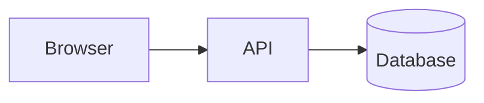

# Contributing to docs

**What this page covers:** how the DryvHub Guide (this site) is organized, how to preview and build it, the MDX mistakes that break the build, how we write, and the steps to add or change a page.

:::tip[In plain English]
This site is built from plain text files in the `dryvhub-docs/docs/` folder. Each folder becomes a section in the sidebar, and each file becomes a page. Write in Markdown, run one command to preview, and run another to check nothing is broken before you open a pull request.
:::

## How the site is organized

The project lives in `dryvhub-docs` (Docusaurus 3, Node 20 or newer, npm).

| Path | Role |
| ---- | ---- |
| `docs/` | All page content, one folder per audience |
| `docs/start/` | Start here: welcome, glossary, how it fits together |
| `docs/executive/` | For executives and non-technical readers |
| `docs/dealer/` | The dealer app, in product terms |
| `docs/marketplace/` | The buyer marketplace, in product terms |
| `docs/developers/` | This section: for engineers and semi-technical staff |
| `docusaurus.config.ts` | Site title, navbar, footer, plugins, broken-link policy, Mermaid |
| `sidebars.ts` | One autogenerated sidebar per folder above |
| `src/css/custom.css` | Theme styles |
| `src/pages/`, `src/components/` | Custom pages and React components (such as the landing page) |
| `docs/drafting.md` | A hidden placeholder page; leave it alone |

Key rules:

- **Folders are sections.** A folder under `docs/` maps to a sidebar and a navbar item through `sidebars.ts`. Adding a brand-new top-level audience needs a config change, which is a maintainer task.
- **Order comes from `sidebar_position`** in each page's frontmatter (lower numbers appear first). `_category_.json` sets the section's label and position.
- **Search** is built in (local search plugin) and indexes headings and text at build time.
- **Broken links fail the build** (`onBrokenLinks: 'throw'`). Plain Markdown link warnings are logged but do not fail; do not rely on that.

### Frontmatter

Every page starts with:

```yaml
---
title: Page title
sidebar_position: 3
description: One sentence that appears in search results and link previews.
---
```

Do not repeat the title as a first-level heading with different words. Start the body with one `# Heading` that matches the title, then a short "What this page covers" paragraph.

### `_category_.json`

```json
{ "label": "For developers", "position": 1, "collapsible": false }
```

It controls the sidebar group label, its order among siblings, and whether it can be collapsed.

## Preview and build

```bash
cd dryvhub-docs
npm install
npm start            # protected Vercel preview with hot reload
npm run build        # production build; this is the check that must pass
npm run clear        # clear caches if something looks stale
npm run typecheck    # TypeScript check for config and src
```

Notes:

- `npm start` runs the pinned Vercel CLI so routing middleware protects local requests too. It uses the port Vercel selects; stop the preview (Ctrl+C) when you are done.
- **Run `npm run build` before every pull request.** It catches broken links and MDX syntax errors that the live preview may tolerate.
- Environment variables `DOCS_SITE_URL` and `DOCS_BASE_URL` control the site URL and base path for deployment; the defaults suit local work.
- `DOCS_PASSCODE` and `DOCS_AUTH_SECRET` in `.env` (see `.env.example`) are required locally. Put both in Vercel Production and Preview environment variables for deployment.
- Vercel routing middleware checks the passcode on the server and protects every generated asset. Never replace it with a browser-only gate. Configure Vercel Firewall to rate-limit `POST /_docs-auth`.

## Writing features

### Admonitions

Callout boxes use three colons. Add a title in square brackets.

```md
:::tip[In plain English]
A short, jargon-free summary.
:::

:::note
Neutral extra context.
:::

:::warning
Something that can bite.
:::

:::danger
Something that can cause data loss or a security incident.
:::
```

Use `:::tip[In plain English]` at the top of conceptual pages to restate the idea for non-engineers. Always close with `:::` on its own line, and leave a blank line before and after.

### Mermaid diagrams

Use a fenced block with the `mermaid` language. Supported types here include `flowchart`, `sequenceDiagram`, `erDiagram`, and `gitGraph`.

````md

````

Tips:

- Quote node labels that contain spaces, slashes, or parentheses: `A["hooks/use*.ts"]`.
- Use `<br/>` for a line break inside a label.
- Keep diagrams small enough to read on a laptop. Split a big one in two.
- Avoid semicolons in labels, and avoid angle brackets for placeholders (write `domain` instead of `<domain>`).
- Diagrams that fail to render show an error on the page but do not always fail the build, so open the page and look.

### Code blocks

Always give a language (`bash`, `json`, `typescript`, `text`, `dotenv`). Only `bash`, `json`, and `typescript` get extra syntax highlighting by default; others render as plain text, which is fine. Never paste real secrets, tokens, or keys; use placeholders like `<your-supabase-url>` inside the code block.

### Links

Link to other pages with absolute doc paths and no file extension:

```md
[Architecture](/docs/developers/architecture)
```

- A link to a page that does not exist fails the build.
- Link to a heading with `#heading-id`, for example `/docs/developers/local-setup#start-order-and-ports`.
- Link to files in the code repos by writing the path in backticks (for example `dryvhub-api/docs/adr/0001-clean-architecture-adoption.md`); they are not part of this site, so do not make them links.
- External links use the full `https://` URL.

## MDX gotchas

Pages are **MDX** (Markdown that understands JSX). That makes a few characters special in normal prose.

| Problem | What happens | Fix |
| ------- | ------------ | --- |
| `{` or `}` in prose (for example `{ id }` or `{slug}`) | Parsed as a JavaScript expression; build error | Put it in backticks, or in a code block |
| `<` in prose (for example `<tenantId>`, `a < b`) | Parsed as an HTML or JSX tag; build error | Put it in backticks, or write "less than" |
| An unclosed tag (`<br>`, `` without `/`) | Build error | Self-close (`<br />`) or avoid raw HTML |
| `<!-- comment -->` | Not valid in MDX | Use `{/* comment */}` or delete it |
| Blank line missing around `:::` lines | Admonition renders as plain text | Add blank lines before and after |
| Tables with a `|` inside a code span | Breaks the column layout | Rephrase, or use the word "or" |
| Indented code with 4 spaces | Treated as a code block when you did not intend it | Use fenced code blocks and keep prose unindented |
| Headings with the same text twice | Duplicate anchors | Make headings unique when you plan to link to them |

Inside fenced code blocks and inline backticks, none of these apply. When the build says "Could not parse expression" or "Unexpected character", look for a stray brace or angle bracket near the reported line.

## Style guide

Plain English first, precision second, never the reverse.

- **Say what the page covers** in the first paragraph, and end with a "Related pages" list.
- **Explain a concept in one plain sentence** before using the jargon (multi-tenancy, JWT, RSC, clean architecture). The `In plain English` box is for this.
- **Describe what exists.** If something is not built yet, label it **Planned**. Do not document wishes as facts.
- Short sentences and active voice. Prefer "the API checks the token" to "the token is checked".
- Use **tables** for lists of attributes, **numbered steps** for procedures, and **diagrams** for flows and relationships.
- Make commands **copy-pasteable** and show the working directory with a `cd` line when it matters.
- **Reference real paths** in backticks (for example `dryvhub-api/src/interceptors/tenant-context.interceptor.ts`) so readers can find the source.
- **Never include secrets or real environment values.** Document variable names and purpose only.
- Keep one idea per heading and keep headings in sentence case.
- Link a term to the [Glossary](/docs/start/glossary) the first time it matters, and use the same name for the same thing everywhere (for example "tenant", not "dealership account" in one place and "workspace" in another, unless you explain the difference).
- No marketing language, no filler. If a sentence could be deleted without losing information, delete it.
- Date-sensitive facts (versions, limits) should say where they come from so the next editor can update them.

## Add a page

1. Pick the folder for the audience (`docs/developers/`, `docs/dealer/`, and so on).
2. Create `kebab-case-name.md` with the frontmatter shown above. Choose a `sidebar_position` that fits the reading order (leave gaps if you expect to insert pages later).
3. Write the page using the structure: title, "What this page covers", optional `In plain English` box, content, "Related pages".
4. Link to and from related pages. Add a link from an existing page so readers can discover it.
5. Run `npm run build` and fix anything it reports (broken links, MDX errors).
6. Run `npm start` and click through the new page: check the sidebar position, tables, and diagrams.
7. Open a pull request from a `document/*` branch into `staging`. See [Git workflow](/docs/developers/git-workflow).

To rename or move a page, update every link to it in the same change; the build will list the broken ones.

## Keeping docs honest

- When code and a doc disagree, **the code wins**; fix the doc in the same pull request that changes behavior.
- When you change an API route, a guard, an environment variable, or a folder, search this section for the old name and update it. Good starting points: [API integration](/docs/developers/api-integration), [Environment variables](/docs/developers/environment-variables), [Repo map](/docs/developers/repo-map).
- Prefer linking to the canonical source (Swagger, an ADR, a plan) over copying long content that will drift.

## Related pages

- [Git workflow](/docs/developers/git-workflow)
- [Conventions](/docs/developers/conventions)
- [AI workflow](/docs/developers/ai-workflow)
- [Welcome](/docs/start/welcome)
