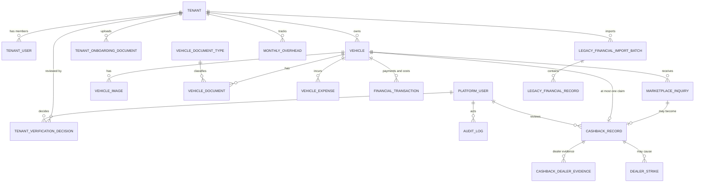

# Data model

**What this page covers:** the PostgreSQL tables behind the API (defined in `dryvhub-api/prisma/schema.prisma`), how they relate, and the conventions every new table must follow. A second datastore, MongoDB, holds only the plate-check registry and is covered at the end.

:::tip[In plain English]
The database has one **tenants** table (one row per dealership). Almost every other table has a `tenantId` column pointing back to it, which is how the API keeps each dealership's data separate. Vehicles are the center of the model: images, documents, expenses, sales payments, marketplace inquiries, and cashback claims all hang off a vehicle.
:::

`schema.prisma` is the source of truth. If this page and the schema disagree, the schema wins. Change it only through the Prisma CLI workflow in [Local setup](/docs/developers/local-setup).

## ER overview

Key relationships only; columns are omitted for readability. Every tenant-owned table also carries `tenantId`.

## Models and purpose

Table names are the snake_case names from `@@map`.

### Identity and tenancy

| Model | Table | Purpose | Tenant-scoped? |
| ----- | ----- | ------- | -------------- |
| `Tenant` | `tenants` | One dealership: business and public-profile fields, unique `subdomain`, subscription plan and status, trial dates, limits (inventory, admins, storage), verification stage and status, Facebook connection fields, cashback eligibility | Is the tenant |
| `TenantUser` | `tenant_users` | A dealership member. Unique `authUserId` (the Supabase user id), role `owner` or `staff`, active flag. This table is the **only** source of tenant identity | Yes |
| `PlatformUser` | `platform_users` | DryvHub staff. Unique `authUserId`, role `admin`, active flag | Global |
| `TenantVerificationDecision` | `tenant_verification_decisions` | History of approve or reject decisions by platform admins, with reason | Yes |
| `AuditLog` | `audit_logs` | Admin action trail (actor, action, entity, JSON metadata) | Global (actor is a platform user) |
| `PlatformSettings` | `platform_settings` | Single settings row: cashback rate, dealer fee, platform revenue share, promo window and promo rate | Global |

### Inventory

| Model | Table | Purpose |
| ----- | ----- | ------- |
| `Vehicle` | `vehicles` | Core inventory record: make, model, year, mileage, `price`, `plateNumber`, category, transmission, fuel, status (`draft`, `active`, `available`, `coming`, `reserved`, `sold`, `archived`), listing status (`draft`, `pending_review`, `published`, `held`, `blocked_platecheck`), per-channel sync status (marketplace, Facebook), private fields (purchase price, buyer, agent, dealer notes), `tenantId`+`refId` unique |
| `VehicleImage` | `vehicle_images` | Photo metadata and S3 `objectKey`; status `pending` then `uploaded` |
| `VehicleDocumentType` | `vehicle_document_type` | Global master list (OR, CR, insurance, deed of sale, ...) with fixed ids |
| `VehicleDocument` | `vehicle_documents` | Document metadata, S3 path, status, `isVerified` |
| `TenantOnboardingDocument` | `tenant_onboarding_documents` | Business verification documents uploaded during onboarding |

### Money

| Model | Table | Purpose |
| ----- | ----- | ------- |
| `VehicleExpense` | `vehicle_expenses` | Per-vehicle cost (soft-deleted via `deletedAt`) |
| `FinancialTransaction` | `financial_transactions` | Payments and costs ledger with direction, category, status, payment method; unique `tenantId`+`transactionNumber` |
| `MonthlyOverhead` | `monthly_overhead` | Recurring monthly business overhead (soft-deleted) |
| `LegacyFinancialImportBatch`, `LegacyFinancialRecord` | `legacy_financial_*` | Imported historical records from before DryvHub, grouped by batch (soft-deleted) |

### Marketplace and cashback

| Model | Table | Purpose |
| ----- | ----- | ------- |
| `MarketplaceInquiry` | `marketplace_inquiries` | A buyer inquiry on a listing: unique `inquiryCode`, source (Messenger), entry point (card or details), cashback rate locked at inquiry time, optional buyer and agent names |
| `CashbackRecord` | `cashback_records` | A buyer's cashback claim tied to an inquiry code and **one vehicle** (`vehicleId` unique). Tracks status from `pending_review` through `approved`, `paid`, or `rejected`/`disputed`, locked rate, dealer fee, buyer and platform amounts, payout method and reference, reviewer |
| `CashbackDealerEvidence` | `cashback_dealer_evidence` | Dealer-provided evidence files for a claim (OR/CR, sales proof, release) |
| `DealerStrike` | `dealer_strikes` | Penalty record against a dealer, optionally linked to a claim |

## Conventions

| Convention | Rule |
| ---------- | ---- |
| Primary keys | UUID (`@id @default(uuid()) @db.Uuid`), generated by the app layer |
| Tenant scoping | Every tenant-owned table has `tenantId` with a foreign key to `tenants`. Every query adds `where: { tenantId }` (ADR-0005). Global tables are only `platform_users`, `platform_settings`, `audit_logs`, `vehicle_document_type`, and `tenants` itself |
| Money | `Decimal` (for example `@db.Decimal(14, 2)` for amounts, `Decimal(5, 2)` for percentages). Never `Float`. Serialize decimals as strings in JSON to avoid precision loss |
| Timestamps | `DateTime @db.Timestamptz(6)`, always UTC. `createdAt` defaults to `now()`; `updatedAt` uses `@updatedAt` |
| Dates without time | `@db.Date` (for example `Vehicle.acquiredAt`) |
| Enums | Prisma enums in the schema; the core domain uses string unions and maps at the boundary |
| Soft delete | `deletedAt` on expenses, overhead, and legacy data; `archivedAt` and `status = archived` on vehicles; `deleted` status on documents |
| Naming | PascalCase models and camelCase fields in Prisma; snake_case plural table names through `@@map` |
| Indexes | Composite indexes lead with `tenantId` (for example `tenantId, status`) so tenant-scoped queries stay fast |
| Cascades | Tenant children cascade on tenant delete; financially significant records (`cashback_records`, `dealer_strikes`) use `Restrict` |
| Secrets in rows | The tenant row stores a Facebook access token (`fbAccessToken`). Never return it from an endpoint or log it |
| Prisma client | Generated into `src/generated/prisma` (gitignored). Core entities in `src/core/entities` are plain interfaces, never Prisma types |

Schema changes always follow: edit `schema.prisma`, run `npx prisma migrate dev --name <name>`, run `npx prisma generate`, then update entities, ports, data services, and tests. Never hand-write migration SQL.

## Planned or partial

- Subscription and billing columns exist on `tenants` (plan, status, trial and renewal dates, limits). A full billing flow (API ADR-0011, dealer plan `docs/plans/subscription-billing.md`) is **Planned**, not shipped.
- Row-level security in PostgreSQL was considered and deferred (ADR-0005 explains why manual filtering was chosen first and lists the triggers to revisit it).

## MongoDB (plate-check registry)

Plate-check flags live in a shared MongoDB database (default name `platecheck`), not in PostgreSQL (ADR-0012). The registry is intentionally visible to all authenticated dealers, so it is **not** tenant-scoped. See [API integration](/docs/developers/api-integration) for its endpoints. Vehicle rows keep a `platecheckFlagged` boolean in Postgres, and the listing status `blocked_platecheck` makes the publish use-case refuse to publish that vehicle.

## Related pages

- [Auth and tenancy](/docs/developers/auth-and-tenancy)
- [Architecture](/docs/developers/architecture)
- [Decisions](/docs/developers/decisions)
- [Adding a feature](/docs/developers/adding-a-feature)
