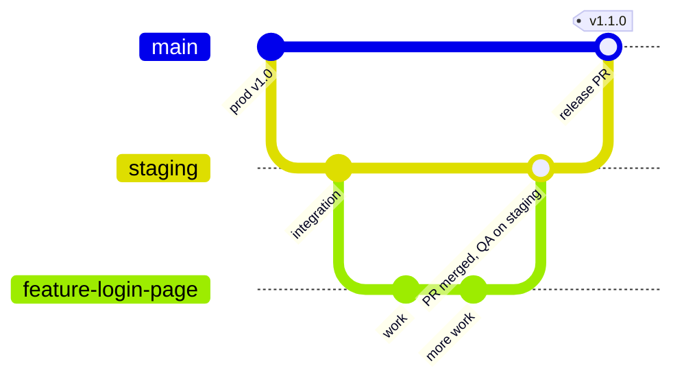

# Git workflow

**What this page covers:** how we branch, review, and release code. This is a summary of the canonical document `dryvhub-api/docs/Git FLow/git-flow.md` (note the folder spelling, which must not be renamed because links depend on it). If this page and that file ever disagree, the file wins.

:::tip[In plain English]
Think of two shared lines of code. **`staging`** is the shared workbench where every finished feature lands first and QA tries it out. **`main`** is what real customers use. You never work on either directly. You make a short-lived branch, open a pull request into `staging`, QA approves, and then a release pull request moves `staging` into `main`. Emergency fixes start from `main`, and **must** be copied back into `staging` afterwards so the two never drift apart.
:::

The process is documented in the API repo and is the working model for all DryvHub repos. Confirm branch names and protections in each repo's settings.

## Core principle

Only **tested and QA-approved code** reaches production (`main`).

## Branches

| Branch | Purpose | Created from | Merges into |
| ------ | ------- | ------------ | ----------- |
| `main` | Production. Always stable and deployable. Strictly protected | n/a | n/a |
| `staging` | Pre-production and QA. Integration branch where features combine and are validated. **Not guaranteed stable** | n/a | `main` (release PR) |
| `feature/*` | New product work (for example `feature/payment-retry`). Short-lived | `staging` | `staging` (PR) |
| `chore/*` | Maintenance with no user-facing impact: dependency updates, refactors, tooling, CI/CD | `staging` | `staging` (PR) |
| `document/*` | Documentation-only changes, no runtime or logic changes (for example `document/api-spec`) | `staging` | `staging` (PR) |
| `hotfix/*` | Urgent production fixes | `main` | `main` (PR), then back into `staging` |



## Flow, step by step

1. Create a `feature/*` branch from `staging`.
2. Merge the feature into `staging` through a pull request.
3. `staging` deploys automatically to the staging environment.
4. QA validates features, integration behavior, regressions, and edge cases.
5. When approved, open a release pull request `staging` to `main`.
6. Merge to `main`; production deploys. Tag the release.

### 1. Create a feature branch

```bash
git checkout staging
git pull origin staging
git checkout -b feature/<feature-name>
```

### 2. Develop and commit

Use clear, conventional commit messages:

- `feat: add login endpoint`
- `fix: resolve token refresh bug`
- `chore: update dependencies`

Keep commits small and focused, write meaningful messages, and avoid unrelated changes in one pull request.

### 3. Open a pull request into `staging`

| Requirement | Detail |
| ----------- | ------ |
| Base branch | `staging` |
| Source | `feature/*` (or `chore/*`, `document/*`) |
| CI | Must pass |
| Review | At least 1 approval |
| Direct pushes | Not allowed |

### 4. Merge into `staging`

After approval: merge the pull request, delete the branch, and let `staging` deploy automatically.

### 5. QA validation

QA verifies feature correctness, integration behavior, regression issues, and edge cases on the staging environment.

### 6. Release to production

When `staging` is stable, open a pull request from `staging` to `main`. Requirements: all tests passing, QA approval complete, no critical issues. After the merge, production deploys and you tag the release:

```bash
git tag v1.0.0
git push origin v1.0.0
```

## Hotfix workflow

Hotfixes are for urgent production problems. Keep them minimal and targeted.

### 1. Branch from `main`

```bash
git checkout main
git pull origin main
git checkout -b hotfix/<issue-name>
```

### 2. Fix and open a pull request into `main`

Open a pull request into `main` with fast-tracked review, then merge and deploy.

### 3. Sync back into `staging` (critical)

:::danger[Do not skip this step]
After a hotfix lands on `main`, merge `main` back into `staging`. Skipping it makes the branches diverge, and the next release can silently drop or conflict with the fix.
:::

```bash
git checkout staging
git pull origin staging
git merge main
git push origin staging
```

Because direct pushes to `staging` are disallowed, do this through whatever route your repository protections require (for example a pull request from `main` into `staging`). The intent is fixed: `staging` must contain everything on `main`.

## Branch protection

| Branch | Rules |
| ------ | ----- |
| `main` | No direct pushes; pull request required; 1 to 2 approvals; all CI checks pass; must be up to date before merge; no force pushes |
| `staging` | No direct pushes; pull request required; CI checks pass |

## CI/CD expectations

| Event | Expected |
| ----- | -------- |
| Pull request | Linting, type checking, unit tests, build validation |
| Merge to `staging` | Deploy to the staging environment |
| Merge to `main` | Deploy to production |

## Rules and best practices

- Never commit directly to `main` or `staging`; always use pull requests.
- Keep pull requests small and focused; delete branches after merge.
- Feature branches always start from `staging`, stay short-lived, and sync with `staging` when needed.
- Releases come from `main` only. Never deploy production from `staging`. Always tag releases.
- Hotfixes originate from `main` and must be merged back into `staging`.

## Anti-patterns to avoid

- Using `main` as a development branch.
- Skipping staging QA validation.
- Long-lived feature branches.
- Not syncing hotfixes back to `staging`.
- Multiple "source of truth" branches (there is no `develop` branch in this model).

## Notes for contributors

- Doc-only work uses a `document/*` branch. Do not put app code, secrets, or tokens in docs.
- Link every pull request to its plan and acceptance criteria (for example "implements AC-1, AC-2"); see [Adding a feature](/docs/developers/adding-a-feature).

## Related pages

- [Adding a feature](/docs/developers/adding-a-feature)
- [Testing](/docs/developers/testing)
- [Conventions](/docs/developers/conventions)
- [Contributing to docs](/docs/developers/contributing-to-docs)
