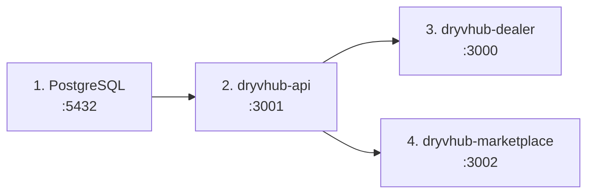

# Local setup

**What this page covers:** getting all three repos running on your machine: prerequisites, install, environment files, the database and Prisma workflow, start order and ports, and common errors. Variable *names* are listed on [Environment variables](/docs/developers/environment-variables); this page never contains real values.

:::tip[In plain English]
You run four things: a local database, the API, the dealer app, and (optionally) the marketplace. Start them in that order. The API needs a database and a Supabase project (for sign-in tokens); the websites only need to know where the API is.
:::

## Prerequisites

| Tool | Notes |
| ---- | ----- |
| Node.js | The API README says 18 or newer. Next.js 16 and the docs site (`engines: node >=20`) need 20 or newer, so use Node 20 LTS or later. |
| npm | **npm only.** Do not use yarn, pnpm, or bun; lockfiles are `package-lock.json`. |
| Docker with Compose | For the local PostgreSQL 15 container (`dryvhub-api/docker-compose.yml`). Skip if you point `DATABASE_URL` at a remote database. |
| A Supabase project | Free tier is fine. Provides sign-in and JWT issuance. You need the project URL and the anon (public) key, and the service-role key for registration checks. |
| Optional | An S3 bucket (or S3-compatible store such as MinIO) for image and document uploads; a MongoDB Atlas cluster for plate-check; Meta app credentials for Facebook connect; a Resend account for signup OTP email. |

## Clone and install

Put the repos side by side in one folder (the docs and AI rules assume sibling folders).

```bash
mkdir -p DryvHub && cd DryvHub
# clone each repo from your team's remote into this folder:
#   dryvhub-api, dryvhub-dealer, dryvhub-marketplace

cd dryvhub-api && npm install && cd ..
cd dryvhub-dealer && npm install && cd ..
cd dryvhub-marketplace && npm install && cd ..
```

In `dryvhub-api`, `npm install` also runs `prisma generate` through the `postinstall` script, so the Prisma client exists after install.

## Environment files

Never commit `.env*` files. Copy templates and fill in your own values.

### API

```bash
cd dryvhub-api
cp .env.example .env
```

Minimum to boot and call protected routes: `DATABASE_URL`, `SUPABASE_URL`, and (for registration) `SUPABASE_SERVICE_ROLE_KEY`. The server **fails fast** at startup if `SUPABASE_URL` is missing. Use placeholders like these when documenting or sharing config:

```dotenv
PORT=3001
DATABASE_URL="<your-postgres-connection-string>"
SUPABASE_URL="<your-supabase-url>"
SUPABASE_SERVICE_ROLE_KEY="<your-service-role-key>"
```

The local Docker database credentials are in `docker-compose.yml` and `.env.example`; use them as-is for local-only Postgres. Add S3, Facebook, MongoDB, and marketplace variables only when you work on those features.

### Dealer app

```bash
cd dryvhub-dealer
cp .env.example .env.local
```

Required for sign-in and API calls:

```dotenv
NEXT_PUBLIC_API_URL=http://localhost:3001
NEXT_PUBLIC_APP_URL=http://localhost:3000
NEXT_PUBLIC_ROOT_DOMAIN=<your-root-domain-or-localhost>
NEXT_PUBLIC_SUPABASE_URL=<your-supabase-url>
NEXT_PUBLIC_SUPABASE_ANON_KEY=<your-anon-public-key>
```

Server-only values (signup OTP): `RESEND_API_KEY`, `RESEND_FROM_EMAIL`, `OTP_SIGNING_SECRET`, `OTP_PEPPER`, `SUPABASE_SERVICE_ROLE_KEY`. Never prefix these with `NEXT_PUBLIC_`.

### Marketplace

The marketplace repo has no `.env.example` in the checked-out branch. Create `.env.local` yourself:

```dotenv
NEXT_PUBLIC_API_URL=http://localhost:3001
NEXT_PUBLIC_SITE_URL=http://localhost:3002
```

`API_URL` (server only) is an optional override when the server reaches the API at a different address than the browser.

## Database and Prisma workflow

Start Postgres, then apply migrations.

```bash
cd dryvhub-api
docker compose up -d          # PostgreSQL 15 on port 5432
npx prisma migrate dev        # apply migrations (dev only); also regenerates the client
```

| Command | When to use |
| ------- | ----------- |
| `npx prisma generate` | After **any** change to `prisma/schema.prisma`, and any time the client looks stale |
| `npx prisma migrate dev --name <name>` | Create **and** apply a new migration locally after editing the schema |
| `npm run db:migrate` (`prisma migrate deploy`) | Apply existing migrations in CI or production; never creates new ones |
| `npx prisma studio` | Browse and edit rows in a GUI |
| `npx prisma migrate reset` | Dev only, **destructive**: drops the database and re-applies all migrations |

:::warning[Prisma is CLI-only in this repo]
- Edit only `prisma/schema.prisma` by hand.
- Never create or edit anything under `src/generated/prisma/`. It is produced by `npx prisma generate`.
- Never hand-write `prisma/migrations/**/migration.sql` or invent migration folders. Create them with `npx prisma migrate dev --name <name>`.
- After a schema change, always run `npx prisma generate` in the same session, even if `migrate dev` already did.
- Never hand-edit `dist/`.
:::

Hosted Supabase Postgres: use the pooled URL in `DATABASE_URL` for runtime and set `DIRECT_URL` (a direct or session-pooler connection on port 5432) for migrations, because pooler URLs hang on `prisma migrate`. `prisma.config.ts` reads `DIRECT_URL` first, then `DATABASE_URL`.

## Start order and ports



| Service | Command (run in its repo) | URL |
| ------- | ------------------------- | --- |
| PostgreSQL | `docker compose up -d` | `localhost:5432` |
| API | `npm run start:dev` | `http://localhost:3001`, Swagger at `/swagger` |
| Dealer app | `npm run dev` | `http://localhost:3000` |
| Marketplace | `npm run dev` (script is `next dev --port 3002`) | `http://localhost:3002` |

The API's default `CORS_ORIGINS` already allows `localhost:3000`, `localhost:3002`, and `*.localhost:3000` (for tenant hosts). Production-style API run: `npm run build` then `npm run start:prod`.

### Testing tenant subdomains locally

Tenant workspaces are `slug.localhost` on the dealer port, for example `http://my-dealer.localhost:3000`. The proxy rewrites the root of that host to the tenant landing page. Most modern browsers resolve `*.localhost` to your machine without extra setup (not verified on every browser). See [Auth and tenancy](/docs/developers/auth-and-tenancy).

## Test accounts and seed data

- There is **no seed script** (`prisma/seed.ts` does not exist) and **no shared test account** is documented.
- Vehicle document types are documented as seeded with fixed ids (see `docs/api/vehicle-documents.md` in the API repo).
- To get a working login, follow `dryvhub-api/SETUP.md`: create a user in the Supabase dashboard (Authentication, Users, auto-confirm), then either seed a tenant plus tenant user row, or call `POST /api/v1/auth/register` with that user's token. Registration creates the tenant and an `owner` tenant user. One Supabase user belongs to exactly one tenant.
- Platform-admin access requires an active row in `platform_users` whose `authUserId` matches the Supabase user id. Creating that row is not documented as a script; treat the procedure as unverified and ask the team.

Smoke test once everything runs:

```bash
curl http://localhost:3001/api/v1/tenants/current \
  -H "Authorization: Bearer <access-token>"
```

A 200 with your tenant proves token verification, tenant context, and the database all work.

## Common setup errors

| Symptom | Likely cause and fix |
| ------- | -------------------- |
| API exits at startup with `SUPABASE_URL is not set` | Set `SUPABASE_URL` in the API `.env` (fail-fast check in the token verifier). |
| `401 Unauthorized` on every call | Token missing, expired, or from a different Supabase project. Get a fresh token; confirm `SUPABASE_URL` matches the project that issued it. |
| `403` "User is not an active member of any tenant" | No active `tenant_users` row for that Supabase user. Register through the API or seed a row. |
| `403` on `POST /auth/register`: email must be verified | Registration checks email confirmation via the Supabase Admin API. Confirm the user (dashboard, or the dealer signup OTP flow) and make sure `SUPABASE_SERVICE_ROLE_KEY` is set. |
| `409` "already registered" or "similar business name" | One user, one tenant; the subdomain is derived from the business name and must be unique. Use a different name or user. |
| Supabase token call returns `email_not_confirmed` | Confirm the user in the dashboard or disable email confirmation in **dev only**. |
| `Property 'tenant' does not exist on type 'PrismaService'` | Prisma client not generated. Run `npx prisma generate`. |
| Port 5432 already in use | Stop the local Postgres or change the published port in `docker-compose.yml` (and `DATABASE_URL`). |
| `prisma migrate` hangs on Supabase | You pointed it at the pooler. Set `DIRECT_URL` to a direct or session connection on port 5432. |
| Dealer app throws `NEXT_PUBLIC_API_URL is not configured` | Create `.env.local` from `.env.example` and restart `npm run dev`. |
| Browser CORS error from the dealer app | Origin not in the API's `CORS_ORIGINS`. Add it (no `*` or `https://*`). |
| Image upload fails with an S3 301 or region message | `S3_REGION` does not match the bucket's real region. Fix it and restart the API. |
| Uploads rejected with "Upload URL is not allowed" in the dealer app | The upload proxy only allows known S3 hosts. For MinIO or local storage add the host to `S3_UPLOAD_HOST_ALLOWLIST`. |
| Plate-check routes return `503` | `MONGODB_URI` is not set or MongoDB is unreachable. |
| Marketplace lists nothing | API not running, or no vehicle is eligible (published, verified dealer, not sold). Eligibility is decided by the API. |

## Related pages

- [Environment variables](/docs/developers/environment-variables)
- [Architecture](/docs/developers/architecture)
- [Auth and tenancy](/docs/developers/auth-and-tenancy)
- [Testing](/docs/developers/testing)
- [Welcome](/docs/start/welcome)
