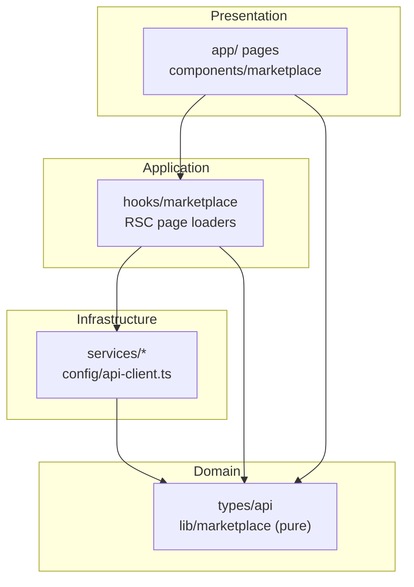
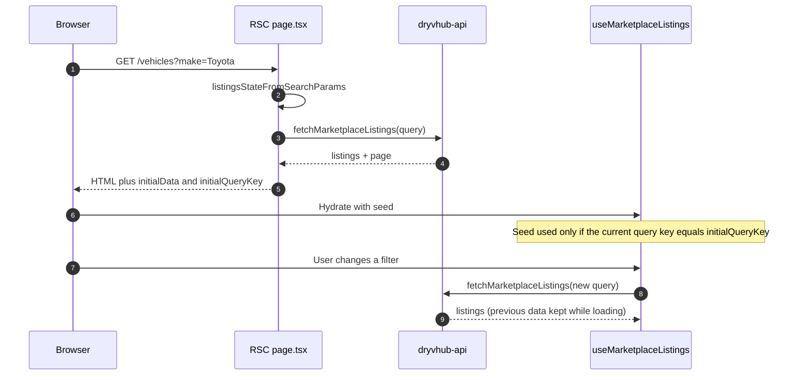

# Marketplace internals

**What this page covers:** how the public buyer site is structured: its layers, what renders on the server versus in the browser, how the inventory page keeps URLs shareable while still filtering instantly, how API responses are validated, which fields the public data contract allows, SEO helpers, and theming.

:::tip[In plain English]
The marketplace is a **read-mostly shop window**. Anyone can browse, no account needed. All the facts (which cars are listed, who is eligible for cashback) come from the API; this site only displays them and forwards buyer actions (inquiries, cashback claims). Because it is public, it must never ask for, store, or show private dealer data.
:::

Product view: [Marketplace overview](/docs/marketplace/overview) and [Eligibility](/docs/marketplace/eligibility). Architecture context: [Architecture](/docs/developers/architecture).

## What the site does today

| Route | Role | Data source |
| ----- | ---- | ----------- |
| `/` | Home: hero search, categories, featured listings, editor's picks, buy guide, testimonials | Server Component calls `fetchMarketplaceListings` (up to 100); featured uses `isFeatured` |
| `/vehicles` | Inventory with filters, sort, and pagination | RSC seeds the first render; client hook refetches |
| `/vehicles/[id]` | Vehicle details, gallery, specs | Server Component `fetchMarketplaceListingById`; JSON-LD and `generateMetadata` |
| `/purchases/cashback` | Buyer cashback claim and evidence | Public `POST /cashback/claims`, `PATCH /cashback/claims/:id/evidence` |
| `/for-dealers` | Dealer-facing landing page | Static content and dealer app links |
| `/sitemap.xml`, `/robots.txt`, `/manifest.webmanifest` | SEO and PWA | Same listings fetch for the sitemap |

Locale is `en_PH`. Canonical origin comes from `NEXT_PUBLIC_SITE_URL` (falls back to a local origin).

Send Inquiry: a button on cards and details uses `useSendInquiry`, which calls `marketplace-inquiries.service.ts` and then redirects to the Messenger URL the API returns. Never deep-link to Messenger without a successful API response; treat 404, gone, or rejected as authoritative. (The repo's `AGENTS.md` still says inquiry is "not implemented yet"; the code and tests show it is. The doc is stale.)

## Layering



| Layer | Folders | Rules |
| ----- | ------- | ----- |
| Presentation | `app/`, `components/marketplace/` | UI only; no `fetch`, no API paths |
| Application | `hooks/marketplace/`, RSC page loaders | Orchestrate use cases. Client components call hooks, not services |
| Infrastructure | `services/`, `config/api-client.ts` | Call public endpoints and parse responses with zod |
| Domain | `types/api/`, `lib/marketplace/` | DTO types and pure helpers; **never** import `services`, `hooks`, `components`, `app`, or `config` |

Forbidden in this repo: buyer auth, Supabase, `AuthContext`, a Bearer api-client, dealer dashboard shells, eligibility or cashback calculations of record, Redux/Zustand/Jotai, axios, and a second UI kit.

## Server vs client rendering

| Piece | Where it runs | Why |
| ----- | ------------- | --- |
| Home featured listings, details page, sitemap, inventory seed | Server Components, calling `services/` directly | Fast first paint and crawlable HTML |
| Header (nav, theme), hero search, inventory filters and pagination, gallery and share controls | Client islands | Interactivity |
| `QueryProvider` | Root layout | `/vehicles` hydrates React Query. Do not add React Query to the homepage without a plan |

The homepage must survive API failure: on error it shows empty arrays and an honest empty state, never fake cars.

## Hybrid React Query on `/vehicles`

Goal: the URL is the source of truth (shareable, crawlable), the first paint comes from the server, and later filter changes feel instant without a full page load.



How it is wired (`app/vehicles/page.tsx`, `hooks/marketplace/use-marketplace-listings.ts`):

- The page parses `searchParams` with `listingsStateFromSearchParams` and maps filters to an API query with `inventoryFiltersToListingsQuery`.
- It seeds the client with `initialData` only when the server fetch succeeded (`seedAllowed`). On failure it passes an empty result and no seed, so the client refetches.
- `shouldUseInitialData` compares the current normalized query key with `initialQueryKey` and uses the seed only on a match, so stale data is never shown for different filters.
- Query key: `["marketplace", "listings", normalizedQuery]`. `placeholderData: keepPreviousData` avoids flicker during refetches.
- Errors are logged and mapped to one friendly message.

Query parameters sent to the API include `search`, `make`, `model`, `category`, `transmission`, `fuelType`, `priceMax`, `yearMin`, `status` (`coming` for the Coming Soon tab; omitted for available stock), `skip`, `take` (default 20, API max 100), `sortBy`, and `sortOrder`. Eligibility for "coming soon" is decided by the API; the client never builds its own list.

## zod at the service boundary

`services/*.service.ts` call `apiGet`, `apiPost`, or `apiPatch` (which return `unknown`) and parse the result with zod before it reaches hooks or components. Benefits: a changed API shape fails loudly in one place, and components can trust types. Each service has a colocated `*.test.ts` that runs without network access.

## Public DTO rules

Render only what the public listing DTO returns (`types/api/marketplace-listing.ts`): `id`, `make`, `model`, `year`, `mileage`, `price` (string), `category`, `transmission`, `fuelType`, `variant`, `color`, `isFeatured`, `listedAt`, `dealer.displayName`, `dealer.subdomain`, `coverImage`, `gallery`.

Never request, store, or render:

- `plate_number` or any plate data
- Purchase price, down payment, or profit
- Dealer notes or expenses
- Internal documents
- Supply agent, buyer, or sales agent personal data
- Any other private tenant information

If a design needs a field the DTO lacks, stop: it is a `dryvhub-api` change, not a reason to widen the frontend's shapes. There is no separate "marketplace vehicle" table; listings are eligible rows from `vehicles`, and if the API does not return a vehicle it is not marketplace-eligible.

Images are presigned URLs (`urlExpiresInSeconds`): use the returned URL, never invent a CDN path, and omit the Open Graph image when none exists.

## SEO helpers (`lib/marketplace/seo.ts`)

| Helper | Purpose |
| ------ | ------- |
| `buildHomepageMetadata`, `buildListingMetadata`, `buildDealerLandingMetadata` | Page metadata for static routes |
| `buildVehicleMetadata` | Title, description, canonical URL, Open Graph for `/vehicles/[id]` (OG image only when a cover image exists) |
| `buildVehicleJsonLd`, `buildFaqJsonLd` | Structured data for vehicles and FAQ blocks |
| `jsonLdScriptContents` | Serializes JSON-LD safely for a `script` tag |

URL helpers live in `lib/marketplace/site-url.ts` (`getSiteOrigin`, `vehiclePath`, `listingPath`, `cashbackPath`, `dealerProfileUrl`, ...). `app/sitemap.ts` lists `/`, `/vehicles`, and each current listing; `app/robots.ts` allows crawling and advertises the sitemap.

## Theming

- Photography-first design with the DryvHub vibrant blue (`--brand` `#2563EB`, accent `#60A5FA`, luxury `#D4AF66`). Runtime tokens are in `app/globals.css`.
- Light and dark mode through `ThemeProvider` plus `themeInitScript()` (an inline script in the document head that sets the theme before first paint, avoiding a flash). The choice is stored under `dryvhub-theme`.
- Optional color palettes through `ColorPaletteProvider`, `paletteInitScript()`, and `lib/marketplace/color-palettes.ts` (stored under `dryvhub-palette`, applied as a `data-palette` attribute).
- Font: Outfit via `next/font`. Do not add a second primary color or introduce Inter or Roboto as a new stack.
- Design docs are duplicated per assistant (`.cursor/docs`, `.codex/docs`, `.claude/docs`); keep all three in sync when changing the contract.

## Verification

```bash
cd dryvhub-marketplace
npm run lint
npx tsc --noEmit
npm test
```

There is no Playwright suite in this repo yet (**Planned**: add `npm run test:e2e` only when a plan's acceptance criteria require browser coverage). UI changes to home, `/vehicles`, details, filters, or inquiry must still be checked in a browser.

## Related pages

- [API integration](/docs/developers/api-integration)
- [Architecture](/docs/developers/architecture)
- [Testing](/docs/developers/testing)
- [Conventions](/docs/developers/conventions)
