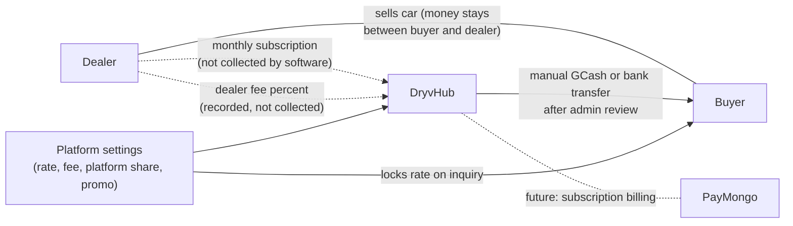

# Business model

:::tip[Key takeaways]
- DryvHub's **intended** revenue is a **monthly dealer subscription** with five plans. The plan catalog and prices exist in the Dealer app, but **no payment is collected by software today**.
- The Marketplace is a **paid-plan feature**: a dealer needs Starter or higher (plus Stage 2 verification) to list publicly. This is the main upgrade lever.
- **Buyer cashback** is calculated by the backend as a percentage of the sold price (default 5 percent), paid **manually** by a DryvHub admin after review. The code does not say who ultimately funds it.
- Three **platform settings** control the money knobs: cashback rate, dealer fee percent, and platform revenue percent, plus an optional promotion window. Defaults are 5, 0, and 0 percent.
- Open question for leadership: the Marketplace tells buyers "a flat ₱2,000", while the backend pays a percentage. Both cannot be true.
:::

## The value exchange

| Party | What they give | What they get |
| --- | --- | --- |
| **Dealer** | Monthly subscription (intended); verified documents; honest sale records | A back office, a public showroom with buyer inquiries, cashback as a selling point |
| **Buyer** | An inquiry through the Marketplace; proof of purchase when claiming | A trusted listing source and cashback on an eligible purchase |
| **DryvHub** | Software, verification work, manual claim review, manual payouts | Subscription revenue (intended) and, possibly, a platform share of each sale (a setting exists; default 0 percent) |

## Dealer subscriptions

### The plan catalog (as shown in the Dealer app)

The catalog below is **hard-coded in the Dealer app** (`lib/billing/dealer-tiers.ts`). It is not stored in the backend, and the billing decision record uses placeholder prices instead. Treat these as the prices currently **displayed**, not as contracted prices.

| Plan | Displayed monthly price | Vehicle units | Admin accounts | Storage | Marketplace listing | Featured listing |
| --- | --- | --- | --- | --- | --- | --- |
| **Free** | ₱0 | Up to 3 | 1 | 500 MB | No | No |
| **Starter** | ₱3,000 | Up to 10 | 2 | 2 GB | Yes | No |
| **Growth** | ₱5,000 | Up to 20 | 5 | 5 GB | Yes | No |
| **Pro** | ₱7,000 | Up to 50 | 10 | 15 GB | Yes | Yes |
| **Enterprise** | ₱10,000 | 51 and up | Unlimited | 50 GB | Yes | Yes |

Every plan includes all DryvHub features; plans differ only by **capacity and Marketplace access**. The billing page also says "Pricing is reviewed annually. We give 30 days' notice before any increase." That sentence is customer-facing copy in the app, so it is a commitment worth knowing about.

### What is actually enforced

| Rule | Enforced by the backend? | Evidence |
| --- | --- | --- |
| Marketplace listing needs a paid plan, Stage 2, and a valid subscription | **Yes** | One shared access policy, with unit tests |
| Featured listing needs Pro or Enterprise | **Yes** | Same policy |
| Vehicle unit limit (3, 10, 20, 50) | **Not found** | The limit is stored on the dealer record, but no code checks it when a car is created |
| Admin account limit | **Not found** | Also stored only. There is no staff-invite endpoint, so the limit cannot be reached anyway |
| Storage quota | **Display only** | The API computes storage used and the Dealer app shows it. No upload block was found |

:::warning Capacity limits look enforced but are not
A Free dealer can see "Up to 3 units" in the app, but the backend does not appear to stop a fourth car. If the limits are part of what is being sold, this is a gap to close. This is the author's reading of the code, not a statement from the engineering team.
:::

### Billing as implemented

**There is no billing engine.** Specifically:

- The Dealer app's **Subscription and Billing** page shows the current plan, capacity, and a plan comparison.
- The **Upgrade** buttons open a dialog that says online checkout is not live and the workspace stays on its current plan "until billing opens".
- The **Invoices** tab is an empty state.
- The API has **no billing, invoice, subscription, or payment-webhook endpoints** (the plan and subscription status are simply columns on the dealer record).
- We found **no code path that changes a dealer's plan or subscription status**. Plan changes today must be made directly in the database or through a process not documented in the repositories.
- New dealers start on **Free** with status `trialing`. No trial timer or expiry logic was found.

### What the design says should come next

Architecture decision record **ADR-0011** (status: **Proposed**) describes the intended system:

- **PayMongo** is the payment provider (the draft originally named Maya; it changed in November 2026). PayMongo's subscription feature creates each month's invoice, charges the dealer's saved card or Maya wallet, and retries a failed charge automatically. DryvHub does not need to build its own charging scheduler.
- DryvHub still owns the dealer's plan, the free trial, what each plan allows, and what happens when payment stops. DryvHub never stores raw card numbers.
- A failed payment should not cut access immediately: PayMongo retries once a day for up to 3 days, then DryvHub gives a short grace period and suspends at about day 7 (length to be confirmed). Suspended dealers keep their data and can still sign in to fix billing, but cannot add cars or record sales.
- Plan changes take effect at the next billing date. Dealers who cancel keep access until the end of the month they paid for.
- The MVP is monthly, one subscription per dealer, one default payment method, no proration, coupons, or tax automation.
- Subscriptions accept **Visa/Mastercard and Maya only**. A dealer who has only GCash or bank transfer cannot subscribe through this flow, so the business needs to decide whether a manual invoice path is required.
- PayMongo must switch on its Subscriptions and card-saving features for DryvHub's account before launch.

None of this is built. See [Billing](/docs/dealer/billing) for what dealers see today and [Risks and dependencies](/docs/executive/risks-and-dependencies) for the revenue-collection risk.

## Buyer cashback

### How the money is calculated

When a buyer submits a cashback claim, the backend computes three amounts from the **sold price** the dealer recorded and **freezes** them on the claim:

| Amount | Formula | Default setting | Meaning |
| --- | --- | --- | --- |
| **Buyer amount** | Sold price times the **rate locked on the inquiry**, divided by 100 | 5 percent | What the buyer is owed |
| **Dealer fee** | Sold price times the dealer fee percent, divided by 100 | 0 percent | A fee attributed to the dealer on this claim |
| **Platform amount** | Sold price times the platform revenue percent, divided by 100 | 0 percent | DryvHub's share attributed to this claim |

The **rate is locked when the buyer sends the inquiry**, so a later settings change does not reprice an inquiry already in flight. The dealer fee and platform amount use the settings in force **when the claim is made**.

:::info Illustration only
Suppose a hypothetical car sold for ₱500,000 and the locked rate was the default 5 percent. The calculated buyer amount would be ₱25,000. This example is invented to show the arithmetic; it is not a real sale or a recommended rate.
:::

### Who funds it?

**The code does not say.** The system records a dealer fee and a platform amount on each claim, and an admin records a manual GCash or bank transfer as the payout. Nothing in the code collects the dealer fee from the dealer, deducts it from a balance, or reconciles payouts against any account. The platform settings default the dealer fee to 0 percent. Leadership should confirm the intended funding model and document it. Until then, the safest reading is that **DryvHub pays cashback from its own funds** and the dealer fee is a recorded but uncollected number.

### The ₱2,000 versus percentage mismatch

| Where | What it says |
| --- | --- |
| Marketplace home, claim page, search snippets | "A flat ₱2,000" cashback (a constant in the Marketplace code) |
| API cashback math | A **percentage** of the sold price (default 5 percent) |

On a ₱200,000 car the two approaches differ widely, and on a ₱1,000,000 car the percentage is several times larger. The Marketplace claim page shows the flat amount as the "expected amount" before the claim is sent, but the claim status screen later shows the amount returned by the API. A buyer could therefore see two different numbers. This is the single most important commercial inconsistency in the product today. See [Risks and dependencies](/docs/executive/risks-and-dependencies).

## Platform settings: the knobs

All values live in one record (`platform_settings`). An admin changes them through an admin-only API call; **no screen for this exists in the admin portal** that we could find.

| Setting | Default | What it controls |
| --- | --- | --- |
| Cashback rate percent | 5.00 | The normal cashback percentage locked onto new inquiries |
| Dealer fee percent | 0.00 | Dealer fee recorded on each claim |
| Platform revenue percent | 0.00 | DryvHub share recorded on each claim |
| Promo enabled | Off | Turns on a promotional cashback rate |
| Promo start and end | Empty | Optional window; if empty, the promo applies whenever it is enabled |
| Promo cashback rate percent | Empty | The rate used instead of the normal rate while the promo is active |

If the settings record cannot be read, an environment fallback (`MARKETPLACE_CASHBACK_RATE`) is used. Its default is 0 percent when unset.

## Money-flow diagram

Solid lines are implemented. Dashed lines are intended or unspecified.

:::note What is not in the platform's money flow
The car purchase itself happens between buyer and dealer. DryvHub does not take payment for cars. The dealer's **Payments** and **Financials** pages are bookkeeping for the dealer, not payment processing.
:::

## Not documented (ask the business owner)

- Who funds cashback, and whether the dealer fee should be collected.
- The intended subscription prices as contracts (the displayed prices are only in app code).
- Trial length and what happens at trial end.
- Whether capacity limits should be enforced.
- How plan upgrades are supposed to be processed before checkout exists.
- PayMongo fees, settlement timing, and reconciliation.
- Whether dealers without a card or Maya wallet need a manual billing option.

## Related pages

- [Executive overview](/docs/executive/overview)
- [Buyer journey](/docs/executive/buyer-journey)
- [Risks and dependencies](/docs/executive/risks-and-dependencies)
- [Dealer billing](/docs/dealer/billing)
- [Dealer cashback](/docs/dealer/cashback)
- [Marketplace cashback claims](/docs/marketplace/cashback-claims)
- [Developer decisions](/docs/developers/decisions)
