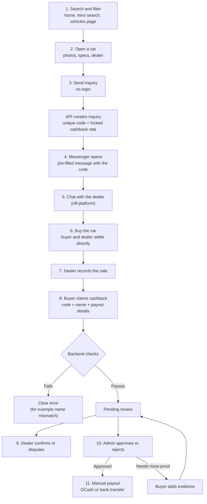

# Buyer journey

:::tip[Key takeaways]
- A buyer can go from **search to a Messenger chat in a few steps with no account**. The only identifiers are an **inquiry code** and the **buyer's name** on the sale.
- **Messenger is the sales channel.** DryvHub starts the conversation and records the inquiry; the negotiation itself happens in Facebook Messenger, outside DryvHub.
- **Cashback is claimed after the sale**, using the inquiry code. Review and payout are **manual** and done by DryvHub staff.
- No-login keeps friction low and avoids storing buyer accounts, but it means DryvHub **cannot proactively contact buyers** (there is no buyer email or push channel).
- The amount a buyer is shown up front (a flat ₱2,000) can differ from the amount the backend calculates. See [Business model](/docs/executive/business-model).
:::

## The journey at a glance

## Step by step

| # | What the buyer does | What happens behind the scenes | Status |
| --- | --- | --- | --- |
| 1 | Searches by make or model, or filters by category, transmission, fuel, maximum price, or minimum year; can switch to the **Coming Soon** tab | Public listing request; only **eligible** cars are returned. Results are paged (default 20, maximum 100 per page) | **Live** |
| 2 | Opens a car | Public details: make, model, year, mileage, price, down payment, category, transmission, fuel, variant, color, photos, dealer name, and a "documents complete" flag | **Live** |
| 3 | Presses **Send Inquiry** | A pop-up opens and the Marketplace immediately asks the API to create an inquiry with a **unique inquiry code**. The **cashback rate is frozen** from the platform settings at that moment (including any active promotion) | **Live** |
| 4 | Types their name (agent name optional), then presses send | The pop-up shows the code (with a Copy button) and a link to the cashback page. The browser opens the dealer's Facebook Messenger with a pre-filled message built from the car, the listing link, the code, and the names. If the dealer has no usable Facebook Page on record, the inquiry is refused and the buyer sees an error | **Live** |
| 5 | Chats with the dealer | Nothing. DryvHub does not see or store the conversation | Off-platform |
| 6 | Buys the car | Nothing. Payment for the car is between buyer and dealer | Off-platform |
| 7 | (Dealer) records the sale | The car becomes **sold** with the sold price, buyer name, and date; it leaves the Marketplace | **Live** |
| 8 | Opens **Cashback**, enters the code, their name, and a payout method (GCash or bank transfer) | The API runs the eligibility checks below and stores a claim as **pending review** | **Live** |
| 9 | (Dealer) confirms with proof (OR/CR, sales proof, release) or disputes with a reason (for example "buyer did not purchase") | Moves the claim to dealer confirmed or disputed; the admin sees this as a signal and is not required to wait for it | **Live** |
| 10 | Waits | An admin approves, rejects, asks for more evidence, or escalates to fraud review | **Live** |
| 11 | Receives money | An admin sends a **manual** GCash or bank transfer and records the reference in the system | **Live** (manual) |

## Why there is no buyer login

This is a deliberate product decision recorded in the Marketplace's agent contract: the buyer site is "public, no-login". The reasons visible in the design:

- **Lower friction.** Philippine buyers already use Facebook Messenger. Asking them to create another account before they can talk to a dealer would cost inquiries.
- **Less data to protect.** DryvHub holds no buyer passwords, emails, or profiles. The only buyer data is a name, an inquiry code, and payout details submitted with a claim.
- **A different identity proof.** Instead of a login, the **inquiry code** proves the buyer started the journey on the Marketplace, and the **name on the dealer's sale record** proves they bought the car.

What it costs:

| Trade-off | Consequence |
| --- | --- |
| No buyer contact channel | DryvHub cannot email or message a buyer about their claim; the buyer must come back to the Cashback page (the latest claim is remembered in the browser only) |
| Name-based matching | A typo or a different spelling between the claim and the dealer's record causes a "buyer name does not match" rejection |
| Public write endpoints | Inquiry and claim creation are open to the internet, so abuse control matters (see below) |

## Where Messenger fits

Messenger is where **the sale actually happens**. DryvHub's job is to (a) create a traceable inquiry before the chat starts and (b) put the inquiry code into the first message so it is visible to both sides.

- The Marketplace **never opens Messenger until the API confirms** the inquiry was saved. The inquiry is created when the pop-up opens, before the buyer presses send.
- The names the buyer types go into the Messenger message text. The Marketplace does not send them back to the API, although the API can accept them.
- The dealer's Messenger destination is taken from the Facebook Page the dealer connected, or parsed from the Facebook Page URL in their profile.
- The code appears in the chat text and in the pop-up (with a Copy button), so the buyer can recover it if they edit the message.
- There is **no inquiry lifecycle** (open, won, lost) yet. Inquiries that never turn into a sale simply stay as inquiries. The API plans explicitly defer this (ticket DRY-99), which also means inquiries where the buyer never sends the Messenger message remain as "orphans" in the data.

## The cashback checks

When the buyer submits a claim, the backend decides yes or no using these rules, in this order:

| Check | Fails with |
| --- | --- |
| The inquiry's dealer is Marketplace-eligible (Stage 2, approved, paid plan, valid subscription). Checked first | An access error naming the missing requirement (Stage 2, verification, or paid plan) |
| The inquiry code exists | `INVALID_INQUIRY` |
| No claim already exists for this inquiry or this car | `DUPLICATE_CLAIM` |
| The dealer is cashback-eligible: not revoked, and not within an active suspension (a strike suspension that has expired counts as eligible) | `DEALER_NOT_ELIGIBLE` |
| The car is marked sold with a sold date and a positive sold price | `SALE_EVIDENCE_INVALID` |
| The claimed first and last name match the buyer recorded on the sale (ignoring case and extra spaces) | `BUYER_MISMATCH` |
| The locked rate on the inquiry is a valid, non-negative number | `LOCKED_RATE_INVALID` |

If everything passes, a claim is saved as **pending review**. If the inquiry was created at or after the recorded sale time, the claim is still saved but flagged **timing review required** ("on hold for review" to the buyer); only a human can clear it.

Abuse control: inquiry creation, claim creation, and evidence updates share one limit of **5 requests per minute** per visitor key (adjustable by configuration). The counter is **in memory**, so each server process keeps its own count and the limit weakens if the API runs on several servers. A shared limit is deferred work.

## What buyers are told at each claim status

| Claim status | What the buyer sees (summary) |
| --- | --- |
| Pending review | "Claim received": pending review |
| Pending, timing flag | "On hold for review": a hold, not a rejection |
| Needs evidence | "More proof needed": add notes or a link to the OR/CR |
| Fraud review | "Under extra review" |
| Rejected | "Claim not approved"; contact the dealer with the inquiry ID |
| Approved | "Claim approved": payout is next |
| Payout failed | "Payout did not go through"; check payout details and wait for a retry |
| Paid | "Cashback sent" |

:::note
The API also has dealer-side states (dealer confirmed, disputed, needs dealer action). The Marketplace's buyer copy only defines the seven messages above, so we could not confirm what a buyer sees in those intermediate states. The pending-review message says the buyer "will hear next", but there is no buyer notification channel, so in practice the buyer must return and check.
:::

## What buyers can never see

The public data contract is an allow-list. Buyers never receive plate numbers, purchase price, expenses, dealer notes, internal documents, supply-agent details, buyer details from other sales, or any other dealership's private data. The Marketplace also does not compute eligibility or cashback itself.

## Related pages

- [Dealer journey](/docs/executive/dealer-journey)
- [Business model](/docs/executive/business-model)
- [Trust and safety](/docs/executive/trust-and-safety)
- [Marketplace buyer journey](/docs/marketplace/buyer-journey)
- [Marketplace eligibility](/docs/marketplace/eligibility)
- [Cashback claims](/docs/marketplace/cashback-claims)
- [Dealer inquiries](/docs/dealer/inquiries)
