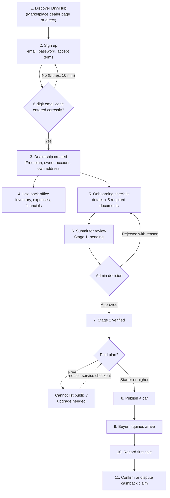

# Dealer journey

:::tip[Key takeaways]
- A dealer passes **four gates** on the way to a first Marketplace sale: **email proof**, **document verification (Stage 2)**, a **paid plan**, and a **published car**.
- Nearly all the **day-to-day back-office tools** (inventory, expenses, financials, reports) are open from the first minute, even before verification. Only the *public* features are gated.
- The biggest drop-off risk is the **paid-plan gate**: a verified Free dealer cannot list publicly, and there is **no self-service way to upgrade** yet.
- Verification has **no stated turnaround time**, no automatic notification of the decision was found, and each review is done by a person.
- The Dealer app calls Stage 2 "**Stage 3 verified**" in the sidebar badge. The database has only Stage 1 and Stage 2.
:::

## The journey at a glance

## Step by step

| # | Checkpoint | What the dealer does | What the system checks | Who decides |
| --- | --- | --- | --- | --- |
| 1 | **Discover** | Visits the Marketplace dealer page (`/for-dealers`) or goes straight to sign-up | Nothing; the page links to dealer sign-up and shows live listing counts only if the API returns them | Dealer |
| 2 | **Sign up** | Enters business and owner details, email, password; accepts terms | Password rules and terms are handled by Supabase and the signup form | Automatic |
| 3 | **Prove the email** | Types the 6-digit code emailed through Resend | Code expires in 10 minutes; 5 wrong attempts invalidate the challenge | Automatic |
| 4 | **Dealership is created** | Nothing | The API derives the dealership's address from the business name. If a similar name exists, the dealer must pick a different name. New dealers start on **Free**, owner role, not verified | Automatic |
| 5 | **First sign-in** | Signs in; is taken to their own dealership address | The session is a token; the address is not used to decide access | Automatic |
| 6 | **Use the back office** | Adds cars, photos, documents, expenses; records sales; reads reports | Tenant isolation on every request | Automatic |
| 7 | **Onboarding checklist** | Fills legal name, phone, email, physical address; uploads **five required documents** | All four text fields present; DTI, BIR, SEC registration, business permit, and showroom photo each uploaded **and confirmed** | Automatic |
| 8 | **Submit for review** | Presses Submit | Status becomes **pending**, stage **Stage 1**. Evidence is **locked** while pending or approved | Automatic |
| 9 | **Admin review** | Waits | A DryvHub admin approves or rejects. Reject requires a written reason. Admins cannot review a dealership they belong to | **DryvHub admin** |
| 10 | **Plan** | Chooses a paid plan | Marketplace needs Starter, Growth, Pro, or Enterprise with status `trialing`, `active`, or `past_due` | Currently done outside the app |
| 11 | **Publish** | Presses Publish on a car | Stage 2 + approved + paid plan + car is not blocked; then Marketplace visibility and a best-effort Facebook post | Automatic |
| 12 | **First sale** | Records buyer, price, payment method, status | Car must not already be sold; writes the money entry and marks the car sold | Dealer |

:::note Optional extras
Optional OR/CR uploads, a dealer profile page with logo and cover, Facebook Page connection, and a public dealer landing page are available but not required to progress. OR/CR was deliberately removed from the required onboarding documents.
:::

## The gates, in one table

| Capability | Stage 0 (not submitted) | Stage 1 (submitted) | Stage 2 + Free | Stage 2 + paid plan | Stage 2 + Pro or Enterprise |
| --- | --- | --- | --- | --- | --- |
| Inventory, expenses, financials, documents, reports | Open | Open | Open | Open | Open |
| PlateCheck **search** | Open | Open | Open | Open | Open |
| PlateCheck **report or import** | Blocked | Open | Open | Open | Open |
| Connect Facebook Page, Facebook posting | Blocked | Open | Open | Open | Open |
| Publish to Marketplace, inquiries, cashback | Blocked | Blocked | Blocked (needs paid plan) | **Open** | Open |
| Featured listing | Blocked | Blocked | Blocked | Blocked | **Open** |

Stage 1 here means a dealer who has submitted documents. The access rule checks the stage value, not whether the review is still pending, so a dealer gets Stage 1 capabilities as soon as they submit. This is a single shared rule in the backend (the access policy) and the Dealer app mirrors it for display. The backend remains the authority.

## Where dealers can drop off

| Stage | Why a dealer might stop | Severity (author's assessment) | Notes |
| --- | --- | --- | --- |
| Email code | Code expired or too many wrong tries; email goes to spam | Medium | Single email provider (Resend); no alternative channel |
| Business name | "Similar name already exists" conflict at registration | Low | The address is derived automatically; the dealer cannot choose it |
| Onboarding documents | Five documents must be uploaded **and confirmed**; photo and PDF size limits apply | Medium | Biggest manual effort for the dealer |
| Waiting for review | No stated turnaround; no decision email or push was found | **High** | A dealer sees status only by returning to the Verification page |
| Rejection | Must fix and resubmit; reason is shown but the process is manual | Medium | Rejected dealers can edit evidence again |
| **Paid plan** | Verified but Free, and **no checkout** | **High** | The upgrade button says checkout is not live. Revenue and activation both depend on a manual process |
| Facebook connect | Needs Stage 1 and a working Meta app configuration | Medium | A failed Facebook post never blocks publishing |
| Staff access | Cannot invite colleagues | Medium | The data model has a staff role but no invite flow |
| Capacity | Free dealers expect 3 units, but the limit is not enforced | Low | Could become an expectation gap |

## What the dealer sees along the way

- A persistent **access banner** tells the dealer which stage they are in and what unlocks next (for example "Verify your dealership to unlock Facebook integration, PlateCheck reporting, and marketplace eligibility").
- The **Inquiries** and **Cashback** pages show a locked state with a checklist until the dealer qualifies for the Marketplace.
- The **Verification** page shows three steps: submit, Stage 1 review, Stage 2 verified.
- The sidebar badge says **"Stage 3 verified"** once the dealer reaches Stage 2. This is a naming inconsistency, not a missing stage.

## PlateCheck in the dealer journey

PlateCheck is open for searching at every stage. Reporting needs Stage 1. It is **advisory**: we found no code that automatically blocks a dealer's own car when its plate appears in the registry. The `blocked_platecheck` listing status exists and stops publishing if set, but no code path sets it. Details on [Trust and safety](/docs/executive/trust-and-safety).

## Related pages

- [Buyer journey](/docs/executive/buyer-journey)
- [Trust and safety](/docs/executive/trust-and-safety)
- [Product status](/docs/executive/product-status)
- [Dealer getting started](/docs/dealer/getting-started)
- [Verification and access](/docs/dealer/verification-and-access)
- [Dealer billing](/docs/dealer/billing)
- [Listings and publishing](/docs/dealer/listings-and-publishing)
- [PlateCheck](/docs/dealer/platecheck)
