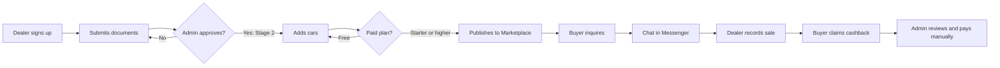

# DryvHub overview

:::tip[Key takeaways]
- DryvHub gives Philippine used-car dealers a **back-office app** and a **public marketplace**, both run by **one shared backend**.
- Buyers browse and inquire **without an account**. The conversation then moves to Facebook Messenger, and verified purchases can earn **cashback**.
- The core loop is **built and working end to end** in code: sign up, get verified, list, inquire, sell, claim cashback, get paid manually.
- **Money collection is not automated.** Subscription prices exist in the Dealer app, but there is no online checkout or billing engine yet.
- The cashback amount shown to buyers (a flat ₱2,000) does **not match** how the backend calculates it (a percentage of the sale price). This needs a decision. See [Risks and dependencies](/docs/executive/risks-and-dependencies).
:::

## The problem we are solving

Used-car dealers in the Philippines typically run on spreadsheets, chat threads, and Facebook posts. Three things hurt them and their buyers:

1. **Dealers lack a simple system** for stock, costs, sales, and profit.
2. **Buyers cannot tell** which listings are trustworthy or whether a car has a known problem.
3. **Leads leak.** A buyer messages a dealer on Facebook, and nobody can later prove the sale came from a particular channel.

DryvHub answers each: a dealer app for the books, a verification and PlateCheck layer for trust, and an inquiry code that ties a sale back to the Marketplace.

## Two products, one backend

| | Dealer app | Marketplace | API (backend) |
| --- | --- | --- | --- |
| **Who uses it** | Dealer owners and staff; DryvHub admins | Car buyers (public) | Both apps; never used directly by people |
| **Sign-in** | Yes (email and password, Google, password reset) | **No** | Verifies sign-in tokens from the Dealer app |
| **What it does** | Inventory, photos, documents, expenses, sales, financials, reports, publishing, inquiries, cashback, PlateCheck, verification, billing page, admin screens | Browse, filter, view a car, inquire, claim cashback, dealer sign-up landing page | All rules and data: tenancy, eligibility, cashback math, audit |
| **Technology (for reference)** | Next.js 16, React 19 | Next.js 16, React 19 | NestJS 11, PostgreSQL, MongoDB (PlateCheck only), Supabase Auth |

See [How it fits together](/docs/start/how-it-fits-together) for the picture.

## Who the users are

| User | Description | Where they work |
| --- | --- | --- |
| **Dealer owner** | Creates the dealership account; the only role at signup | Dealer app |
| **Dealer staff** | A second role exists in the data (`staff`), but there is **no way to invite staff** through the API yet | Dealer app |
| **Buyer** | A member of the public in the Philippines; no account, identified only by an inquiry code and the name on the sale | Marketplace |
| **Platform admin** | A DryvHub employee who reviews dealers, handles cashback, and manages cars across dealers | Admin screens in the Dealer app, plus the API |

## What is live today

Live means it exists in code and is wired end to end. The detailed table is on [Product status](/docs/executive/product-status).

| Area | Highlights | Status |
| --- | --- | --- |
| Dealer signup and sign-in | Email code verification, password and Google sign-in, per-dealer address | **Live** |
| Verification | Onboarding checklist, document upload, admin approve or reject | **Live** |
| Inventory | Vehicles, photos, documents, expenses, record sale, archive | **Live** |
| Publishing | Publish, unpublish, Marketplace sync, Facebook post, Facebook bump | **Live** |
| Marketplace | Home, inventory with filters, car details, dealer landing page, SEO | **Live** |
| Inquiry to Messenger | Inquiry code, locked cashback rate, Messenger redirect | **Live** |
| Cashback | Buyer claim, dealer confirm or dispute, admin review, manual payout record | **Live** |
| Financials and reports | Sales summary, payments, expenses, overhead, four reports with export | **Live** |
| PlateCheck | Search, report, bulk import on a shared registry | **Live** (advisory; see [Trust and safety](/docs/executive/trust-and-safety)) |
| Subscription billing | Plan page and prices only; no checkout, invoices, or recurring charges | **Partial** |
| Admin screens | Verification queue works; several other admin endpoints the UI calls were not found in the API | **Partial** |

## Headline numbers of scope

These were counted from the code at the time of writing.

| Measure | Count | How it was counted |
| --- | --- | --- |
| Dealer app pages | **45** | Page files under the Dealer app's routes (27 dashboard, 6 admin, 12 sign-in, onboarding, public, and legal pages) |
| Dealer app server routes | **3** | Signup email code (send and verify) and the photo upload proxy |
| Marketplace pages | **5** | Home, vehicles list, vehicle details, cashback claim, for-dealers (plus sitemap and robots files) |
| API endpoints | **99** | HTTP handlers across 20 controllers; **9** are public (no sign-in) |
| Database tables | **20** in PostgreSQL | Plus 2 collections in MongoDB for PlateCheck |
| Subscription plans | **5** | Free, Starter, Growth, Pro, Enterprise |
| Automated test files | **130** API, **107** Dealer unit, **20** Dealer browser flows, **26** Marketplace | File counts only. Pass rates were not run for this guide |

:::note These are scope numbers, not business numbers
This guide does not contain customer counts, revenue, listing volume, or conversion rates. None are stored in the repositories. The Marketplace home page deliberately shows a fallback line instead of numbers "while real marketplace volume is still small".
:::

## One-page summary

**In one sentence:** DryvHub is a working dealer-plus-marketplace platform whose trust, listing, and cashback machinery is built, but whose revenue collection and some admin tooling are still manual or unfinished.

## Related pages

- [Business model](/docs/executive/business-model)
- [Product status](/docs/executive/product-status)
- [Risks and dependencies](/docs/executive/risks-and-dependencies)
- [How it fits together](/docs/start/how-it-fits-together)
- [Dealer app overview](/docs/dealer/overview)
- [Marketplace overview](/docs/marketplace/overview)
