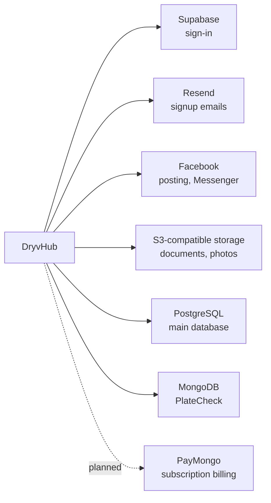

# Risks and dependencies

:::tip[Key takeaways]
- The biggest risks are **business-process risks**, not code defects: revenue collection, verification, and cashback payouts are all **manual**, and the cashback funding model is not written down.
- DryvHub relies on **six outside services**. The most strategic one is **Facebook**, because Messenger is where sales conversations happen.
- On the engineering side, the main concerns are **tenant isolation that depends on developers never forgetting a filter**, a **small number of engineers**, and **no monitoring** we could find.
- **All severity ratings on this page are the author's assessment** from reading the code and plans. They are not the result of a formal risk review. Severity combines how likely the problem is and how much it would hurt.
:::

:::note How to read the tables
**Severity:** High (could stop revenue, leak data, or harm trust), Med (hurts efficiency or quality, workaround exists), Low (minor or contained). **Mitigation** entries are suggestions unless they say a control already exists.
:::

## 1. Third-party dependencies

| Dependency | What breaks if it fails or changes | Severity | Mitigation |
| --- | --- | --- | --- |
| **Supabase** (sign-in, token keys) | Nobody can sign in or register; admin access also depends on it | **High** | Status monitoring; document an incident plan; keep the integration behind one auth service so a replacement is possible |
| **Facebook / Meta** (Page connect, auto-post, bump, **Messenger link**) | Auto-posting stops. If Meta changes Messenger deep links, permissions, or app review rules, the **buyer-to-dealer handoff** breaks | **High** | Track Graph API version changes (the code pins one); keep a second contact path available (for example phone) as a product option; Facebook failures already never block publishing |
| **Resend** (signup email code) | New dealers cannot finish signup | Med | Add a second provider or a resend path; alert on failures |
| **PostgreSQL** (system of record: dealers, cars, inquiries, claims) | Everything | **High** | Backups, restore test, and hosting details are **not documented** in the repositories; document and test them |
| **S3-compatible storage** (private bucket for documents and photos) | Photos and verification documents unavailable | Med | Versioning and backup policy on the bucket; confirm region and access policy |
| **MongoDB Atlas** (PlateCheck registry only) | Plate search and reporting fail; nothing else | Low | PlateCheck is advisory today, so impact is contained |
| **PayMongo** (planned subscription billing) | Not a dependency yet. Once built, monthly revenue collection depends on PayMongo approving Subscriptions and card saving on our account, and on webhooks reaching us. PayMongo disables a webhook after repeated delivery failures, which would silently stop billing updates | Med | Request enablement early; alert on webhook failures; run a reconciliation job; keep manual billing as fallback |
| **Hosting and domains** (`dryvhub.com`, wildcard subdomains, `admin.` host) | Site availability, dealer addresses | Med | **Not documented in the repositories**; record providers, owners, renewal dates |

:::warning Unknown ownership
We could not find who owns the cloud accounts, domains, Meta app, Resend account, or Supabase project. If these sit on one person's login, that is a **High** continuity risk. This is an open question for the team, not a finding.
:::

## 2. Operational risks

| Risk | Why it matters | Severity | Mitigation |
| --- | --- | --- | --- |
| **No self-service billing or plan change** | A verified Free dealer cannot list; every upgrade needs staff action; revenue collection is outside the product | **High** | Ship checkout (ADR-0011) or document a manual process with an owner and a service time |
| **Cashback funding model not defined in code or docs** | The platform pays buyers, but where the money comes from (dealer fee, platform margin) is unspecified; the dealer fee is recorded but not collected | **High** | Decide and document before volume grows; align legal terms with the dealer |
| **Older claims still store a percentage amount** | Claims submitted before the flat ₱2,000 rule keep that saved amount. Paying them as stored would overpay | **Medium** | Correct unpaid rows to ₱2,000 before payout |
| **Manual cashback review and payout** | Slow, error-prone at scale, and the only reviewer UI we could not find in the Dealer app; payouts are GCash or bank by hand | **High** | Build the admin screens; add a review checklist and target turnaround; later automate payouts |
| **Manual dealer verification** | No stated turnaround; growth makes it a bottleneck; one admin's quality sets the bar | **High** | Document criteria, service time, and a second reviewer; add notification of decisions |
| **Admin screens that call missing API routes** | Staff may see errors on tenants, follow-ups, or vehicle tools | Med | Confirm whether those routes live elsewhere or finish them |
| **No monitoring, error tracking, or analytics** found | Outages and abuse are discovered by users, not by DryvHub | Med | Add uptime and error monitoring first; web analytics second |
| **No support or incident runbooks** found | Slow or inconsistent response when a dealer or buyer has an issue | Med | Write short runbooks for the top five support cases |
| **Plan limits not enforced** (units, admin seats, storage) | Pricing tiers promise capacity the system does not enforce | Low | Enforce, or stop displaying them as limits |
| **Orphan inquiries** (buyer never sends the Messenger message) | Inflates inquiry counts; weakens conversion data | Low | Inquiry lifecycle (DRY-99) |

## 3. Technical debt

| Item | What it means | Severity | Mitigation |
| --- | --- | --- | --- |
| **In-memory rate limiter and notification stream** | Counts are per server process; limits weaken with more than one server; live updates would not reach all users | Med | Shared store (DRY-103) before scaling out |
| **Documentation drift** | API README lists about 30 endpoints; the code has about 99; older plans say "planned" for shipped things | Low | Treat Swagger and this site as sources; fix README |
| **Expense-summary N+1 queries** | Inventory list may call the API once per car for expense totals; slower as stock grows | Low | API-side summary (deferred) |
| **No browser tests for the Marketplace; no CI configuration found** | Regressions depend on manual checks. CI may run in another system (for example hosting) that we could not see | Med | Add a CI pipeline running lint, type checks, and unit tests; add a minimal E2E for inquiry and claim |
| **Staff roles exist but cannot be invited** | Dealers with employees must share one login | Med | Staff invite flow (ADR-0008 deferred) |
| **Dealer admin UI inside the dealer app** | Admin and dealer code are deployed together | Low | Acceptable now; revisit if admin grows |
| **Tests exist but were not run for this site** | Test counts are not proof of health | Low | Run in CI and publish status |

## 4. Security posture

| Area | Assessment | Severity | Mitigation |
| --- | --- | --- | --- |
| **Cross-dealer data isolation** | Enforced by filtering every query by dealership, with tenant identity derived from the signed-in user. A single forgotten filter would leak data. No database-level backstop (row-level security) | **High** impact, Med likelihood | Keep the review checklist strict; add automated tests for every new endpoint; consider row-level security |
| **Admin access** | Separate admin table and host; self-review blocked; audit log for verification, review, and payouts | Low | Add admin sign-in hardening (for example a second factor) and log review |
| **Facebook Page tokens at rest** | Stored as plain text in the database; no application-level encryption found | Med | Encrypt at rest with a key held outside the database |
| **Public write endpoints** (inquiry, claim) | Protected by validation and a per-process rate limit | Med | Shared rate limit; bot protection if abuse appears |
| **Secrets handling** | Environment-based; examples contain names only; not reviewed against the live environments | Low | Rotate keys on staff changes; keep secrets out of chat tools and tickets |
| **Personal data** | The platform holds buyer names, payout phone numbers or bank details, and dealer identity documents. The Philippine **Data Privacy Act** is likely relevant | Med | Get a privacy review: retention periods, access logging, deletion requests. Not legal advice |
| **Marketing vs enforcement** | The Marketplace describes PlateCheck-backed protection, but PlateCheck does not block anything | Med | Soften the copy or build the rule |
| **Penetration test** | None found | Med | Commission one before heavy marketing or paid launch |

## 5. People and continuity (bus factor)

| Risk | Evidence | Severity | Mitigation |
| --- | --- | --- | --- |
| **Few engineers carry the platform** | Git history shows a handful of committer identities, with the work concentrated in two or three of them; one person appears under two accounts. The API has about 150 commits and the Dealer app about 100 | **High** | Keep this documentation current; pair on releases; record access to every account |
| **Operational knowledge lives in people** | Review criteria, payout steps, and support handling are not written down | **High** | Write the admin review and payout playbooks first |
| **Single branch discipline** | The API working copy is on `staging` with uncommitted Marketplace-related work at the time of reading | Low | Follow the documented git flow: feature branch → `staging` → `main` |

## What we would tackle first (author's suggestion)

1. Decide and document the **cashback funding model**; make the buyer's number match the math.
2. Put **billing** in front of the paid-plan gate (checkout, or a documented manual process with an owner).
3. Give admins **screens for cashback review and platform settings**, plus a written review playbook.
4. Add **uptime, error, and web analytics** tools; write a weekly metrics query ([Metrics and reporting](/docs/executive/metrics-and-reporting)).
5. Record **ownership and access** for every account and domain.

## Related pages

- [Overview](/docs/executive/overview)
- [Business model](/docs/executive/business-model)
- [Trust and safety](/docs/executive/trust-and-safety)
- [Product status](/docs/executive/product-status)
- [Metrics and reporting](/docs/executive/metrics-and-reporting)
- [FAQ](/docs/executive/faq)
- [Architecture](/docs/developers/architecture)
- [Decisions](/docs/developers/decisions)
- [Auth and tenancy](/docs/developers/auth-and-tenancy)
