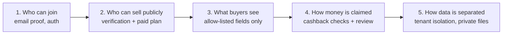

# Trust and safety

:::tip[Key takeaways]
- Trust in DryvHub rests on **five layers**: who may sign up, who may sell publicly, what buyers can see, how money claims are checked, and how data is kept apart between dealerships.
- The strongest, best-tested controls are **dealer verification**, the **single access rule** in the backend, the **public allow-list** of listing fields, and the **cashback checks**.
- The weakest points are **PlateCheck, which advises but does not block**, **rate limiting held in one server's memory**, **tenant isolation that depends on developers always filtering by dealership**, and **no notification or monitoring story** that we could find in the repositories.
- Every control below is described as **control → what it protects → who owns it**. Where something is only a plan, it says so.
:::

## How the layers fit together

## 1. Accounts and access

| Control | What it protects | Who owns it |
| --- | --- | --- |
| **Email code at signup** (6 digits, 10-minute expiry, 5 attempts, delivered through Resend) | Fake or mistyped emails; scripted signups | Platform engineering (API) |
| **Supabase sign-in** with signed tokens that the API verifies against Supabase's public keys | Account credentials; the API never stores passwords | Supabase (service), platform engineering (integration) |
| **Bearer token on every dealer API call** | Anonymous access to dealer data | Platform engineering |
| **Public routes are an explicit exception** (a marker on each route) | Accidentally exposing a private route | Platform engineering; code reviewers |
| **Separate admin host and admin role** (platform users are a different table from dealer users) | Dealer staff reaching DryvHub admin tools | Platform engineering |
| **Admins cannot review their own dealership** | Self-approval | Platform engineering |

## 2. Dealer trust (who may sell publicly)

| Control | What it protects | Who owns it |
| --- | --- | --- |
| **Document verification** (legal name, contact details, address, DTI, BIR, SEC, business permit, showroom photo) reviewed by a person | Buyers from fake or unregistered sellers | **DryvHub admin team** (review); platform engineering (workflow) |
| **Stage 2 + approved + paid plan + valid subscription** before any car appears publicly (one shared rule, enforced in the API) | Marketplace quality; ensures sellers are accountable and paying | Platform engineering; product (rules) |
| **Reject requires a written reason** and evidence is locked while under review | Disputes about why a dealer was rejected; edits after submission | Platform engineering |
| **Eligibility is re-checked on every public read** (verification, plan, subscription status, active account, car published and not sold or archived) | A dealer who falls out of good standing still showing cars | Platform engineering |
| **Dealer strikes** for confirmed cashback fraud: 1st is a warning, 2 within 365 days is a 30-day cashback suspension, 3 in a lifetime is revocation | Repeat bad actors | **DryvHub admin team** (decides), platform engineering (applies) |
| **Featured placement needs Pro or Enterprise** | Paid promotion being given to unverified or Free dealers | Platform engineering |

:::warning What "verified" does not mean
Verification checks that a dealership **submitted documents and an admin accepted them**. We found no automated checking against government registries, no re-verification schedule, and no expiry on approval. The strength of this control is the quality of the admin review, which is not documented.
:::

## 3. Buyer protection (what the public sees and does)

| Control | What it protects | Who owns it |
| --- | --- | --- |
| **Public allow-list of listing fields.** The public listing returns only an approved set (make, model, year, mileage, price, down payment, category, specs, photos, dealer name, documents-complete flag). Plate numbers, purchase price, expenses, notes, and internal documents are not in the public shape | Dealer confidential data; buyer safety (no plate lookups) | Platform engineering; Marketplace team follows the contract |
| **Eligibility is never computed in the Marketplace site** | A browser or a bug in the buyer site granting itself access | Platform engineering |
| **Photos use short-lived signed links** | Hot-linking and permanent exposure of stored files | Platform engineering |
| **Inquiry created and recorded before Messenger opens** | "Lost" leads; later disputes over who contacted whom | Platform engineering |
| **Locked cashback rate at inquiry time** | Buyers losing a promised rate when settings change later | Platform engineering; product (rates) |
| **Dealer's Messenger page must be on record** | Buyers being sent to a wrong or empty chat | Platform engineering |
| **Marketplace listing report button** | Reporting a bad listing | **Not built.** No buyer-facing report feature was found |

## 4. Money safety (cashback)

| Control | What it protects | Who owns it |
| --- | --- | --- |
| **Inquiry code as proof of origin** | Cashback claimed for a car the buyer never inquired about on DryvHub | Platform engineering |
| **Name on the claim must match the dealer's sale record** | Someone else claiming for a sale | Platform engineering; **dealers** (must record names correctly) |
| **Sale evidence required** (car marked sold, sold date, positive sold price) | Claims against cars still for sale | Platform engineering |
| **One claim per inquiry and per car** | Double payment | Platform engineering |
| **Timing flag** when the inquiry was created at or after the sale | Back-dated inquiries created after the buyer already bought | **DryvHub admin team** (clears the flag) |
| **Manual admin review with explicit decisions** (approve, reject, needs evidence, fraud review, fraud confirmed, needs dealer action) | Paying out on weak or suspicious claims | **DryvHub admin team** |
| **Dealer confirmation or dispute** with proof and reasons | Claims the dealer knows are false | Dealers; admin team weighs it |
| **Manual payout with a recorded reference** (GCash or bank transfer) | Payout mistakes; gives an audit trail | **DryvHub admin team / finance** |
| **Financial snapshots on the claim** (locked rate, dealer fee, buyer amount, platform amount) | Later arguments about what was promised | Platform engineering |
| **Audit log** entries for verification decisions, review decisions, and payout success or failure | Accountability for admin actions | Platform engineering (writes), admin leadership (should read) |

:::caution Gaps
- Dealer confirmation is **optional** for admin approval, so an admin can approve a claim the dealer never responded to.
- The Marketplace advertises a flat ₱2,000 cashback while the backend computes a percentage of the sold price; a mismatch is a **trust and dispute risk** (see [Business model](/docs/executive/business-model)).
- There is **no written admin review playbook** in the repositories (what proof is enough, how fast to respond).
:::

## 5. Data separation and storage

| Control | What it protects | Who owns it |
| --- | --- | --- |
| **Tenant identity comes from the signed-in user's membership**, never from a header, address, or form field | One dealership reading another's data | Platform engineering |
| **Every dealer query is filtered by dealership** in code (ADR-0005) | Cross-dealer leaks | Platform engineering; reviewers |
| **Private storage with signed links** for documents and photos; type and size checks on upload | Exposure of IDs, permits, OR/CR | Platform engineering; storage provider |
| **No secrets in public settings** (environment-based configuration) | Credential leaks | Platform engineering |
| **Dealer Page access tokens for Facebook** stored per dealership | Posting only to the dealer's own Page | Platform engineering |

:::warning Two honest notes on data separation
1. We found **no database-level isolation** (row-level security). Safety depends on every query remembering to filter by dealership. This is the highest-impact bug class for the platform; the architecture decision explicitly accepted this trade-off.
2. We found **no application-level encryption** for the stored Facebook Page token (it is a plain text column). Whether the database or disk is encrypted is up to the hosting provider and is not documented here.
:::

## 6. Abuse control and availability

| Control | What it protects | Who owns it |
| --- | --- | --- |
| **Rate limit: 5 requests per minute** on public inquiry, claim, and evidence endpoints | Spam inquiries and brute-force of claim codes | Platform engineering |
| **Input validation at the boundary** on every endpoint | Malformed or hostile input | Platform engineering |
| **Best-effort Facebook posting** (a Facebook failure never blocks publishing) | A third-party outage taking down publishing | Platform engineering |

:::note Limits of these controls
The rate limiter is **in the memory of a single API process**. With more than one API server it becomes much weaker. The live-notification stream is in-memory too and has no publishers yet. Both are known and deferred.
:::

## 7. PlateCheck (advisory only)

PlateCheck is a plate-number registry kept separately (MongoDB) so dealers can check a vehicle for reported problems.

| Aspect | State today |
| --- | --- |
| Search | Open to any signed-in dealer (not a public endpoint) |
| Report or bulk import | Stage 1 and above; reporting is rate limited |
| Effect on a dealer's own car | **None automatically.** Listing eligibility checks a `platecheckFlagged` flag and a `blocked_platecheck` status, but we found no code that sets them |
| Marketplace copy | Describes "PlateCheck-backed" protection |

This means the product message is stronger than the enforcement. Either the copy should soften, or a block rule should be built. Owner: product plus platform engineering. See [PlateCheck](/docs/dealer/platecheck).

## What we could not verify

- Who monitors the admin queues and how quickly they respond.
- Backups, restore tests, incident response, and uptime monitoring (no runbooks or infrastructure files in the repositories).
- Penetration tests or external security reviews.
- Data-retention and privacy-law handling (for example, how long buyer names and payout details are kept).
- Terms of service and privacy-policy contents beyond the existence of public legal pages in the Dealer app.

## Related pages

- [Risks and dependencies](/docs/executive/risks-and-dependencies)
- [Dealer journey](/docs/executive/dealer-journey)
- [Buyer journey](/docs/executive/buyer-journey)
- [Product status](/docs/executive/product-status)
- [Verification and access](/docs/dealer/verification-and-access)
- [Marketplace eligibility](/docs/marketplace/eligibility)
- [Cashback claims](/docs/marketplace/cashback-claims)
- [Auth and tenancy](/docs/developers/auth-and-tenancy)
- [Decisions](/docs/developers/decisions)
