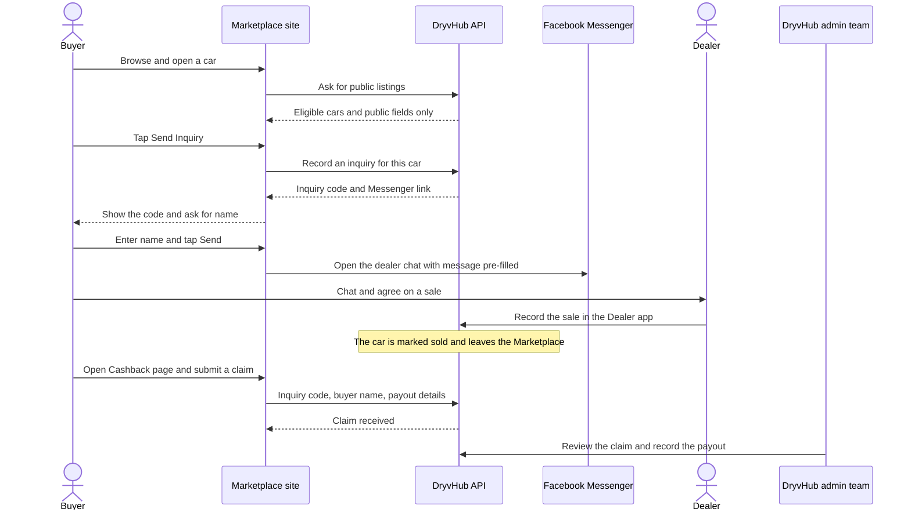

# Buyer journey

This page walks through everything a buyer does, in order, and what happens behind the scenes at each step.

:::tip[In plain English]
A buyer finds a car on the website, taps **Send Inquiry**, and lands in a Messenger chat with the dealer. DryvHub **writes the inquiry down first**, so it can later prove the buyer came through DryvHub. After the sale, the buyer returns to the site, enters the inquiry code, and asks for **cashback**. The DryvHub team reviews it and pays it out.
:::

## The big picture

## Illustrations

These pictures come from the Marketplace's own "how it works" section. They are **illustrations with sample data** (a sample car, a sample inquiry code and sample names), not real records. The inquiry code in picture 3 and picture 4 looks different from the real format, which is described in [Send Inquiry](/docs/marketplace/send-inquiry).

| Step | Picture |
| --- | --- |
| 1. Find a verified dealer's car |  |
| 2. Open a listing |  |
| 3. Send the inquiry |  |
| 4. Chat on Messenger |  |

## Step by step

1. **Discover.** The buyer arrives at the home page (from a search engine, a shared link or a social post). The home page offers a search box, brand shortcuts and featured cars. Buyers can also land directly on a car's page from a link. See [Browsing and search](/docs/marketplace/browsing-and-search).
2. **Browse.** On `/vehicles` the buyer narrows the list with filters (brand, body type, price, year and more) and sorts it. The page address changes with the filters, so the exact view can be shared.
3. **Open a car.** The buyer taps a card to see the full photo gallery, price, specs and the dealer's name. See [Vehicle details](/docs/marketplace/vehicle-details).
4. **Send Inquiry.** The buyer taps **Send Inquiry** (or **Inquire** on a card). A small window opens and immediately says "Starting your inquiry..." No account is needed.
5. **DryvHub records the inquiry.** While the window opens, the site asks the API to create an inquiry for that car. The API returns a unique **inquiry code** and the dealer's Messenger link. The window then shows the code (with a **Copy** button) and asks for the buyer's first and last name, plus, optionally, the name of the sales agent they were dealing with. If recording fails, the buyer sees an error and Messenger is **not** opened. See [Send Inquiry](/docs/marketplace/send-inquiry).
6. **Messenger opens.** When the buyer taps **Send**, the site sends them to the dealer's Facebook Messenger chat with a ready-written message containing the car, a link to the listing, the inquiry code and the buyer's name. The buyer still has to press **Send** inside Messenger. The link only exists because the inquiry was recorded first.
7. **Chat and buy.** Buyer and dealer talk, visit, negotiate and (hopefully) close the sale. This happens outside the Marketplace.
8. **Dealer records the sale.** The dealer enters the sale in the [Dealer app](/docs/dealer/overview). The car leaves the public Marketplace once it is sold.
9. **Claim cashback.** The buyer opens **Cashback** in the menu (or the link inside the inquiry window), enters the inquiry code, the same name as on the sale paperwork (OR/CR), and where to receive the money (GCash or bank transfer). See [Cashback claims](/docs/marketplace/cashback-claims).
10. **Review and payout.** The DryvHub team reviews the claim against the dealer's sale record and, if approved, records a manual payout. Dealers may also be asked to confirm the sale. See [Dealer cashback](/docs/dealer/cashback).

:::note[Why the inquiry code matters]
The code is the link between "this buyer asked about this car" and "this buyer later bought it." It is how DryvHub knows a sale came from the Marketplace. Buyers should keep it. It appears in the Messenger message, and the cashback form asks for it.
:::

## Who does what

| Step | Buyer | Marketplace site | API / backend | Dealer | DryvHub admins |
| --- | --- | --- | --- | --- | --- |
| Show cars | Browses | Displays | Decides what is public | Keeps stock updated | Not involved |
| Inquiry | Enters name | Shows the window | Records inquiry, locks cashback rate | Receives Messenger chat | Not involved |
| Sale | Buys | Not involved | Stores the sale | Records the sale | Not involved |
| Cashback | Submits claim | Shows the form | Validates and stores the claim | May confirm or dispute | Reviews and pays |

## What the buyer can and cannot see afterwards

- After sending a claim, the site shows a "Claim received" screen with the amount the API returned, the inquiry code and the payout method.
- The site remembers the last claim **only in the current browser tab** (it is cleared when the tab is closed).
- There is currently **no public "check my claim status" page** that updates as admins work on the claim. This is **Planned**, not built. See [Cashback claims](/docs/marketplace/cashback-claims).

## For developers

- Journey code map: home (`app/page.tsx`), inventory (`app/vehicles/page.tsx`), details (`app/vehicles/[id]/page.tsx`), inquiry (`components/marketplace/inquiry-modal.tsx`, `hooks/marketplace/use-send-inquiry.ts`), cashback (`app/purchases/cashback/page.tsx`).
- The ordering rule "record, then redirect" is enforced in the inquiry modal: it only builds the Messenger URL from the API response.

## Related pages

- [Marketplace overview](/docs/marketplace/overview)
- [Send Inquiry](/docs/marketplace/send-inquiry)
- [Cashback claims](/docs/marketplace/cashback-claims)
- [Dealer inquiries](/docs/dealer/inquiries)
- [How it fits together](/docs/start/how-it-fits-together)
