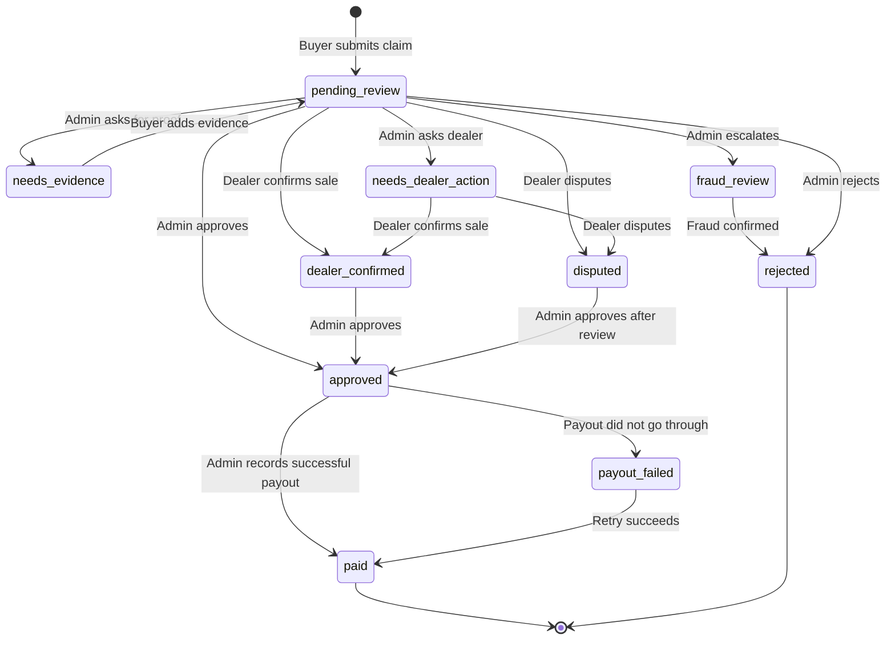

# Cashback claims

This page explains the buyer's cashback claim on the Marketplace (`/purchases/cashback`) and what the DryvHub team does with it afterwards.

:::tip[In plain English]
If a buyer finds a car through DryvHub Marketplace and buys it, they can ask DryvHub for **cashback**. They enter the **inquiry code** from their chat, the **name on the sale paperwork**, and where the money should go (GCash or bank). DryvHub checks the claim against the **dealer's recorded sale**. A DryvHub admin reviews it, and if it is approved, an admin sends the payout by hand and records it. An eligible claim pays a flat **₱2,000**.
:::

## Who is eligible?

The **backend** decides. The website cannot check eligibility; it only submits the claim and shows the result. A claim is accepted only when **all** of these are true:

| # | Rule | Plain meaning |
| --- | --- | --- |
| 1 | The **inquiry code exists**. | The buyer started the purchase through Send Inquiry. See [Send Inquiry](/docs/marketplace/send-inquiry). |
| 2 | **No claim exists yet** for that inquiry **or** that car. | One cashback per car and per inquiry. |
| 3 | The **dealer qualifies** for Marketplace access and cashback. | The dealer is verified and on an active paid plan, and has not been suspended or removed from cashback (see strikes below). |
| 4 | The **car is marked sold** by the dealer, with a **sold date** and a **sold price**. | The dealer must record the sale in the [Dealer app](/docs/dealer/overview) first. A buyer cannot claim before the sale is recorded. |
| 5 | The **buyer name matches** the buyer name on the dealer's sale record. | Compared ignoring capital letters and extra spaces. The claim form tells buyers to use the name on the OR/CR (Official Receipt / Certificate of Registration). |
| 6 | The **locked cashback rate** saved at inquiry time is valid. | A rate that is not a normal number, or below zero, is rejected. |

### Timing rule: inquiry must come before the sale

The inquiry should be created **before** the car's sold date. If the inquiry was created **at or after** the sold date, the claim is still accepted but is flagged **timing review required** and shown to the buyer as:

> **On hold for review.** Your claim was received, but the purchase timing needs a closer look. This is a hold, not a rejection.

Why: DryvHub pays cashback for sales it helped create. An inquiry created after the sale cannot have influenced it, so a human must look at it. An admin can still approve it after review.

## What the buyer fills in

The claim form has three sections:

| Section | Field | Required? | Notes |
| --- | --- | --- | --- |
| Your purchase | **Inquiry ID** | Yes | Up to 16 characters. Pre-filled when the buyer arrives from the inquiry window. |
| Your purchase | **First name**, **Last name** | Yes | Up to 100 characters each. Must match the sale record. |
| Proof of sale | **Notes** | Optional | Up to 2,000 characters. |
| Proof of sale | **Link to evidence** | Optional | A web address starting with `http` or `https`, up to 500 characters (for example a link to a photo of the OR/CR). |
| Payout | **Method** | Yes | **GCash** or **Bank transfer**. |
| Payout | **Destination** | Optional | GCash number or bank details, up to 160 characters. It can be given later. |

The site does **not** upload files. Evidence is notes and/or a link. File uploads from buyers are not part of the current flow.

**Page address parameters** (used by links generated inside the site): `inquiryCode`, `vehicleId`, `vehicleLabel` and `claimId`. The page is marked "do not index" for search engines.

### After submitting

The buyer sees the status screen with:

- the headline for the claim's status (normally **Claim received**),
- **Cashback amount** (a flat ₱2,000),
- the inquiry code, the vehicle, and the payout method.

The site remembers the **latest claim for this browser tab only**. It is cleared when the tab is closed. A buyer who returns later in a new tab starts with an empty claim form.

## Review and payout lifecycle

:::note
The diagram is simplified and partly inferred: the admin moves come from the backend (`transitionCashbackReview` in `cashback.entity.ts`), while the dealer confirm/dispute moves and the payout retry are inferred from how the dealer app groups claims as "needs action" and "approved", and were not traced step by step. In short: an admin can approve or reject a claim that is in review (pending, needs evidence, fraud review, dealer confirmed, or disputed), ask for more evidence, escalate to fraud review, or ask the dealer to act.
:::

### Statuses and what they mean

The backend has ten statuses. The **buyer-facing screen** has text for seven of them.

| Status | Meaning | Buyer-facing text (headline) |
| --- | --- | --- |
| `pending_review` | Claim received, waiting for the team. | **Claim received** (or **On hold for review** if timing needs review) |
| `needs_evidence` | Admin needs more proof. | **More proof needed** |
| `fraud_review` | Claim is in a deeper check. | **Under extra review** |
| `rejected` | Claim not approved. | **Claim not approved** |
| `approved` | Approved, payout is next. | **Claim approved** |
| `payout_failed` | The payout attempt failed. | **Payout did not go through** |
| `paid` | Money sent. | **Cashback sent** |
| `dealer_confirmed` | Dealer confirmed the sale. | *No buyer text in the site* |
| `disputed` | Dealer disputes the claim. | *No buyer text in the site* |
| `needs_dealer_action` | Admin is waiting for the dealer. | *No buyer text in the site* |

:::warning[What buyers can actually see today]
The public cashback endpoint returns the claim with status **`pending_review`** every time (the backend hard-codes this for the public view), and there is **no public "check my claim" page or endpoint** that returns later statuses. The status texts for approved, paid and so on exist in the website, but nothing in the current public flow can show them. This means buyers are not shown live progress. How buyers are told the outcome (for example by the dealer, or a message from the team) is **not defined in the code reviewed**. A buyer-visible status lookup is **Planned**, not built.
:::

### Evidence follow-up

When an admin sets a claim to **needs_evidence**, the buyer is meant to use **I was asked for more evidence** on the cashback page. The form asks for the **Claim ID** (a long unique ID; hidden if the site already knows it from this tab), the **Inquiry ID**, and additional notes or a link (at least one of the two; otherwise "Add notes or a proof URL."). After a successful send, the buyer sees **Evidence sent**: "We received the extra proof. The claim is back in review." The claim then returns to review.

If the claim is not in a state that accepts evidence, the buyer sees "This claim cannot accept that update right now."

The status screen does not currently show the claim ID. How a buyer who closed the tab learns their claim ID is **not verified** (a support person with admin access can look it up).

## What admins and dealers do

| Who | Actions |
| --- | --- |
| **DryvHub admins** | List claims and open a claim's details. **Review** (approve, reject, ask for evidence, send to fraud review, mark fraud confirmed, ask the dealer to act). **Record a payout** with the method, a reference and a success or failed outcome. |
| **Dealers** | See cashback claims on their cars in the Dealer app, and may **confirm** or **dispute** a sale with reasons and evidence (for example OR/CR, sales proof, release). See [Dealer cashback](/docs/dealer/cashback). |
| **Platform settings (admins)** | Dealer fee percentage, platform revenue percentage, and a stored cashback rate that is no longer used to price the buyer payout. The buyer payout is a flat ₱2,000. |

:::note[Payouts are manual]
DryvHub does not connect to GCash or a bank to pay automatically. Admins send the money themselves, then record the outcome and reference in the system. A failed payout can be retried.
:::

### Dealer strikes (why a dealer may be blocked)

If a dealer's cashback behavior is found to be a problem (for example a confirmed fraudulent claim), the backend records a **strike**. The rules in code are: the first strike is a warning; a second strike within 365 days suspends the dealer's cashback for 30 days; a third strike (lifetime) revokes cashback eligibility. A suspended or revoked dealer's cars cannot receive new cashback claims (the buyer sees "This dealer is not eligible for cashback on this purchase."). See also [Dealer verification and access](/docs/dealer/verification-and-access).

## How much is the cashback?

Eligible claims pay a flat **₱2,000**. The website and the API use that same amount. The sold price does not change it.

Claims created before this rule still show the amount stored when they were submitted. New claims store ₱2,000.

## Error messages buyers can see

| Message | When it appears |
| --- | --- |
| "That inquiry ID is invalid. Check the ID from marketplace chat and try again." | No inquiry with that code. |
| "The sale is not confirmed yet. Add clearer proof of sale or wait until the dealer records it." | The car is not recorded as sold yet, or sold data is incomplete. |
| "The buyer name does not match the completed sale. Use the name on the OR/CR." | Name differs from the dealer's sale record. |
| "The cashback rate on this purchase cannot be used. Contact the dealer." | The locked rate is invalid. |
| "A cashback claim already exists for this inquiry or vehicle." | Duplicate claim. |
| "This dealer is not eligible for cashback on this purchase." | Dealer suspended, revoked or otherwise not eligible. |
| "This claim cannot accept that update right now." | Evidence sent when the claim is not asking for it. |
| "Too many attempts. Wait a few minutes and try again." | Rate limit: 5 attempts per 60 seconds for the same visitor and code. |
| "Unable to submit your cashback claim right now." (generic) | Anything else, including the dealer not having marketplace access. For evidence the generic text is "Unable to send evidence right now." |

## For developers

- Frontend: `app/purchases/cashback/page.tsx`; components in `components/marketplace/cashback/*`; copy and error mapping in `lib/marketplace/cashback-claim-copy.ts`; form rules in `lib/marketplace/cashback-claim-form.ts`; last-claim storage key `dryvhub.cashback.lastClaim` (browser tab storage) in `lib/marketplace/cashback-claim-storage.ts`; service `services/cashback-claims.service.ts`.
- Public API: `POST /api/v1/cashback/claims` and `PATCH /api/v1/cashback/claims/:id/evidence`. Both are rate limited using the same in-memory limiter as inquiries (5 per 60 seconds, per visitor and key). Distributed limiting is **Planned** (DRY-103).
- Admin API: `GET /api/v1/admin/cashback/claims`, `GET .../:id`, `PATCH .../:id` (review), `POST .../:id/payout`, and `GET`/`PATCH /api/v1/admin/platform-settings`.
- Backend rules live in `src/core/entities/cashback.entity.ts`; the claim transaction is in `CashbackDataService.submitClaim`.
- The admin review, payout and dealer confirm/dispute details above come from the entities and plans and were not re-verified controller by controller.

## Related pages

- [Send Inquiry](/docs/marketplace/send-inquiry)
- [Buyer journey](/docs/marketplace/buyer-journey)
- [Troubleshooting and FAQ](/docs/marketplace/troubleshooting-faq)
- [Dealer cashback](/docs/dealer/cashback)
- [Trust and safety](/docs/executive/trust-and-safety)
- [Data model](/docs/developers/data-model)
