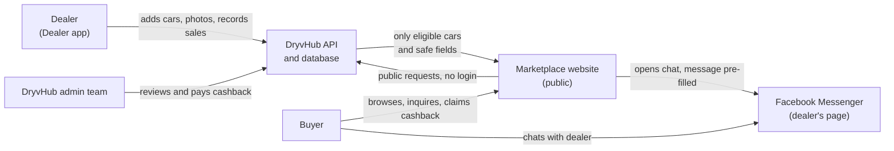

# Marketplace overview

This page explains what DryvHub Marketplace is, who uses it, what pages it has, and how it relates to the Dealer app and the DryvHub API.

:::tip[In plain English]
DryvHub Marketplace is the **public website where car buyers in the Philippines look at used cars** listed by verified DryvHub dealers. Buyers do not need an account. They browse, open a car, tap **Send Inquiry**, and continue the conversation with the dealer on Facebook Messenger. After buying, they can claim **cashback** on the same site.

The website itself makes no business decisions. Which cars appear, who gets cashback and who may sell are all decided by the DryvHub backend. The website only shows the results.
:::

## Who it is for

| Audience | What they use it for |
| --- | --- |
| **Car buyers** (public, no login) | Find a car, see price and photos, message the dealer, claim cashback after buying. |
| **Dealers** (indirectly) | Their eligible stock appears here automatically. They manage everything in the [Dealer app](/docs/dealer/overview). |
| **Support and operations** | Share links with buyers, explain why a car is or is not visible, help with cashback questions. |
| **Executives** | See the buyer-facing half of the DryvHub product. See also the [executive overview](/docs/executive/overview). |
| **Developers** | Maintain a small, read-mostly Next.js site that talks to the public DryvHub API. |

## The pages at a glance

| Address (route) | What it is | What the buyer sees |
| --- | --- | --- |
| `/` | Home page | Search box, featured cars, brand shortcuts, editor's picks, cashback teaser, "how it works" guide. |
| `/vehicles` | Inventory | Every public car with filters, sorting and paging. See [Browsing and search](/docs/marketplace/browsing-and-search). |
| `/vehicles/{id}` | Vehicle details | Photo gallery, price, specs, dealer name, **Send Inquiry**. See [Vehicle details](/docs/marketplace/vehicle-details). |
| `/purchases/cashback` | Cashback claim | A form to claim cashback, and a "claim received" screen. See [Cashback claims](/docs/marketplace/cashback-claims). |
| `/for-dealers` | Dealer landing page | A sales page that invites dealers to sign up. See [For-dealers page](/docs/marketplace/for-dealers-page). |
| `/sitemap.xml` and `/robots.txt` | Instructions for search engines | Not for people. See [SEO and sharing](/docs/marketplace/seo-and-sharing). |
| `/manifest.webmanifest` | Web app manifest | Lets a phone treat the site like an installable app (name, colors, icon). |

The top menu always shows: **Browse Cars**, **Featured**, **Cashback**, **How It Works**, **For Dealers**.

## What the Marketplace deliberately is NOT

These limits are on purpose. They keep the public site simple and keep private business data private.

- **No buyer accounts or login.** Nobody signs in to browse, inquire or claim cashback.
- **Not the dealer portal.** Dealers add cars, photos, expenses and sales in the [Dealer app](/docs/dealer/overview), never here.
- **No accounting, internal documents or PlateCheck administration.** Those live in the Dealer app and the admin tools.
- **No business rules in the browser.** The site never works out whether a car is allowed to be listed, or whether a buyer qualifies for cashback. It asks the API and shows the answer. See [Eligibility](/docs/marketplace/eligibility).
- **No separate list of "marketplace cars."** A Marketplace listing is simply a dealer vehicle that passes the eligibility rules. If a car is missing from the public API, it is not on the site, and the site never invents a replacement.

:::note
Related background: the shared vocabulary is in the [Glossary](/docs/start/glossary), and the big picture is in [How it fits together](/docs/start/how-it-fits-together).
:::

## How it relates to the Dealer app

Dealers and buyers use two different websites that share one backend (the **DryvHub API**). The dealer manages stock. The API decides what is public. The Marketplace shows it.

In short:

1. The dealer works in the Dealer app.
2. The API checks the rules and publishes only eligible cars with only public fields.
3. The Marketplace shows those cars to anyone.
4. When a buyer inquires, the Marketplace asks the API to record it, then sends the buyer to Messenger.

## What the Marketplace shows versus what the backend decides

| Question | Who decides |
| --- | --- |
| Is this car shown publicly? | **Backend** (see [Eligibility](/docs/marketplace/eligibility)) |
| Which fields are public? | **Backend** (see [What buyers never see](/docs/marketplace/what-buyers-never-see)) |
| Does this inquiry get recorded and which Messenger page does it go to? | **Backend** |
| Is this buyer entitled to cashback, and how much? | **Backend** (see [Cashback claims](/docs/marketplace/cashback-claims)) |
| How the page looks, filters, light/dark mode | **Marketplace website** |

## For developers

- Repository: `dryvhub-marketplace` (Next.js 16 App Router, React 19, TypeScript, Tailwind 4, TanStack Query, zod).
- Layers (keep this direction): `app/` and `components/` (screens) call `hooks/`, which call `services/`, which call `config/api-client.ts` (plain `fetch`, **no** Authorization header). `lib/` and `types/` hold pure helpers and data shapes only.
- Server pages (home, inventory seed, details, sitemap) call `services/` directly. Interactive parts (header, search box, filters, gallery, inquiry modal, cashback forms) are client components that use hooks.
- Public API endpoints used:
  - `GET /api/v1/marketplace/listings` and `GET /api/v1/marketplace/listings/:vehicleId`
  - `POST /api/v1/marketplace/listings/:vehicleId/inquiries`
  - `POST /api/v1/cashback/claims` and `PATCH /api/v1/cashback/claims/:id/evidence`
- Environment variable names: `NEXT_PUBLIC_API_URL`, `API_URL` (server only, optional), `NEXT_PUBLIC_SITE_URL` (public origin used in canonical links and the sitemap). Values are never documented here.
- Details: [Architecture](/docs/developers/architecture) and [API integration](/docs/developers/api-integration).

:::warning
An older note in the repository's `AGENTS.md` says Send Inquiry is "not implemented yet." The current code does implement it. See [Send Inquiry](/docs/marketplace/send-inquiry).
:::

## Related pages

- [Buyer journey](/docs/marketplace/buyer-journey): the whole story from first visit to cashback.
- [Browsing and search](/docs/marketplace/browsing-and-search)
- [Troubleshooting and FAQ](/docs/marketplace/troubleshooting-faq)
- [Welcome](/docs/start/welcome)
- [Dealer app overview](/docs/dealer/overview)
