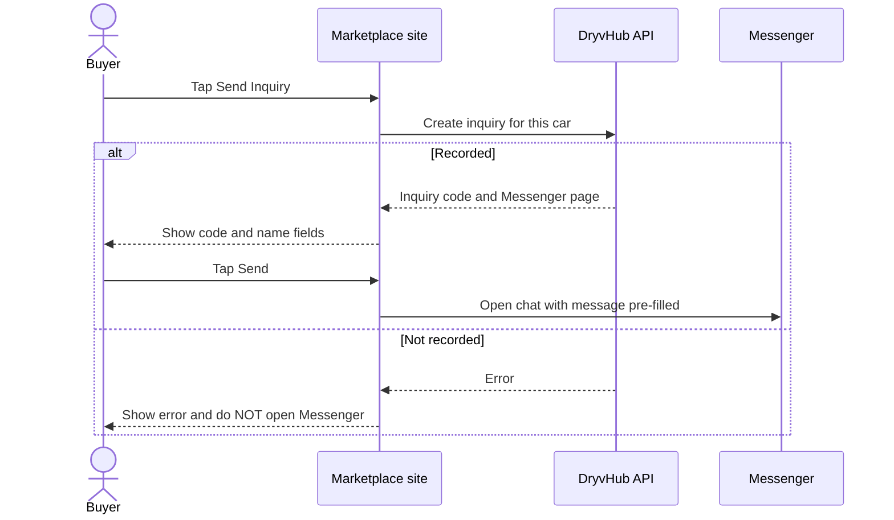

# Send Inquiry

This page explains what happens when a buyer taps **Send Inquiry**, why DryvHub records the inquiry first, and what each error message means.

:::tip[In plain English]
When a buyer wants a car, they tap **Send Inquiry**. DryvHub **writes the inquiry down first** and gives it a short code. Only then does it send the buyer to the dealer's Facebook Messenger with a ready-made message. That written record is what makes cashback possible later, because it proves the buyer found this car through DryvHub.
:::

## Is it implemented?

**Yes.** In the current code, the full flow works: the buttons, the inquiry window, the call to the API, the code display, and the Messenger hand-off.

:::warning[Older notes disagree]
The Marketplace repository's `AGENTS.md` still says Send Inquiry is "not implemented as an API flow yet" and that the details button only links to `?inquire=1`. That text is out of date. The code (the inquiry button, the inquiry window, the `useSendInquiry` hook and the inquiries service) implements the flow, and the backend endpoint exists. This documentation follows the code.
:::

## What the buyer does and sees

1. The buyer taps **Send Inquiry** on the details page, or **Inquire** on a listing card.
2. A window titled **Send Inquiry** opens and says "Starting your inquiry...". At this moment the site asks the API to create the inquiry.
3. When the API answers, the window shows:
   - the **Inquiry code** (with a **Copy** button),
   - a line "After you buy, claim ₱2,000 cashback with this code" that links to the cashback page with the code and car already filled in (see the cashback warning in [Cashback claims](/docs/marketplace/cashback-claims)),
   - **Buyer** first and last name (both required),
   - **Agent (optional)** first and last name. If the buyer fills in either agent name, both become required.
4. The buyer taps **Send**. The site opens Messenger:
   - On a phone or tablet (a device where the main pointer is touch) it opens the Messenger **app link** (`m.me`).
   - On a computer it opens Messenger on the **web** (`messenger.com`).
5. Messenger opens with the message already typed. **The buyer must still press Send in Messenger.**

The pre-filled message contains the vehicle line (year, make, model, variant), the listing link, the inquiry code, and then the buyer name (and agent name if given). For example (sample data):

```text
I'm inquiring about this vehicle:

2019 Toyota Vios 1.3 E

https://marketplace.example/vehicles/<listing-id>

Inquiry code: DH-ABCDEFGH

Buyer: Juan Dela Cruz
Agent: Maria Santos
```

If a buyer opens the page with `?inquire=1` on the address, the inquiry starts automatically once, and the `inquire` parameter is removed from the address. This is used for links that should jump straight into the inquiry window.

## Why the inquiry is recorded before Messenger opens



Reasons:

- **Proof for cashback.** Without a saved record, nobody can later prove the buyer came through DryvHub.
- **Dealer visibility.** The dealer sees the inquiry in their Dealer app list (see [Dealer inquiries](/docs/dealer/inquiries)).
- **Code in the chat.** The code is created by DryvHub, so it can be put into the message and later matched.
- **No broken promises.** If DryvHub cannot record the inquiry (car gone, dealer not set up, too many attempts), the buyer is told right away instead of being sent into a chat that DryvHub cannot track.

:::note
Because the inquiry is created as soon as the window opens, an inquiry can exist even if the buyer closes the window and never opens Messenger. Each time the buyer starts again, a **new** inquiry with a new code is created.
:::

## What is recorded

| Item | Detail |
| --- | --- |
| **Inquiry code** | `DH-` followed by 8 characters. The characters avoid look-alikes (no `I`, `O`, `0` or `1`). Example shape: `DH-ABCDEFGH`. |
| **Vehicle and dealer** | The car and its dealership, taken by the backend (never from the browser). |
| **Time** | Creation time (UTC). |
| **Source** | Always the Marketplace Messenger flow. |
| **Cashback rate lock** | The cashback percentage in force **at that moment** (see below). |
| **Entry point** | Whether the buyer started from a **listing card** or the **details page**. See the note below. |

### Card versus details ("source")

The backend can store an **entry point** value of `listing_card` or `listing_details`. **The current website does not send it**, so the entry point is stored as empty for Marketplace inquiries. The button label differs ("Inquire" on cards, "Send Inquiry" on details) but that difference is cosmetic today. If the team wants card-versus-details reporting, the website needs a small change to send this value. Treat this as **Planned**.

### Buyer and agent names

The names typed in the window are used **only to write the Messenger message**. The website creates the inquiry before asking for names and does not send them to the API, so they are not saved on the inquiry record. (The backend can store them if a client sends them.) The name that matters for cashback is the one the buyer enters later on the claim form, which must match the dealer's sale record.

### The cashback rate lock

When the inquiry is created, the backend copies the current cashback rate into the inquiry. This is the **locked rate**. If admins later change the platform rate or run a promotion, inquiries that already exist keep the rate they were created with. The rate comes from platform settings (including any active promotion window) and is configured by admins, not by the website. The API returns this value (`cashbackRateAtInquiry`), but the current inquiry window does not display it.

## Error cases

| What the buyer sees | What it means | Typical cause |
| --- | --- | --- |
| "This listing is no longer available." | The API said the car was not found. | Car sold, unpublished, no longer eligible, or removed. |
| "This dealer isn't set up for Messenger inquiries yet." | The API answered "conflict". | The dealer has not connected a Facebook page in the Dealer app. |
| "We couldn't start this inquiry. Please try again." | Any other failure. | Network problem, server error, or **too many attempts** (rate limit), or a malformed car ID. |

Other details:

- **Rate limit.** The backend allows at most **5 inquiries per 60 seconds** for the same visitor address and the same car. The counter is kept in the server's memory, so it resets if the server restarts and is not shared between servers. A shared (distributed) limiter is **Planned** (tracked as DRY-103). A rate-limited buyer currently sees the generic message above, not a special "too many attempts" message.
- **Messenger link problems.** If DryvHub cannot build a Messenger link from the dealer's page, the buyer sees "We couldn't start this inquiry. Please try again."
- **Messenger prefill is a convenience.** DryvHub passes the message text to Messenger in the link. Facebook controls whether it appears in the chat box. If the box is empty, the buyer can paste the code themselves (it is on screen with a **Copy** button).

## For developers

- Frontend: `components/marketplace/send-inquiry-button.tsx` (labels and the auto-start rule), `components/marketplace/inquiry-modal.tsx` (window and redirect), `hooks/marketplace/use-send-inquiry.ts` (error texts), `services/marketplace-inquiries.service.ts`, `lib/marketplace/inquiry-message.ts`, `lib/marketplace/messenger-redirect.ts`, `lib/marketplace/inquiry-auto-start.ts`.
- API: `POST /api/v1/marketplace/listings/:vehicleId/inquiries` (public). The use case is `CreateMarketplaceInquiryUseCase`. It checks the rate limit, finds an eligible car (available or coming soon), resolves the dealer's Messenger page, locks the rate, saves the inquiry (retrying a few times on a rare code collision), and returns the code, the Messenger URLs and the prefilled message.
- The listing link inside the message is built by the API from its own public-origin setting (`MARKETPLACE_PUBLIC_ORIGIN`). It must match the real Marketplace address, or the link in Messenger will point to the wrong place. Production value not verified here.
- Response codes: 201 created, 400 malformed ID or body, 404 car not found, 409 dealer Messenger not configured, 429 rate limited.
- Dealers read inquiries through `GET /api/v1/inquiries` (authenticated).

## Related pages

- [Buyer journey](/docs/marketplace/buyer-journey)
- [Cashback claims](/docs/marketplace/cashback-claims)
- [Vehicle details](/docs/marketplace/vehicle-details)
- [Dealer inquiries](/docs/dealer/inquiries)
- [API integration](/docs/developers/api-integration)
