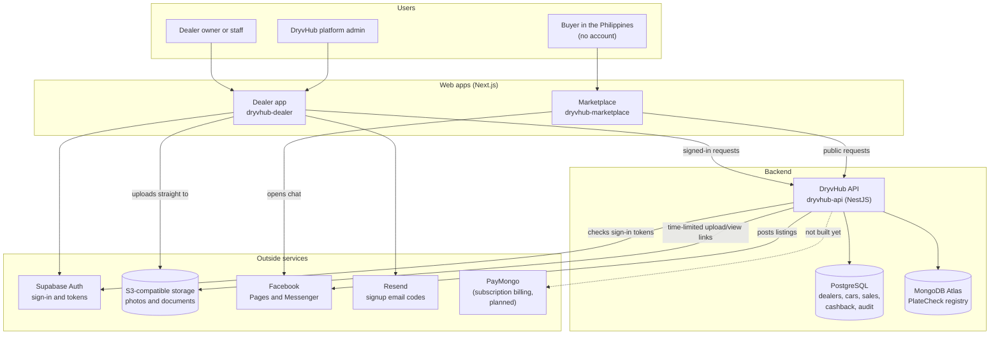
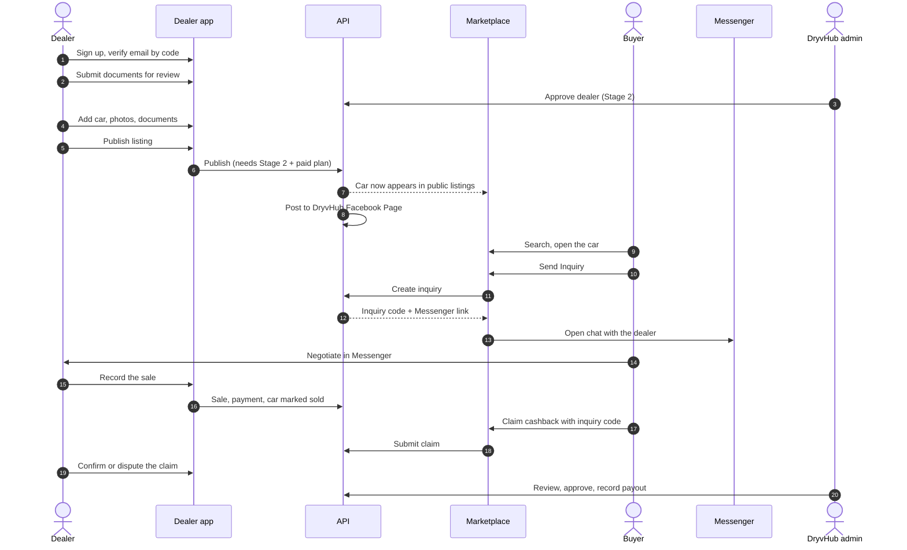

# How it fits together

DryvHub is three software pieces and a handful of outside services. This page shows all of them in one picture, then follows a single car through its whole life on the platform.

## The platform in one picture

### What each piece does

| Piece | Plain-English role | Status |
| --- | --- | --- |
| **Dealer app** | The dealership's back office: inventory, photos, documents, expenses, sales, financials, reports, listing publishing, inquiries, cashback, PlateCheck, verification, billing page. Also hosts the platform admin screens. | **Live** (45 pages) |
| **Marketplace** | The public showroom. Buyers search and filter, view a car, send an inquiry, and claim cashback. No login. | **Live** (5 pages) |
| **API** | The single source of truth. It holds all business rules: who is allowed to do what, which cars are public, how cashback is calculated. Both apps are thin clients of it. | **Live** (99 endpoints) |
| **Supabase Auth** | Handles passwords, Google sign-in, and issues the sign-in token. DryvHub stores its own dealer and tenant records separately. | **Live** |
| **Storage (S3)** | Holds car photos, dealer documents, and cashback evidence. The bucket is private. Files are reached only through short-lived links the API hands out. The code also supports S3-compatible stores such as MinIO through an optional endpoint setting. | **Live** |
| **PostgreSQL** | The main database: 20 tables covering dealers, users, cars, images, documents, expenses, financial transactions, inquiries, cashback, strikes, platform settings, and audit logs. | **Live** |
| **MongoDB Atlas** | A second database used only for PlateCheck, the shared registry of flagged plates. | **Live** |
| **Facebook** | Two uses. The API posts published listings to Facebook Pages (DryvHub's own Page, and optionally the dealer's Page). The Marketplace sends buyers into **Messenger** to talk to the dealer. | **Live** |
| **Resend** | Sends the 6-digit email code during dealer signup. Used by the Dealer app's server routes. | **Live** |
| **PayMongo** | The chosen payment provider for dealer subscriptions. It would charge dealers monthly and retry failed payments. | **Planned** (a decision record exists; no billing code in the API) |

:::warning Payments are not automated yet
The Dealer app shows plans and prices, but its upgrade button says online checkout is not live. No billing endpoints exist in the API. Plan changes are therefore not self-service today. See [Business model](/docs/executive/business-model).
:::

## Where the web addresses come from

- The Dealer app has a platform address (the code refers to `app.dryvhub.com`) and, after sign-in, each dealership works on its own address of the form `dealership-name.dryvhub.com`. That per-dealer address is called a **subdomain**.
- Platform admins use a separate admin address (the code refers to `admin.dryvhub.com`).
- The Marketplace's public address is set by an environment setting. The specific production address is not documented in the repositories.

The address is only a convenience for display. The API never decides which dealership you belong to from the address. It decides from your signed-in identity. See [Auth and tenancy](/docs/developers/auth-and-tenancy).

## A day in the life of one car

Follow a single car, a used sedan, through the platform.

### Chapter by chapter

1. **The dealer joins.** A dealership owner signs up with email and password (or signs in with Google later). Supabase creates the identity. The Dealer app emails a 6-digit code through Resend to prove the email is real. Then the API creates the dealership record (the **tenant**) with the owner attached. New dealerships start on the **Free** plan with limited capacity.
2. **The dealer gets verified.** The dealer fills in the onboarding checklist: business details and required documents (DTI, BIR, SEC registration, business permit, and a showroom photo). Submitting moves the dealer to **Stage 1, pending review**. A DryvHub admin approves or rejects. Approval moves the dealer to **Stage 2, verified**.
3. **The car goes into inventory.** The dealer creates the vehicle record: make, model, year, mileage, asking price, plate number, and optional purchase and supplier details. Photos upload straight from the browser to private storage using links issued by the API. Documents such as OR/CR can be attached.
4. **The dealer publishes.** Publishing needs Stage 2 approval and a paid plan (Starter or higher) with a valid subscription. If those are met, the car becomes visible in the Marketplace and the API automatically attempts a Facebook post. A Facebook failure does not undo the listing.
5. **A buyer finds the car.** The Marketplace shows only cars that pass the eligibility check. The buyer sees the car's public details, not private ones. They never see the plate number, purchase price, expenses, or dealer notes.
6. **The buyer sends an inquiry.** One click creates an **inquiry** record with a unique **inquiry code** and **locks the current cashback rate** onto it. The API returns a Messenger link pre-filled with the car details and the code.
7. **The conversation happens off-platform.** The buyer and dealer talk in Facebook Messenger. DryvHub does not see the chat. The inquiry code is how DryvHub later links a purchase back to the Marketplace.
8. **The dealer records the sale.** In the Dealer app the dealer records the buyer's name, sale price, payment method, and status. The API marks the car **sold**, writes a financial transaction, and removes the Facebook posts or rewrites them as "sold".
9. **The buyer claims cashback.** The buyer enters the inquiry code, their name (it must match the buyer name on the sale), and a GCash or bank payout destination. The API checks the claim against the sale and either rejects it with a reason or stores it as **pending review**.
10. **Review and payout.** The dealer can confirm (with proof) or dispute the claim. A DryvHub admin reviews it, approves or rejects it, and records the payout after sending the money manually. There is no automated bank or GCash integration.

:::tip Why this design
The Marketplace never decides anything. Eligibility, cashback math, and privacy all live in the API, so a bug or a copy change in a website cannot accidentally expose a private car or grant a payout.
:::

## Related pages

- [Welcome](/docs/start/welcome)
- [Glossary](/docs/start/glossary)
- [Executive overview](/docs/executive/overview)
- [Dealer journey](/docs/executive/dealer-journey)
- [Buyer journey](/docs/executive/buyer-journey)
- [Developer architecture](/docs/developers/architecture)
- [Marketplace overview](/docs/marketplace/overview)
