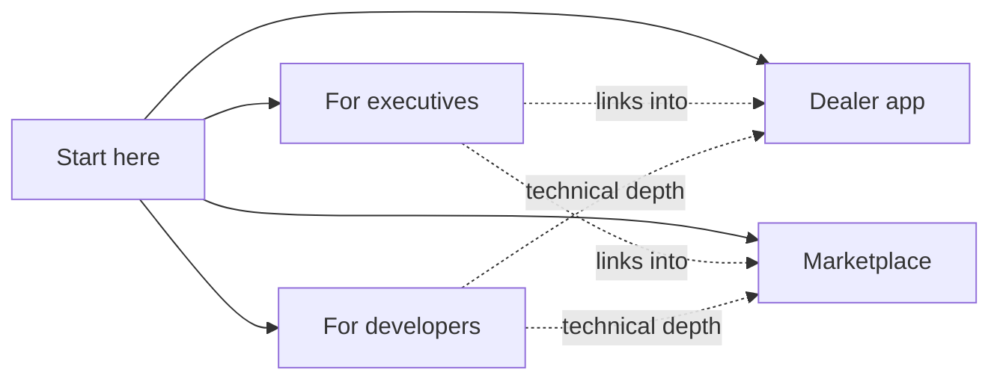

# Welcome to the DryvHub guide

This is the internal guide to DryvHub. It explains what we have built, how the business logic works, what is finished and what is not, and where the risks are. It is written for people who do not read code, with a short path in for the people who do.

:::info What DryvHub is, in one paragraph
DryvHub is a platform for used-car dealers in the Philippines. Dealers run their dealership in the **Dealer app** (inventory, expenses, sales, reports). Cars they choose to publish appear on the **Marketplace**, a public website where buyers browse without creating an account. Both apps talk to one shared backend, the **API**. Buyers who complete a verified purchase can claim a **cashback** payout.
:::

## How to use this guide

- **Start with the section for your role** (table below). Each section stands on its own.
- **Look up unfamiliar words** in the [Glossary](/docs/start/glossary). It has plain-English definitions and tells you where each term shows up.
- **Trust the status labels.** Wherever we say something is **Live**, it exists in the code today. **In progress** means part of it exists. **Planned** means it is written down in a plan or decision record but is not built. A plan alone never counts as shipped.
- **Expect honesty.** The executive pages call out gaps and risks directly. If something is unknown or not documented, we say so rather than guess.

## Pick your path

| If you are... | You mostly want to know... | Start here |
| --- | --- | --- |
| **An executive or board member** | What the products are, how money moves, what is live, what could go wrong | [Executive overview](/docs/executive/overview), then [Product status](/docs/executive/product-status) and [Risks and dependencies](/docs/executive/risks-and-dependencies) |
| **Support or operations** | How a dealer gets approved, how cashback claims are reviewed, what the admin tools do | [Dealer journey](/docs/executive/dealer-journey), [Trust and safety](/docs/executive/trust-and-safety), [Admin portal](/docs/dealer/admin-portal), [Cashback claims](/docs/marketplace/cashback-claims) |
| **Dealer success (onboarding and training)** | What a dealer sees and does, step by step | [Dealer app overview](/docs/dealer/overview), [Getting started](/docs/dealer/getting-started), [Verification and access](/docs/dealer/verification-and-access) |
| **Marketplace or buyer support** | What buyers see, how inquiries and cashback work | [Marketplace overview](/docs/marketplace/overview), [Buyer journey](/docs/marketplace/buyer-journey), [Eligibility](/docs/marketplace/eligibility) |
| **A new developer** | How the pieces connect and how to run them locally | [How it fits together](/docs/start/how-it-fits-together), [Architecture](/docs/developers/architecture), [Local setup](/docs/developers/local-setup) |

## How this site is organized

The left sidebar changes depending on which section you are in. There are five sections.

| Section | Purpose | Audience |
| --- | --- | --- |
| **Start here** (you are here) | Orientation, the one-picture overview, glossary | Everyone |
| **For executives** | Business model, journeys, status, risks, metrics, FAQ | Leadership, non-technical staff |
| **Dealer app** | What each Dealer app page does and why | Dealer success, support, product |
| **Marketplace** | The public buyer site, eligibility rules, cashback claims | Support, product, marketing |
| **For developers** | Architecture, local setup, authentication and tenancy, data model, decisions | Engineers |

## Where the facts come from

This guide was written from the code and the internal plans of the three repositories, not from marketing material:

- **`dryvhub-dealer`**: the dealer web app.
- **`dryvhub-marketplace`**: the public buyer website.
- **`dryvhub-api`**: the backend and database.

When a plan and the code disagree, we describe the code and flag the difference. A few of the repositories' own summary documents are out of date (for example, the API README lists about 30 endpoints while the code has 99). Treat this guide and the code as the source of truth, and see [Risks and dependencies](/docs/executive/risks-and-dependencies) for the documentation-drift note.

:::note Numbers in this guide
Counts such as "45 dealer pages" or "99 API endpoints" were taken from the code at the time of writing (November 2026). They will drift as the product changes. Business numbers such as prices, revenue, or customer counts are not invented here. Where a number is needed and is not in the code, the page says where it is configured or that it is not documented.
:::

## Related pages

- [How it fits together](/docs/start/how-it-fits-together)
- [Glossary](/docs/start/glossary)
- [Executive overview](/docs/executive/overview)
- [Dealer app overview](/docs/dealer/overview)
- [Marketplace overview](/docs/marketplace/overview)
- [Developer architecture](/docs/developers/architecture)
